# Photo review — 2026-11-26

Drafts and stories published in the last 3 days. **🔴 wrong: 0 · 🟠 to look at: 0**

How to use (about a minute): look at each picture next to its caption. 🔴 photos block publishing. To remove or replace a photo, add the story ID to `photos.yaml` (examples at the top of that file), or tell Claude the story ID and which photo is wrong. Official Instagram/Facebook posts can be added with `embed:` lines in `photos.yaml`.

## ✅ live · Lehecka and Machac Sweep Canada to Send Czechia Into Davis Cup Semi-Finals
`2026-11-25-news-f7a857` · 2026-11-25

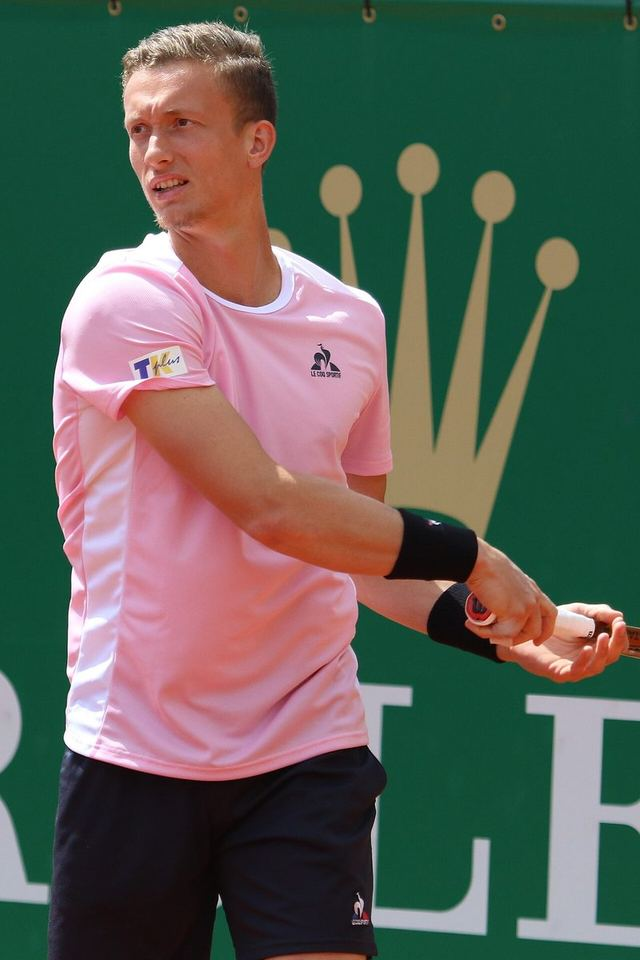

**1. 🟢 OK** · cover Caption: **Jiří Lehečka** 2023 · CC BY-SA 2.0 · [source](https://commons.wikimedia.org/wiki/File:Lehecka_MCM23_(5)_(52883527310).jpg) AI sees: _Jiří Lehečka playing tennis_
 

**2. 🟢 OK** Caption: **Félix Auger-Aliassime** 2023 · CC BY-SA 4.0 · [source](https://commons.wikimedia.org/wiki/File:F%C3%A9lix_Auger-Aliassime_(2023_DC_Open)_01_(cropped).jpg) AI sees: _portrait of tennis player Félix Auger-Aliassime_
 

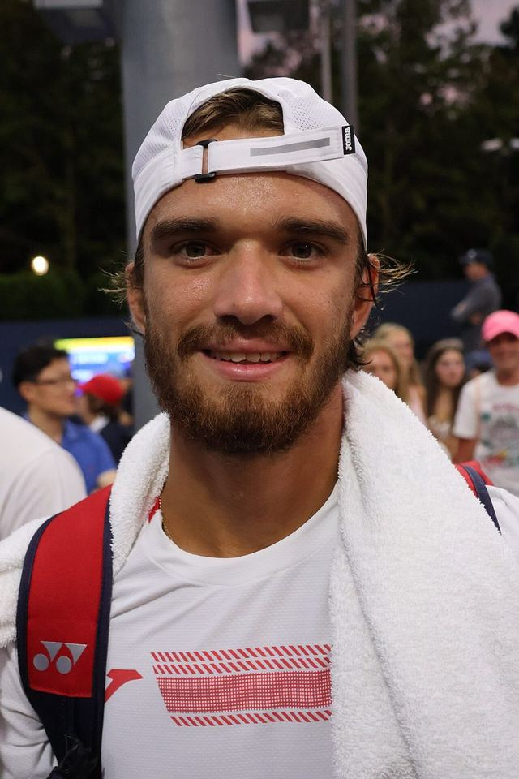

**3. 🟢 OK** Caption: **Tomáš Macháč** 2023 · CC BY-SA 4.0 · [source](https://commons.wikimedia.org/wiki/File:Tom%C3%A1%C5%A1_Mach%C3%A1%C4%8D_(2023_US_Open)_06.jpg) AI sees: _Czech tennis player Tomáš Macháč smiling after a match_
 

---

## ✅ live · Arthur Rinderknech Denies ITIA Anti-Doping Charge Over Alleged Test Refusal
`2026-11-25-news-e226ae` · 2026-11-25

**1. 🟢 OK** · cover Caption: **Arthur Rinderknech** 2022 · CC BY-SA 2.0 · [source](https://commons.wikimedia.org/wiki/File:Rinderknech_MCM22_(16)_(52036912945).jpg) AI sees: _Arthur Rinderknech playing tennis on a clay court_
 

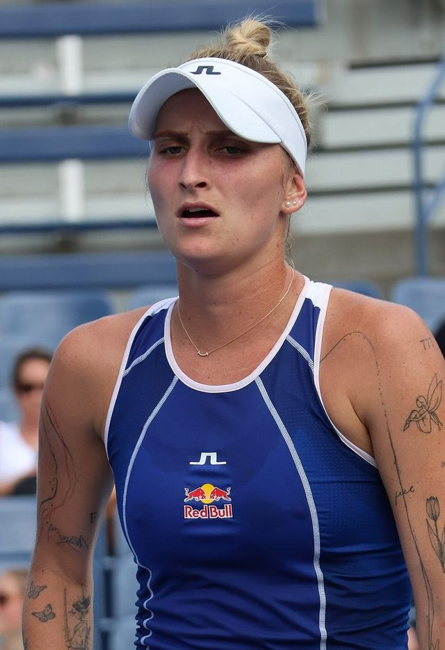

**2. 🟢 OK** Caption: **Markéta Vondroušová** 2023 · CC BY-SA 4.0 · [source](https://commons.wikimedia.org/wiki/File:Mark%C3%A9ta_Vondrou%C5%A1ov%C3%A1_(2023_US_Open)_14.jpg) AI sees: _Markéta Vondroušová on a tennis court_
 

**3. 🟢 OK** Caption: **Valentin Vacherot** 2026 · CC BY-SA 4.0 · [source](https://commons.wikimedia.org/wiki/File:Valentin_Vacherot_Swiss_Indoors_2026_(cropped).jpg) AI sees: _tennis player Valentin Vacherot holding a trophy_
 

---

## ✅ live · Kamila Valieva Ruled Out of Russian Figure Skating Championships in Chelyabinsk
`2026-11-25-news-d8cd04` · 2026-11-25

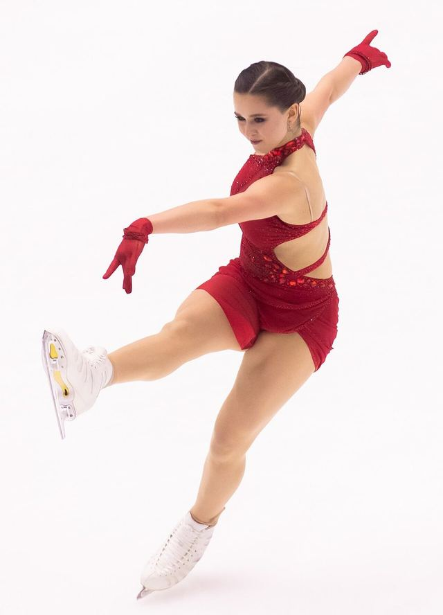

**1. 🟢 OK** · cover Caption: **Kamila Valieva** 2023 · CC BY 4.0 · [source](https://commons.wikimedia.org/wiki/File:Kamila_Valieva_-_2023_Russian_GP_Stage_4_-_06_(cropped).jpg) AI sees: _Kamila Valieva figure skating in a red dress on ice_
 

**2. 🟢 OK** Caption: **Eteri Tutberidze** 2025 · CC BY 4.0 · [source](https://commons.wikimedia.org/wiki/File:Eteri_Tutberidze_at_2025_Skate_Canada_International.jpg) AI sees: _figure skating coach Eteri Tutberidze standing by the rink boards_
 

**3. 🟢 OK** Caption: **Chelyabinsk** 2018 · CC BY-SA 4.0 · [source](https://commons.wikimedia.org/wiki/File:Saint_Alexander_Nevsky_Church_(Chelyabinsk).jpg) AI sees: _Saint Alexander Nevsky Church in Chelyabinsk_
 

---

## ✅ live · Jayson Tatum Pours in 41 Points as Celtics Hold Off Wizards 131-116 to Snap Four-Game Skid
`2026-11-25-news-c4f690` · 2026-11-25

**1. 🟢 OK** · cover Caption: **Jayson Tatum** 2024 · CC BY-SA 4.0 · [source](https://commons.wikimedia.org/wiki/File:Celtics_at_Wizards_2024-12-044_(cropped_2).jpg) AI sees: _Boston Celtics player Jayson Tatum wearing jersey number 0_
 

**2. 🟢 OK** Caption: **Paul George** 2026 · CC BY-SA 4.0 · [source](https://commons.wikimedia.org/wiki/File:1_paul_george_2026_(cropped)_(cropped).jpg) AI sees: _Paul George in a Philadelphia 76ers jersey_
 

**3. 🟢 OK** Caption: **Anthony Davis** 2022 · CC BY 2.0 · [source](https://commons.wikimedia.org/wiki/File:Anthony_Davis_pre-game_(cropped).jpg) AI sees: _Anthony Davis in a Lakers hoodie holding a basketball_
 

**4. 🟢 our score card** Caption: **Washington Wizards 116 - 131 Boston Celtics · NBA Cup** 2026 · Own work
 

---

## ✅ live · Bojan Hodak Appointed Malaysia Head Coach as Harimau Malaya Reorganise
`2026-11-25-news-b8d792` · 2026-11-25

**1. 🟢 OK** · cover Caption: **Bojan Hodak** 2014 · CC BY 3.0 · [source](https://commons.wikimedia.org/wiki/File:BojanHodak2014.jpg) AI sees: _Bojan Hodak speaking at a football press conference_
 

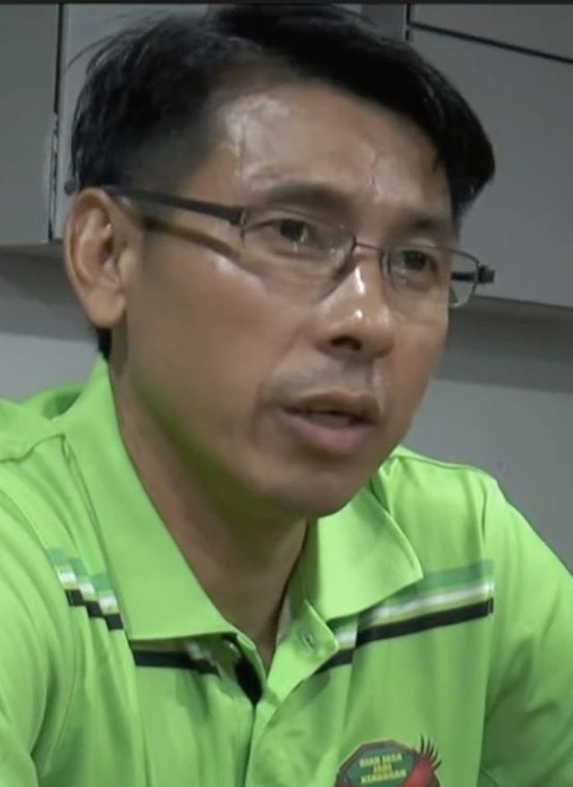

**2. 🟢 OK** Caption: **Tan Cheng Hoe** 2014 · CC BY 4.0 · [source](https://commons.wikimedia.org/wiki/File:Tan_Cheng_Hoe_2014.png) AI sees: _Tan Cheng Hoe wearing a Kedah football team polo shirt_
 

---

## ✅ live · Former Singapore Captain Rosnani Azman Retires from International Football
`2026-11-25-news-4afcf1` · 2026-11-25

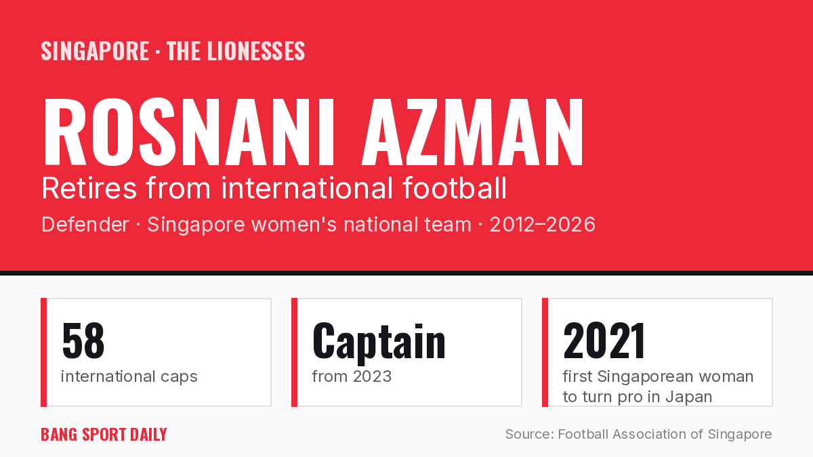

**1. ⚪ not checked** · cover Caption: **Rosnani Azman retires from international football: 58 caps, captain from 2023** 2026 · Own work
 

🔗 Embedded post: [Football Association of Singapore (official Instagram)](https://www.instagram.com/p/DgKX2DyGaqc/) — {'en': "FAS announces Rosnani Azman's retirement from international football", 'zh': '新加坡足球总会宣布罗斯娜妮退出国家队', 'ru': 'Футбольная ассоциация Сингапура объявляет о завершении международной карьеры Роснани Азман'}

---

## ✅ live · Joseph Schooling's Journey: From Childhood Dream to Singapore's First Olympic Gold
`2026-11-25-athl-f4dbe9` · 2026-11-25

**1. 🟢 OK** · cover Caption: **Joseph Schooling** 2015 · CC BY-SA 4.0 · [source](https://commons.wikimedia.org/wiki/File:Joseph_Schooling_Kazan_2015.jpg) AI sees: _Joseph Schooling on the podium holding his medal at a swimming competition_
 

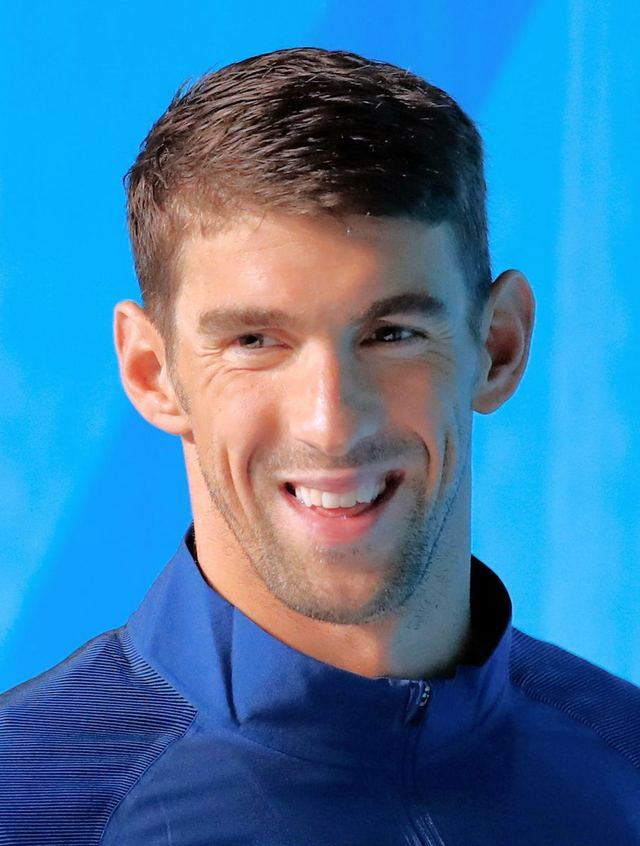

**2. 🟢 OK** Caption: **Michael Phelps** 2016 · CC BY 2.0 · [source](https://commons.wikimedia.org/wiki/File:Michael_Phelps_Rio_Olympics_2016.jpg) AI sees: _Michael Phelps smiling during an interview or event_
 

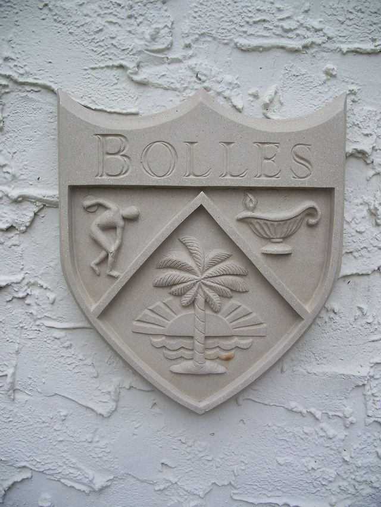

**3. 🟢 OK** Caption: **The Bolles School** Asked for: Bolles School → got page: The Bolles School 2011 · CC BY-SA 3.0 · [source](https://commons.wikimedia.org/wiki/File:Jax_FL_7356_San_Jose_Blvd_House_Bolles_School_stone01.jpg) AI sees: _A stone crest of The Bolles School mounted on a stucco wall_
 

---

## ✅ live · From a Sweet Factory Court to Badminton History: The Life of Ratchanok Intanon
`2026-11-25-athl-a5a295` · 2026-11-25

**1. 🟢 OK** · cover Caption: **Ratchanok Intanon** 2025 · CC BY 3.0 · [source](https://commons.wikimedia.org/wiki/File:Ratchanok_Intanon_Indonesia_Masters_2025.jpg) AI sees: _Ratchanok Intanon holding a badminton tournament gold medal_
 

**2. 🟢 OK** Caption: **Li Xuerui** 2012 · CC BY-SA 3.0 · [source](https://commons.wikimedia.org/wiki/File:Li_Xuerui_2012_(portrait).jpg) AI sees: _Chinese badminton player Li Xuerui at London 2012_
 

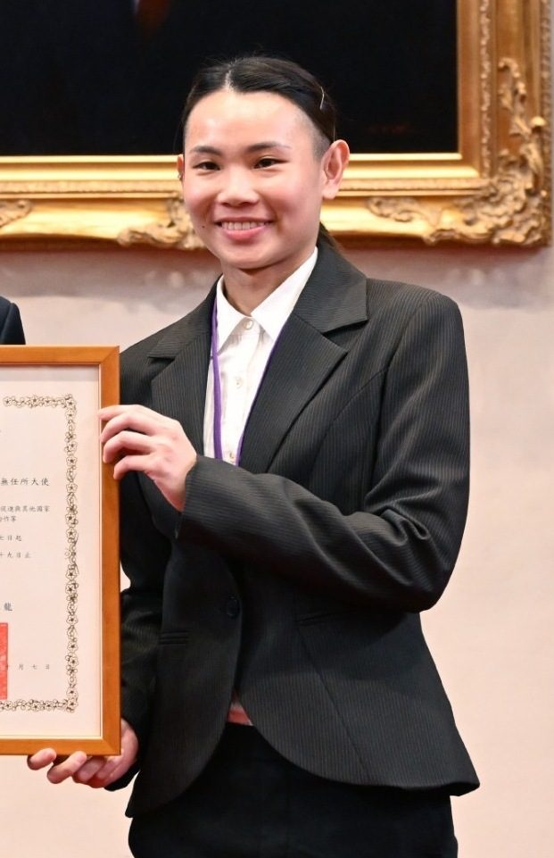

**3. 🟢 OK** Caption: **Tai Tzu-ying** 2024 · CC BY 2.0 · [source](https://commons.wikimedia.org/wiki/File:Tai_Tzu-ying_in_2024.jpg) AI sees: _Badminton player Tai Tzu-ying holding a framed certificate_
 

---

## ✅ live · From Heartbreak in London to History in Rio: The Life of Hoang Xuan Vinh
`2026-11-25-athl-9fb3af` · 2026-11-25

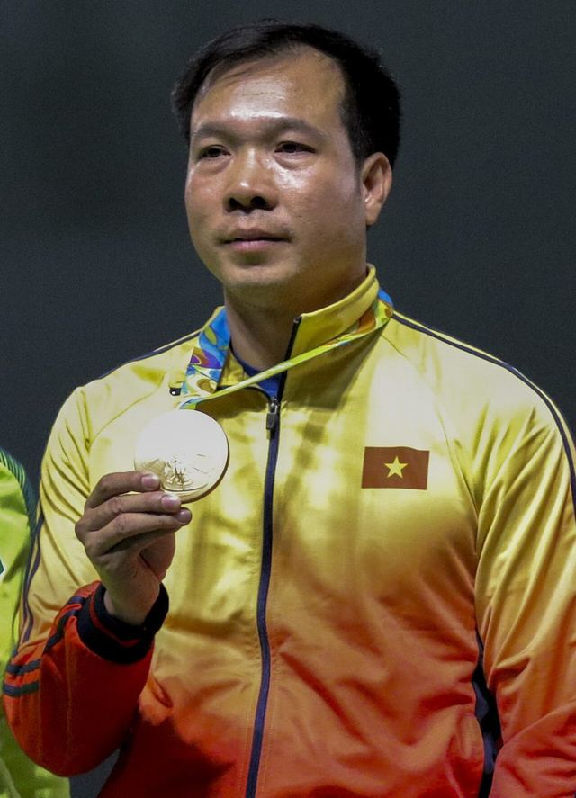

**1. 🟢 OK** · cover Caption: **Hoàng Xuân Vinh** 2016 · CC BY 3.0 br · [source](https://commons.wikimedia.org/wiki/File:Hoang_Xuan_Vinh.jpg) AI sees: _Hoàng Xuân Vinh holding his Rio 2016 Olympic gold medal_
 

**2. 🟢 OK** Caption: **Shooting at the 2016 Summer Olympics – Men's 10 metre air pistol** 2016 · CC BY 3.0 br · [source](https://commons.wikimedia.org/wiki/File:Rio2016_julho_ZonaB_Deodoro_004_8180_-c-2016_GabrielHeusi_HeusiAction.jpg) AI sees: _Aerial view of the National Shooting Center in Deodoro, Rio de Janeiro_
 

---

## ✅ live · Chan Vathanaka: The Kampot Prodigy Who Put Cambodian Football on the Regional Map
`2026-11-25-athl-077aa4` · 2026-11-25

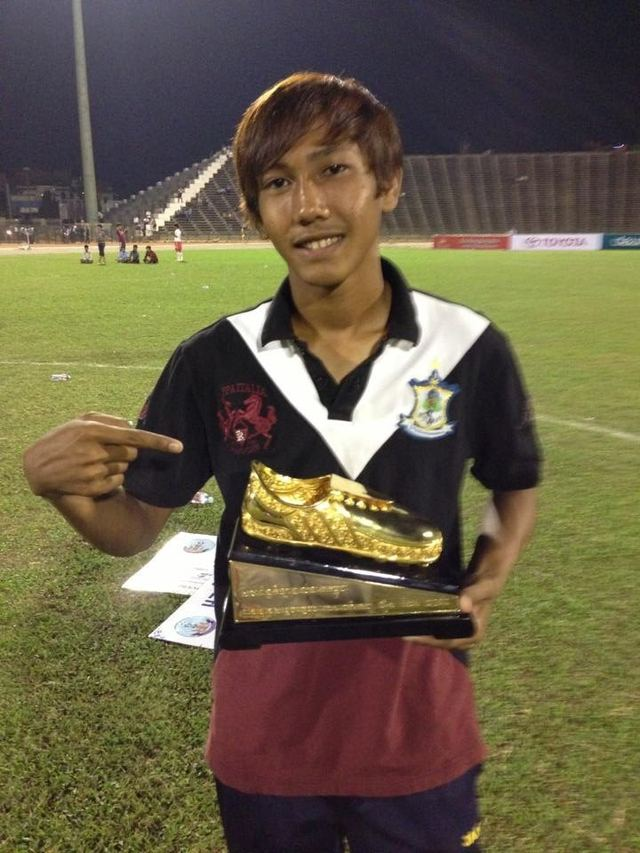

**1. 🟢 OK** · cover Caption: **Chan Vathanaka** 2013 · CC BY-SA 3.0 · [source](https://commons.wikimedia.org/wiki/File:Chan_vathanaka_2013-11-04_11-18.jpg) AI sees: _Chan Vathanaka holding a Golden Boot trophy on a football pitch_
 

**2. 🟢 OK** Caption: **Olympic Stadium (Phnom Penh)** Asked for: Phnom Penh Olympic Stadium → got page: Olympic Stadium (Phnom Penh) 2023 · CC BY 3.0 · [source](https://commons.wikimedia.org/wiki/File:Olympic_Stadium_Phnom_Penh_SG2023.png) AI sees: _Olympic Stadium in Phnom Penh during the 2023 SEA Games final_
 

🔗 Embedded post: [Cambodian Premier League (@the_official_cpl)](https://www.instagram.com/p/DdeH7JXgVxy/) — {'en': 'Chan Vathanaka in an official Cambodian Premier League post', 'zh': '柬埔寨超级联赛官方帖子中的占·瓦塔纳卡', 'ru': 'Чан Ватанака в официальной публикации Камбоджийской Премьер-лиги'}

---

## ✅ live · PFL Confirms 14-Fight Lyon Card Headlined by Lapilus vs McKee Title Bout
`2026-11-24-news-f01fca` · 2026-11-24

**1. 🟢 OK** · cover Caption: **Lyon, host city of the PFL event on 19 December** 2023 · CC BY-SA 4.0 · [source](https://commons.wikimedia.org/wiki/File:Lyon-part-dieu-2023.jpg) AI sees: _Skyline of Lyon featuring Part-Dieu skyscrapers_
 

**2. 🟢 OK** Caption: **LDLC Arena** 2023 · CC BY-SA 4.0 · [source](https://commons.wikimedia.org/wiki/File:LDLC_Arena_-_D%C3%A9cines-Charpieu_(FR69)_-_2023-12-28_-_1.jpg) AI sees: _Exterior of the LDLC Arena at night with crowds entering_
 

---

## ✅ live · Vietnam Earn Historic First U17 World Cup Point in 3-3 Thriller Against New Zealand
`2026-11-24-news-98e731` · 2026-11-24

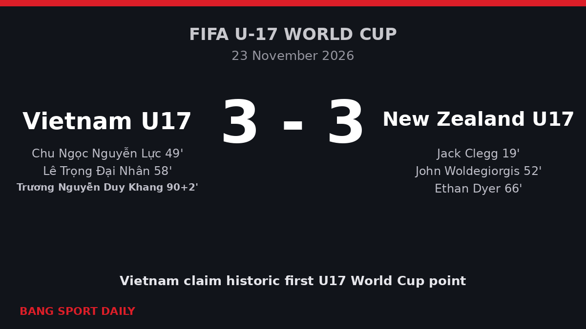

**1. 🟢 our score card** · cover Caption: **Vietnam U17 3 - 3 New Zealand U17 · FIFA U-17 World Cup** 2026 · Own work
 

---

## ✅ live · China U17 Earn First World Cup Point in 21 Years After 2-2 Morocco Draw
`2026-11-24-news-95243b` · 2026-11-24

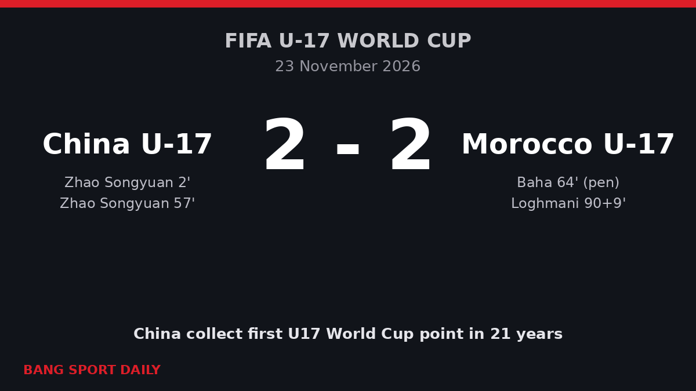

**1. 🟢 our score card** · cover Caption: **China U-17 2 - 2 Morocco U-17 · FIFA U-17 World Cup** 2026 · Own work
 

---

## ✅ live · Kun Khmer champion Chhut Serey Vannthong outpoints Riki at K-1 Revenge II in Tokyo
`2026-11-24-news-928d27` · 2026-11-24

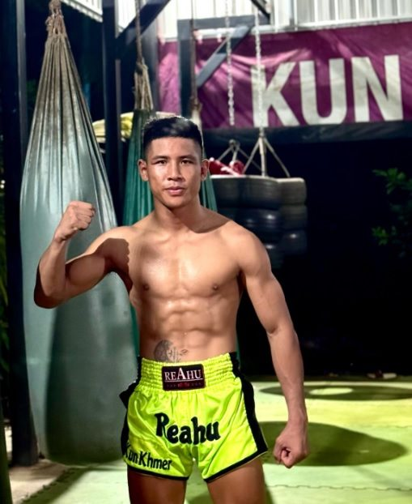

**1. 🟢 OK** · cover Caption: **Chhut Serey Vannthong** 2023 · CC0 · [source](https://commons.wikimedia.org/wiki/File:Rahumeaspradalserey.jpg) AI sees: _Kun Khmer fighter Chhut Serey Vannthong in a training gym_
 

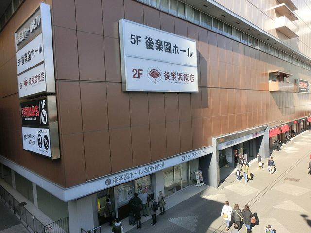

**2. 🟢 OK** Caption: **Korakuen Hall** 2017 · CC BY-SA 4.0 · [source](https://commons.wikimedia.org/wiki/File:20170104_Korakuen_Hall.jpg) AI sees: _Exterior of Korakuen Hall building with signs in Tokyo_
 

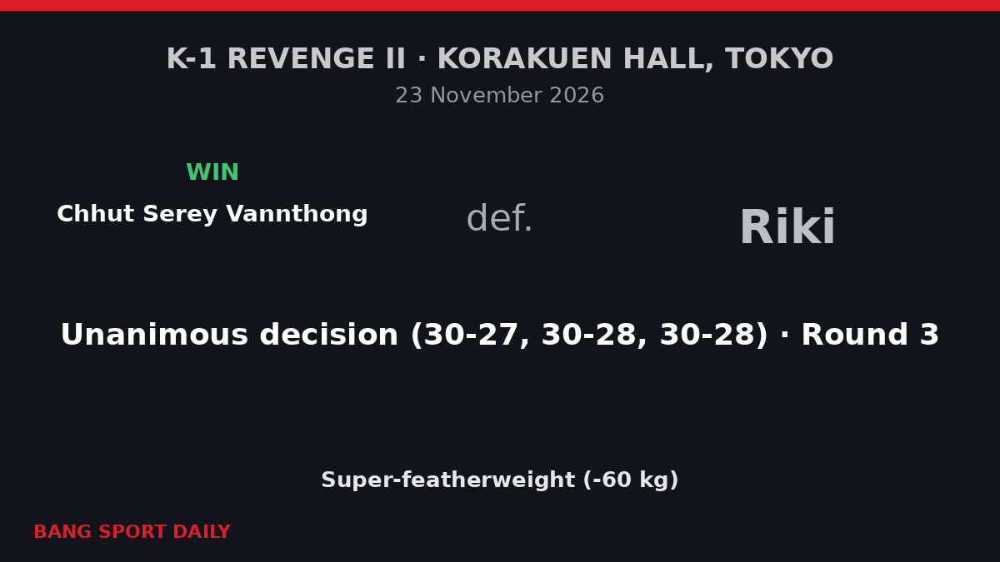

**3. 🟢 our score card** Caption: **Chhut Serey Vannthong def. Riki · Unanimous decision (30-27, 30-28, 30-28) · Round 3 · K-1 Revenge II · Korakuen Hall, Tokyo** 2026 · Own work
 

🔗 Embedded post: [K-1 Worldwide (@K1_ReBoot)](https://x.com/K1_ReBoot/status/2124823613643858283) — {'en': "Official K-1 video: Chhut Serey Vannthong's decision win over Riki", 'zh': 'K-1官方视频：Chhut Serey Vannthong判定战胜立基', 'ru': 'Официальное видео K-1: победа Чхута Серей Ваннтонга над Рики решением судей'}

---

## ✅ live · Russian Boxing Federation Voted In as Full World Boxing Member in Panama
`2026-11-24-news-4177ff` · 2026-11-24

**1. 🟢 OK** · cover Caption: **Panama City, where the World Boxing congress voted** 2016 · CC BY 3.0 · [source](https://commons.wikimedia.org/wiki/File:Panama_Papers_(148830809).jpeg) AI sees: _Aerial view of the Panama City skyline and waterfront_
 

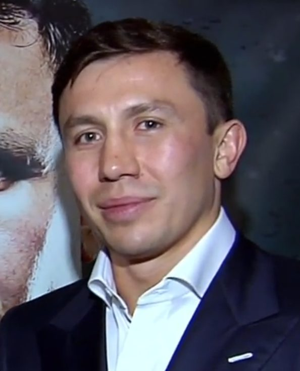

**2. 🟢 OK** Caption: **Gennady Golovkin** 2017 · CC BY 3.0 · [source](https://commons.wikimedia.org/wiki/File:Gennady_Golovkin_(KAZ)_2017.png) AI sees: _Gennady Golovkin in a suit_
 

---

## ✅ live · Tian Bingyi Appointed China Badminton Head Coach for Los Angeles 2028 Cycle
`2026-11-24-news-3d085d` · 2026-11-24

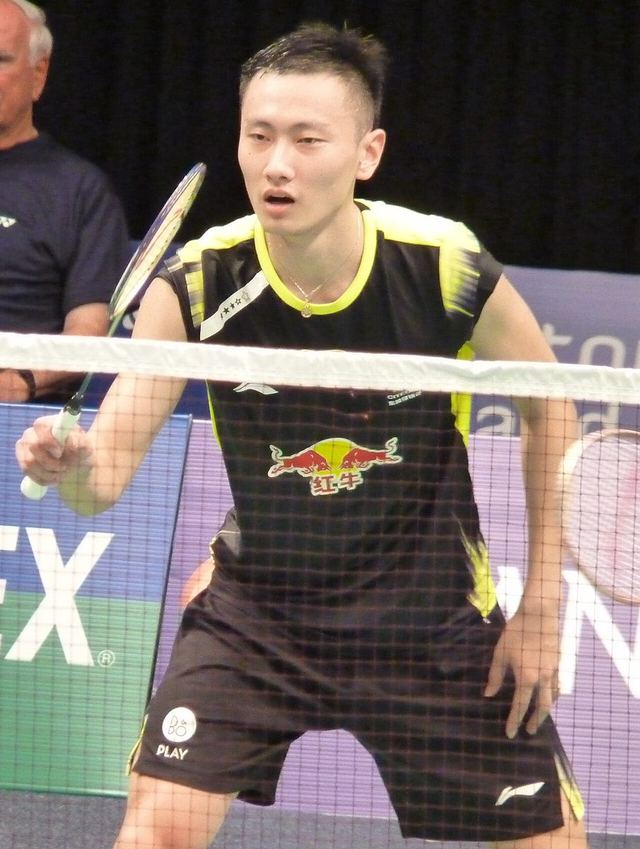

**1. 🟢 OK** · cover Caption: **Zhang Nan (badminton)** 2013 · CC BY-SA 4.0 · [source](https://commons.wikimedia.org/wiki/File:Zhang_Nan.jpg) AI sees: _Zhang Nan playing badminton_
 

**2. 🟢 OK** Caption: **Li Yongbo** 2015 · CC BY-SA 2.0 · [source](https://commons.wikimedia.org/wiki/File:Li_Yonbgo_portrait.jpg) AI sees: _Chinese badminton coach Li Yongbo in national team apparel_
 

---

## ✅ live · Mirra Andreeva Earns $10.65 Million to Enter Global Top Five in 2026 Prize Money
`2026-11-24-news-2b4378` · 2026-11-24

**1. 🟢 OK** · cover Caption: **Elena Rybakina** 2025 · CC BY-SA 4.0 · [source](https://commons.wikimedia.org/wiki/File:Elena_Rybakina_(2025_DC_Open)_11_(cropped).jpg) AI sees: _tennis player Elena Rybakina smiling on court_
 

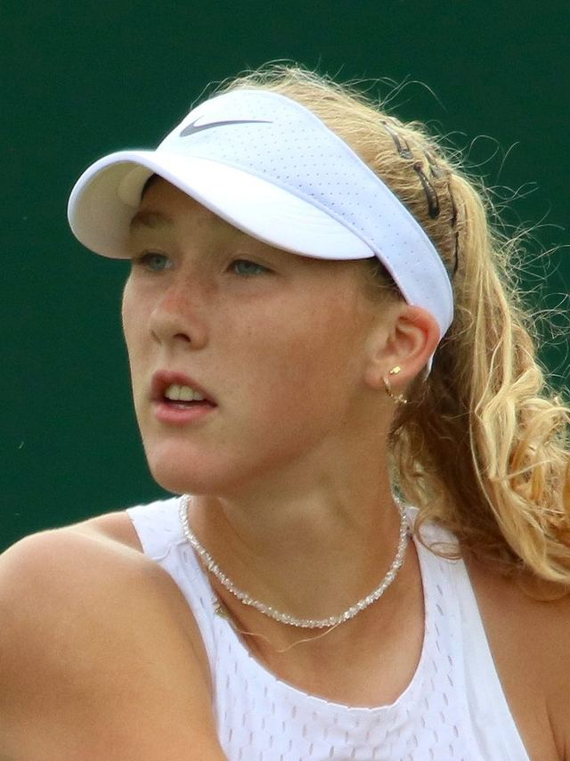

**2. 🟢 OK** Caption: **Mirra Andreeva** 2023 · CC BY-SA 2.0 · [source](https://commons.wikimedia.org/wiki/File:Mirra_Andreeva_WMQ23_(cropped).jpg) AI sees: _Mirra Andreeva playing tennis in tennis attire_
 

**3. 🟢 OK** Caption: **Alexander Zverev** 2026 · CC BY-SA 4.0 · [source](https://commons.wikimedia.org/wiki/File:Alexander_Zverev_in_Miami.jpg) AI sees: _Alexander Zverev on a tennis court_
 

---

## ✅ live · Kazakhstan Names 11 Boxers for Season-Ending World Boxing Cup Finals in Tashkent
`2026-11-24-news-0390f5` · 2026-11-24

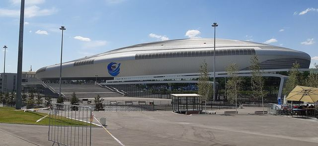

**1. 🟢 OK** · cover Caption: **Humo Arena, Tashkent** 2019 · CC BY-SA 4.0 · [source](https://commons.wikimedia.org/wiki/File:Humo_Arena_2019.jpg) AI sees: _Exterior of Humo Arena in Tashkent_
 

---

## ✅ live · Carlos Alcaraz Defeats Alexander Zverev in Turin to Claim Maiden ATP Finals Title
`2026-11-23-news-dbb56e` · 2026-11-23

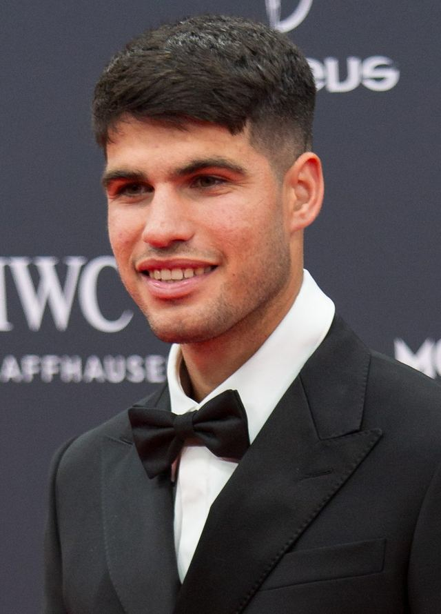

**1. 🟢 OK** · cover Caption: **Carlos Alcaraz** 2024 · CC BY-SA 4.0 · [source](https://commons.wikimedia.org/wiki/File:25th_Laureus_World_Sports_Awards_-_Red_Carpet_-_Carlos_Alcaraz_-_240422_192324_(cropped).jpg) AI sees: _Carlos Alcaraz in a black tuxedo on a red carpet_
 

**2. 🟢 OK** Caption: **Alexander Zverev** 2026 · CC BY-SA 4.0 · [source](https://commons.wikimedia.org/wiki/File:Alexander_Zverev_in_Miami.jpg) AI sees: _Alexander Zverev wearing a black headband and shirt_
 

**3. 🟢 OK** Caption: **Inalpi Arena** 2023 · CC BY-SA 4.0 · [source](https://commons.wikimedia.org/wiki/File:Piazzale_Grande_Torino,_Turin,_Italy.jpg) AI sees: _Inalpi Arena (formerly Pala Alpitour) and Piazzale Grande Torino in Turin_
 

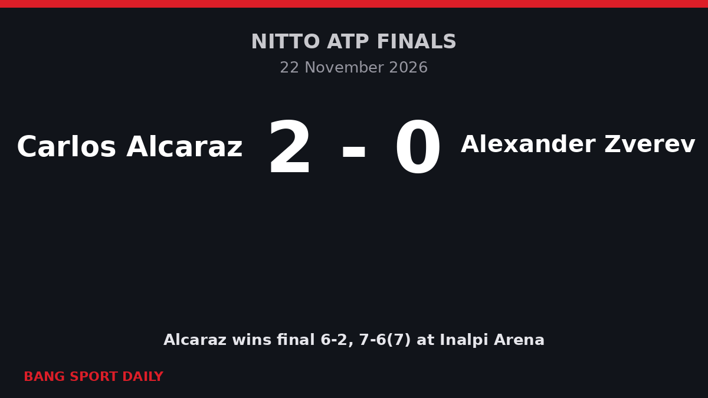

**4. 🟢 our score card** Caption: **Carlos Alcaraz 2 - 0 Alexander Zverev · Nitto ATP Finals** 2026 · Own work
 

---

## ✅ live · Bangladesh and Singapore finalize preparations ahead of December women's friendlies
`2026-11-23-news-bb407c` · 2026-11-23

**1. 🟢 OK** · cover Caption: **Jalan Besar Stadium** 2022 · CC BY-SA 4.0 · [source](https://commons.wikimedia.org/wiki/File:JalanBesarStadium2022.jpg) AI sees: _Jalan Besar Stadium during a football match_
 

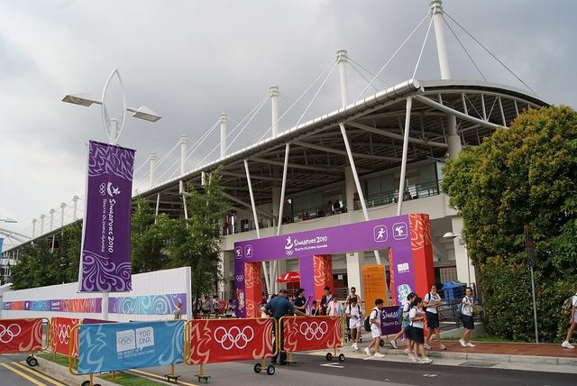

**2. 🟢 OK** Caption: **Bishan Stadium** 2010 · CC BY-SA 4.0 · [source](https://commons.wikimedia.org/wiki/File:Bishan_Stadium,_Singapore,_during_the_2010_Summer_Youth_Olympics_-_20100816-02.JPG) AI sees: _exterior of Bishan Stadium during the 2010 Youth Olympic Games_
 

---

## ✅ live · Trefilov Rejects 2028 Olympic Medal Guarantee by Russian Handball Chief
`2026-11-23-news-23b075` · 2026-11-23

**1. 🟢 OK** · cover Caption: **Yevgeni Trefilov in August 2016** 2016 · FAL · [source](https://commons.wikimedia.org/wiki/File:Handball_Yevgeny_Trefilov_MoscowTass_08-2016.jpg) AI sees: _Yevgeni Trefilov at a press conference_
 

**2. 🟢 OK** Caption: **Sergey Shishkarev** 2023 · CC BY-SA 4.0 · [source](https://commons.wikimedia.org/wiki/File:Sergey_Shishkarev_2023.jpg) AI sees: _portrait of Russian handball chief Sergey Shishkarev in a suit_
 

---

## ✅ live · Svay Rieng and Phnom Penh Crown chase a historic AFC Champions League Two double
`2026-11-23-news-00ad68` · 2026-11-23

**1. 🟢 OK** · cover Caption: **Cambodian Premier League (CPL) logo** 2025 · PD · [source](https://en.wikipedia.org/wiki/File:Cambodian_Premier_League_logo.png)
 

🔗 Embedded post: [Cambodian Premier League (official Facebook)](https://www.facebook.com/theofficialcpl/posts/pfbid02CPwVjauvNKcVzepP9hkio7gLfzFCAMPkUpkF19nbjX1vVqcSDjHTR1nSwJZDN6yQl) — {'en': 'Official CPL 2026/27 table after Week 8', 'zh': '柬埔寨超级联赛2026/27赛季第8轮后官方积分榜', 'ru': 'Официальная таблица чемпионата Камбоджи 2026/27 после 8-го тура'}

🔗 Embedded post: [Cambodian Premier League (official Facebook)](https://www.facebook.com/theofficialcpl/posts/pfbid02Tyeustz4U58pGcdoYFtX5ZQB3BD4PSdyGP4aP1QSDsCqZdFGtH8WEKHT7DcaokCml) — {'en': 'Official Week 8 results, 21–22 November 2026', 'zh': '第8轮官方赛果（2026年11月21日至22日）', 'ru': 'Официальные результаты 8-го тура, 21–22 ноября 2026 года'}

🔗 Embedded post: [Cambodian Premier League (official Facebook)](https://www.facebook.com/theofficialcpl/posts/pfbid01S7vWskCqLio1oj9h6EKXYfTxVVQ5GD3vsLBdfPQyLBTFYPZu8zS1YebuicRCSAEl) — {'en': 'Week 8 attendance: 9,789 fans, including 7,502 at Svay Rieng v Angkor Tiger', 'zh': '第8轮观众人数：共9,789人，其中柴桢对阵吴哥猛虎7,502人', 'ru': 'Посещаемость 8-го тура: 9 789 зрителей, из них 7 502 на матче «Свайриенг» — «Ангкор Тайгер»'}

---

## ✅ live · From Middle-School Backup to 9.83 Seconds: The Life and Science of Su Bingtian
`2026-11-23-athl-db5356` · 2026-11-23

**1. 🟢 OK** · cover Caption: **Su Bingtian** 2013 · CC BY-SA 3.0 · [source](https://commons.wikimedia.org/wiki/File:2013_World_Championships_in_Athletics_(August,_10)_by_Dmitry_Rozhkov_63.jpg) AI sees: _Chinese sprinter Su Bingtian walking with a backpack in athletic stadium_
 

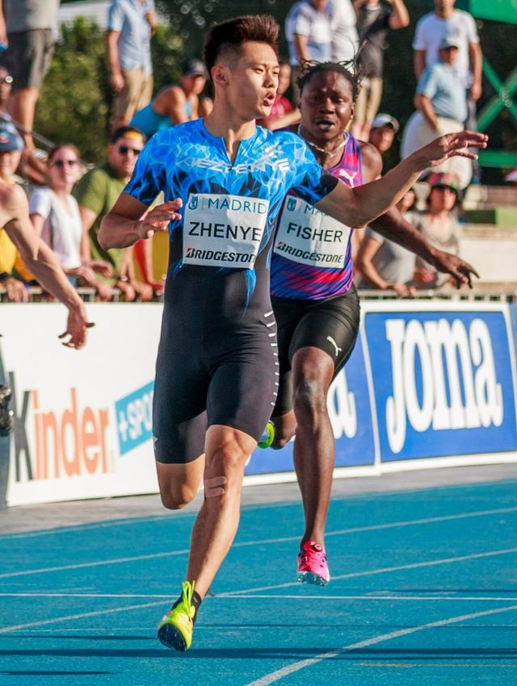

**2. 🟢 OK** Caption: **Xie Zhenye** 2017 · CC BY-SA 3.0 · [source](https://commons.wikimedia.org/wiki/File:Xie_Zhenye.jpg) AI sees: _Sprinter Xie Zhenye competing in a race in Madrid_
 

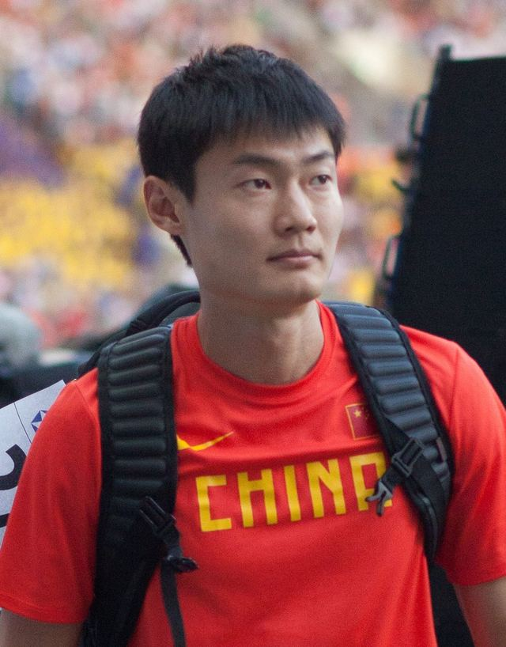

**3. 🟢 OK** Caption: **Zhang Peimeng** 2013 · CC BY-SA 3.0 · [source](https://commons.wikimedia.org/wiki/File:Zhang_Peimeng_(Moscow_2013)_by_Dmitry_Rozhkov_35.jpg) AI sees: _Chinese sprinter Zhang Peimeng in team China gear_
 

---

## ✅ live · Manny Pacquiao: The Street Fighter Who Conquered Eight Divisions
`2026-11-23-athl-a5664c` · 2026-11-23

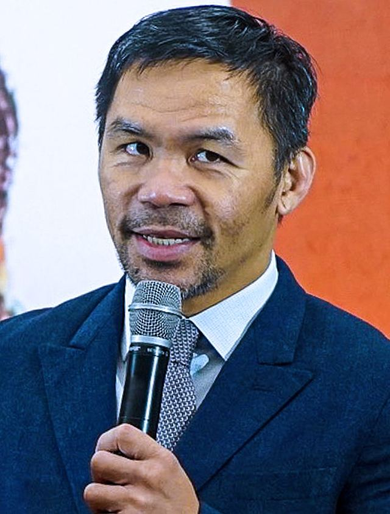

**1. 🟢 OK** · cover Caption: **Manny Pacquiao** 2025 · Public domain · [source](https://commons.wikimedia.org/wiki/File:Former_senator_Manny_Pacquiao_speaks_in_event_(10-01-2025)_(cropped).jpg) AI sees: _Manny Pacquiao speaking into a microphone_
 

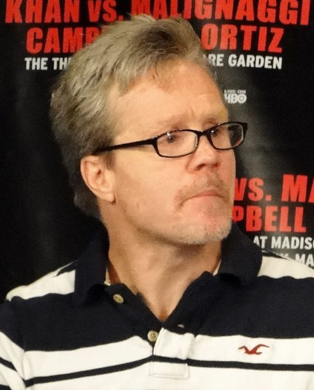

**2. 🟢 OK** Caption: **Freddie Roach** 2010 · CC BY-SA 2.0 · [source](https://commons.wikimedia.org/wiki/File:Freddie_Roach_2010.jpg) AI sees: _boxing trainer Freddie Roach at a press conference_
 

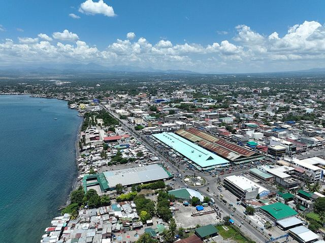

**3. 🟢 OK** Caption: **General Santos** 2026 · CC BY-SA 4.0 · [source](https://commons.wikimedia.org/wiki/File:Gensan_Dadiangas_South,_P._Acharon_Boulevard,_Gensan_Public_Market_drone_(General_Santos_City;_03-24-2026).jpg) AI sees: _aerial view of General Santos City coastline and buildings_
 

---

