# Photo review — 2026-11-25

Drafts and stories published in the last 3 days. **🔴 wrong: 0 · 🟠 to look at: 0**

How to use (about a minute): look at each picture next to its caption. 🔴 photos block publishing. To remove or replace a photo, add the story ID to `photos.yaml` (examples at the top of that file), or tell Claude the story ID and which photo is wrong. Official Instagram/Facebook posts can be added with `embed:` lines in `photos.yaml`.

## 📝 DRAFT · Mirra Andreeva Named ESPN Breakthrough Player of the Year for 2026
`2026-11-25-news-cad9bb` · 2026-11-25

**1. 🟢 OK** · cover Caption: **Conchita Martínez** 2010 · CC BY-SA 2.0 · [source](https://commons.wikimedia.org/wiki/File:Conchita_Mart%C3%ADnez_at_the_2010_US_Open_02_(cropped).jpg) AI sees: _former Spanish tennis player Conchita Martínez carrying a tennis bag_
 

**2. 🟢 OK** Caption: **Mirra Andreeva** 2023 · CC BY-SA 2.0 · [source](https://commons.wikimedia.org/wiki/File:Mirra_Andreeva_WMQ23_(cropped).jpg) AI sees: _Mirra Andreeva in tennis attire wearing a white Nike visor_
 

**3. 🟢 OK** Caption: **Elena Rybakina** 2025 · CC BY-SA 4.0 · [source](https://commons.wikimedia.org/wiki/File:Elena_Rybakina_(2025_DC_Open)_11_(cropped).jpg) AI sees: _Elena Rybakina on a tennis court_
 

---

## 📝 DRAFT · Russian Biathlon Cup Second Stage Relocated from Uvat to Ufa Due to Lack of Snow
`2026-11-25-news-24905a` · 2026-11-25

**1. 🟢 OK** · cover Caption: **Ufa** 2018 · CC BY 4.0 · [source](https://commons.wikimedia.org/wiki/File:%D0%94%D0%BE%D0%BC_%D0%B6%D0%B8%D0%BB%D0%BE%D0%B9_%D0%9D%D0%B0%D0%B3%D0%B0%D1%80%D0%B5%D0%B2%D0%B0,_%D0%A3%D1%84%D0%B0.jpg) AI sees: _A historic brick building located in the city of Ufa_
 

**2. 🟢 OK** Caption: **Biathlon** 2006 · CC BY-SA 3.0 · [source](https://commons.wikimedia.org/wiki/File:Biathlon_Schalke.jpg) AI sees: _biathletes at a shooting range during a biathlon competition_
 

---

## 📝 DRAFT · From Heartbreak in London to History in Rio: The Life of Hoang Xuan Vinh
`2026-11-25-athl-9fb3af` · 2026-11-25

**1. 🟢 OK** · cover Caption: **Hoàng Xuân Vinh** 2016 · CC BY 3.0 br · [source](https://commons.wikimedia.org/wiki/File:Hoang_Xuan_Vinh.jpg) AI sees: _Hoàng Xuân Vinh holding his Rio 2016 Olympic gold medal_
 

**2. 🟢 OK** Caption: **Shooting at the 2016 Summer Olympics – Men's 10 metre air pistol** 2016 · CC BY 3.0 br · [source](https://commons.wikimedia.org/wiki/File:Rio2016_julho_ZonaB_Deodoro_004_8180_-c-2016_GabrielHeusi_HeusiAction.jpg) AI sees: _Aerial view of the National Shooting Center in Deodoro, Rio de Janeiro_
 

---

## ✅ live · Kamila Valieva Ruled Out of Russian Figure Skating Championships in Chelyabinsk
`2026-11-25-news-d8cd04` · 2026-11-25

**1. 🟢 OK** · cover Caption: **Kamila Valieva** 2023 · CC BY 4.0 · [source](https://commons.wikimedia.org/wiki/File:Kamila_Valieva_-_2023_Russian_GP_Stage_4_-_06_(cropped).jpg) AI sees: _Kamila Valieva figure skating in a red dress on ice_
 

**2. 🟢 OK** Caption: **Eteri Tutberidze** 2025 · CC BY 4.0 · [source](https://commons.wikimedia.org/wiki/File:Eteri_Tutberidze_at_2025_Skate_Canada_International.jpg) AI sees: _figure skating coach Eteri Tutberidze standing by the rink boards_
 

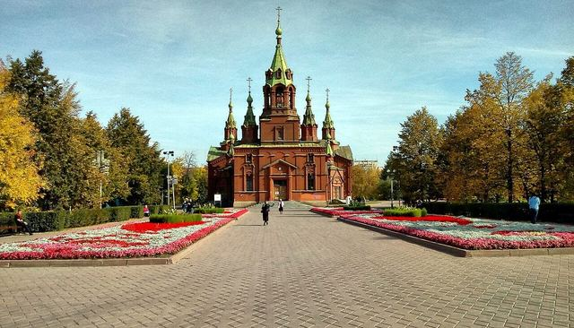

**3. 🟢 OK** Caption: **Chelyabinsk** 2018 · CC BY-SA 4.0 · [source](https://commons.wikimedia.org/wiki/File:Saint_Alexander_Nevsky_Church_(Chelyabinsk).jpg) AI sees: _Saint Alexander Nevsky Church in Chelyabinsk_
 

---

## ✅ live · Bojan Hodak Appointed Malaysia Head Coach as Harimau Malaya Reorganise
`2026-11-25-news-b8d792` · 2026-11-25

**1. 🟢 OK** · cover Caption: **Bojan Hodak** 2014 · CC BY 3.0 · [source](https://commons.wikimedia.org/wiki/File:BojanHodak2014.jpg) AI sees: _Bojan Hodak speaking at a football press conference_
 

**2. 🟢 OK** Caption: **Tan Cheng Hoe** 2014 · CC BY 4.0 · [source](https://commons.wikimedia.org/wiki/File:Tan_Cheng_Hoe_2014.png) AI sees: _Tan Cheng Hoe wearing a Kedah football team polo shirt_
 

---

## ✅ live · From a Sweet Factory Court to Badminton History: The Life of Ratchanok Intanon
`2026-11-25-athl-a5a295` · 2026-11-25

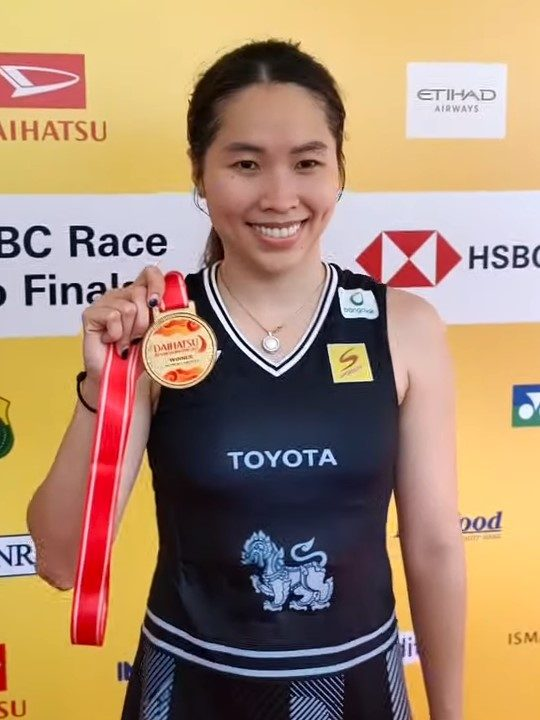

**1. 🟢 OK** · cover Caption: **Ratchanok Intanon** 2025 · CC BY 3.0 · [source](https://commons.wikimedia.org/wiki/File:Ratchanok_Intanon_Indonesia_Masters_2025.jpg) AI sees: _Ratchanok Intanon holding a badminton tournament gold medal_
 

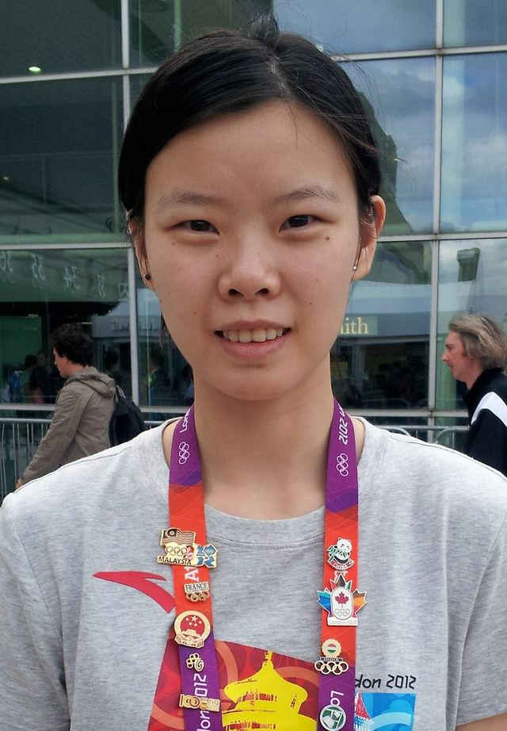

**2. 🟢 OK** Caption: **Li Xuerui** 2012 · CC BY-SA 3.0 · [source](https://commons.wikimedia.org/wiki/File:Li_Xuerui_2012_(portrait).jpg) AI sees: _Chinese badminton player Li Xuerui at London 2012_
 

**3. 🟢 OK** Caption: **Tai Tzu-ying** 2024 · CC BY 2.0 · [source](https://commons.wikimedia.org/wiki/File:Tai_Tzu-ying_in_2024.jpg) AI sees: _Badminton player Tai Tzu-ying holding a framed certificate_
 

---

## ✅ live · PFL Confirms 14-Fight Lyon Card Headlined by Lapilus vs McKee Title Bout
`2026-11-24-news-f01fca` · 2026-11-24

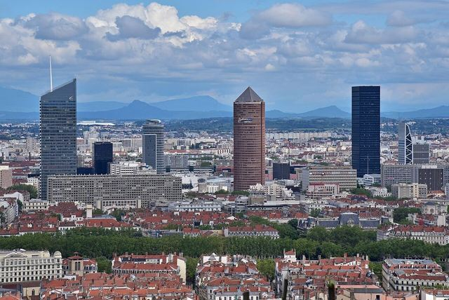

**1. 🟢 OK** · cover Caption: **Lyon, host city of the PFL event on 19 December** 2023 · CC BY-SA 4.0 · [source](https://commons.wikimedia.org/wiki/File:Lyon-part-dieu-2023.jpg) AI sees: _Skyline of Lyon featuring Part-Dieu skyscrapers_
 

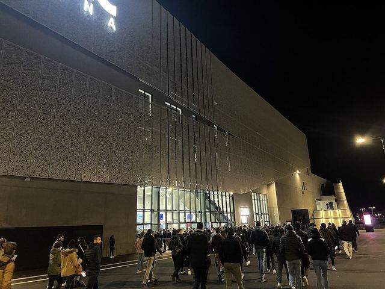

**2. 🟢 OK** Caption: **LDLC Arena** 2023 · CC BY-SA 4.0 · [source](https://commons.wikimedia.org/wiki/File:LDLC_Arena_-_D%C3%A9cines-Charpieu_(FR69)_-_2023-12-28_-_1.jpg) AI sees: _Exterior of the LDLC Arena at night with crowds entering_
 

---

## ✅ live · Vietnam Earn Historic First U17 World Cup Point in 3-3 Thriller Against New Zealand
`2026-11-24-news-98e731` · 2026-11-24

**1. 🟢 our score card** · cover Caption: **Vietnam U17 3 - 3 New Zealand U17 · FIFA U-17 World Cup** 2026 · Own work
 

---

## ✅ live · China U17 Earn First World Cup Point in 21 Years After 2-2 Morocco Draw
`2026-11-24-news-95243b` · 2026-11-24

**1. 🟢 our score card** · cover Caption: **China U-17 2 - 2 Morocco U-17 · FIFA U-17 World Cup** 2026 · Own work
 

---

## ✅ live · Kun Khmer champion Chhut Serey Vannthong outpoints Riki at K-1 Revenge II in Tokyo
`2026-11-24-news-928d27` · 2026-11-24

**1. 🟢 OK** · cover Caption: **Chhut Serey Vannthong** 2023 · CC0 · [source](https://commons.wikimedia.org/wiki/File:Rahumeaspradalserey.jpg) AI sees: _Kun Khmer fighter Chhut Serey Vannthong in a training gym_
 

**2. 🟢 OK** Caption: **Korakuen Hall** 2017 · CC BY-SA 4.0 · [source](https://commons.wikimedia.org/wiki/File:20170104_Korakuen_Hall.jpg) AI sees: _Exterior of Korakuen Hall building with signs in Tokyo_
 

**3. 🟢 our score card** Caption: **Chhut Serey Vannthong def. Riki · Unanimous decision (30-27, 30-28, 30-28) · Round 3 · K-1 Revenge II · Korakuen Hall, Tokyo** 2026 · Own work
 

🔗 Embedded post: [K-1 Worldwide (@K1_ReBoot)](https://x.com/K1_ReBoot/status/2124823613643858283) — {'en': "Official K-1 video: Chhut Serey Vannthong's decision win over Riki", 'zh': 'K-1官方视频：Chhut Serey Vannthong判定战胜立基', 'ru': 'Официальное видео K-1: победа Чхута Серей Ваннтонга над Рики решением судей'}

---

## ✅ live · Russian Boxing Federation Voted In as Full World Boxing Member in Panama
`2026-11-24-news-4177ff` · 2026-11-24

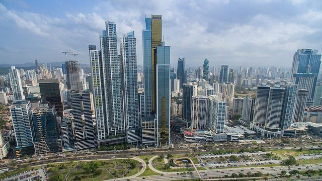

**1. 🟢 OK** · cover Caption: **Panama City, where the World Boxing congress voted** 2016 · CC BY 3.0 · [source](https://commons.wikimedia.org/wiki/File:Panama_Papers_(148830809).jpeg) AI sees: _Aerial view of the Panama City skyline and waterfront_
 

**2. 🟢 OK** Caption: **Gennady Golovkin** 2017 · CC BY 3.0 · [source](https://commons.wikimedia.org/wiki/File:Gennady_Golovkin_(KAZ)_2017.png) AI sees: _Gennady Golovkin in a suit_
 

---

## ✅ live · Tian Bingyi Appointed China Badminton Head Coach for Los Angeles 2028 Cycle
`2026-11-24-news-3d085d` · 2026-11-24

**1. 🟢 OK** · cover Caption: **Zhang Nan (badminton)** 2013 · CC BY-SA 4.0 · [source](https://commons.wikimedia.org/wiki/File:Zhang_Nan.jpg) AI sees: _Zhang Nan playing badminton_
 

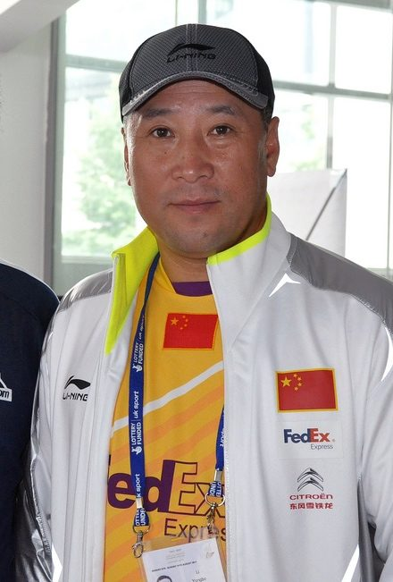

**2. 🟢 OK** Caption: **Li Yongbo** 2015 · CC BY-SA 2.0 · [source](https://commons.wikimedia.org/wiki/File:Li_Yonbgo_portrait.jpg) AI sees: _Chinese badminton coach Li Yongbo in national team apparel_
 

---

## ✅ live · Mirra Andreeva Earns $10.65 Million to Enter Global Top Five in 2026 Prize Money
`2026-11-24-news-2b4378` · 2026-11-24

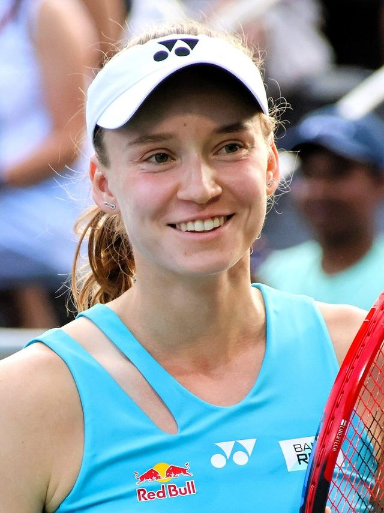

**1. 🟢 OK** · cover Caption: **Elena Rybakina** 2025 · CC BY-SA 4.0 · [source](https://commons.wikimedia.org/wiki/File:Elena_Rybakina_(2025_DC_Open)_11_(cropped).jpg) AI sees: _tennis player Elena Rybakina smiling on court_
 

**2. 🟢 OK** Caption: **Mirra Andreeva** 2023 · CC BY-SA 2.0 · [source](https://commons.wikimedia.org/wiki/File:Mirra_Andreeva_WMQ23_(cropped).jpg) AI sees: _Mirra Andreeva playing tennis in tennis attire_
 

**3. 🟢 OK** Caption: **Alexander Zverev** 2026 · CC BY-SA 4.0 · [source](https://commons.wikimedia.org/wiki/File:Alexander_Zverev_in_Miami.jpg) AI sees: _Alexander Zverev on a tennis court_
 

---

## ✅ live · Kazakhstan Names 11 Boxers for Season-Ending World Boxing Cup Finals in Tashkent
`2026-11-24-news-0390f5` · 2026-11-24

**1. 🟢 OK** · cover Caption: **Humo Arena, Tashkent** 2019 · CC BY-SA 4.0 · [source](https://commons.wikimedia.org/wiki/File:Humo_Arena_2019.jpg) AI sees: _Exterior of Humo Arena in Tashkent_
 

---

## ✅ live · Carlos Alcaraz Defeats Alexander Zverev in Turin to Claim Maiden ATP Finals Title
`2026-11-23-news-dbb56e` · 2026-11-23

**1. 🟢 OK** · cover Caption: **Carlos Alcaraz** 2024 · CC BY-SA 4.0 · [source](https://commons.wikimedia.org/wiki/File:25th_Laureus_World_Sports_Awards_-_Red_Carpet_-_Carlos_Alcaraz_-_240422_192324_(cropped).jpg) AI sees: _Carlos Alcaraz in a black tuxedo on a red carpet_
 

**2. 🟢 OK** Caption: **Alexander Zverev** 2026 · CC BY-SA 4.0 · [source](https://commons.wikimedia.org/wiki/File:Alexander_Zverev_in_Miami.jpg) AI sees: _Alexander Zverev wearing a black headband and shirt_
 

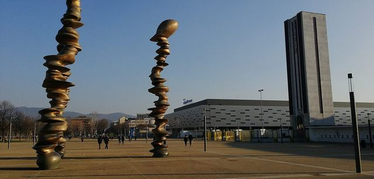

**3. 🟢 OK** Caption: **Inalpi Arena** 2023 · CC BY-SA 4.0 · [source](https://commons.wikimedia.org/wiki/File:Piazzale_Grande_Torino,_Turin,_Italy.jpg) AI sees: _Inalpi Arena (formerly Pala Alpitour) and Piazzale Grande Torino in Turin_
 

**4. 🟢 our score card** Caption: **Carlos Alcaraz 2 - 0 Alexander Zverev · Nitto ATP Finals** 2026 · Own work
 

---

## ✅ live · Bangladesh and Singapore finalize preparations ahead of December women's friendlies
`2026-11-23-news-bb407c` · 2026-11-23

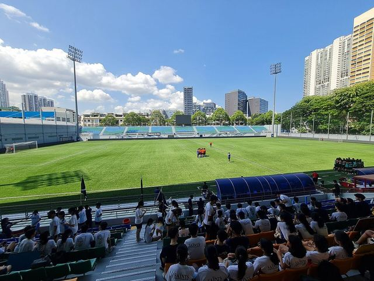

**1. 🟢 OK** · cover Caption: **Jalan Besar Stadium** 2022 · CC BY-SA 4.0 · [source](https://commons.wikimedia.org/wiki/File:JalanBesarStadium2022.jpg) AI sees: _Jalan Besar Stadium during a football match_
 

**2. 🟢 OK** Caption: **Bishan Stadium** 2010 · CC BY-SA 4.0 · [source](https://commons.wikimedia.org/wiki/File:Bishan_Stadium,_Singapore,_during_the_2010_Summer_Youth_Olympics_-_20100816-02.JPG) AI sees: _exterior of Bishan Stadium during the 2010 Youth Olympic Games_
 

---

## ✅ live · Trefilov Rejects 2028 Olympic Medal Guarantee by Russian Handball Chief
`2026-11-23-news-23b075` · 2026-11-23

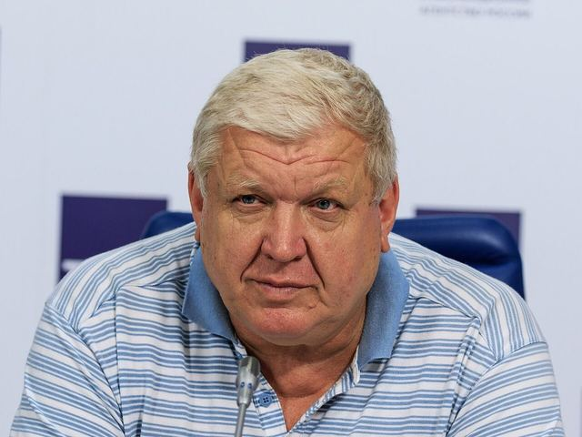

**1. 🟢 OK** · cover Caption: **Yevgeni Trefilov in August 2016** 2016 · FAL · [source](https://commons.wikimedia.org/wiki/File:Handball_Yevgeny_Trefilov_MoscowTass_08-2016.jpg) AI sees: _Yevgeni Trefilov at a press conference_
 

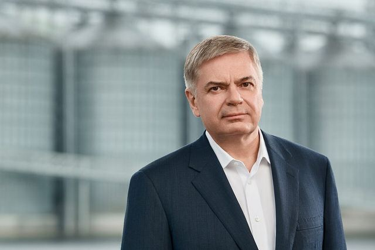

**2. 🟢 OK** Caption: **Sergey Shishkarev** 2023 · CC BY-SA 4.0 · [source](https://commons.wikimedia.org/wiki/File:Sergey_Shishkarev_2023.jpg) AI sees: _portrait of Russian handball chief Sergey Shishkarev in a suit_
 

---

## ✅ live · Svay Rieng and Phnom Penh Crown chase a historic AFC Champions League Two double
`2026-11-23-news-00ad68` · 2026-11-23

**1. 🟢 OK** · cover Caption: **Cambodian Premier League (CPL) logo** 2025 · PD · [source](https://en.wikipedia.org/wiki/File:Cambodian_Premier_League_logo.png)
 

🔗 Embedded post: [Cambodian Premier League (official Facebook)](https://www.facebook.com/theofficialcpl/posts/pfbid02CPwVjauvNKcVzepP9hkio7gLfzFCAMPkUpkF19nbjX1vVqcSDjHTR1nSwJZDN6yQl) — {'en': 'Official CPL 2026/27 table after Week 8', 'zh': '柬埔寨超级联赛2026/27赛季第8轮后官方积分榜', 'ru': 'Официальная таблица чемпионата Камбоджи 2026/27 после 8-го тура'}

🔗 Embedded post: [Cambodian Premier League (official Facebook)](https://www.facebook.com/theofficialcpl/posts/pfbid02Tyeustz4U58pGcdoYFtX5ZQB3BD4PSdyGP4aP1QSDsCqZdFGtH8WEKHT7DcaokCml) — {'en': 'Official Week 8 results, 21–22 November 2026', 'zh': '第8轮官方赛果（2026年11月21日至22日）', 'ru': 'Официальные результаты 8-го тура, 21–22 ноября 2026 года'}

🔗 Embedded post: [Cambodian Premier League (official Facebook)](https://www.facebook.com/theofficialcpl/posts/pfbid01S7vWskCqLio1oj9h6EKXYfTxVVQ5GD3vsLBdfPQyLBTFYPZu8zS1YebuicRCSAEl) — {'en': 'Week 8 attendance: 9,789 fans, including 7,502 at Svay Rieng v Angkor Tiger', 'zh': '第8轮观众人数：共9,789人，其中柴桢对阵吴哥猛虎7,502人', 'ru': 'Посещаемость 8-го тура: 9 789 зрителей, из них 7 502 на матче «Свайриенг» — «Ангкор Тайгер»'}

---

## ✅ live · From Middle-School Backup to 9.83 Seconds: The Life and Science of Su Bingtian
`2026-11-23-athl-db5356` · 2026-11-23

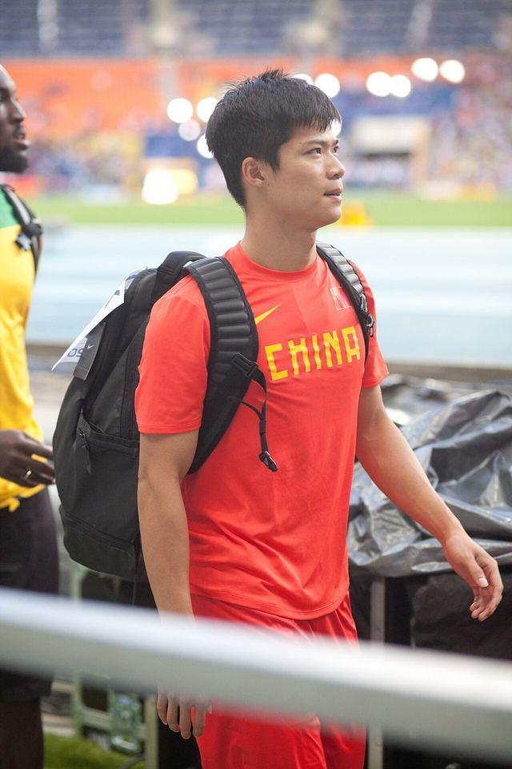

**1. 🟢 OK** · cover Caption: **Su Bingtian** 2013 · CC BY-SA 3.0 · [source](https://commons.wikimedia.org/wiki/File:2013_World_Championships_in_Athletics_(August,_10)_by_Dmitry_Rozhkov_63.jpg) AI sees: _Chinese sprinter Su Bingtian walking with a backpack in athletic stadium_
 

**2. 🟢 OK** Caption: **Xie Zhenye** 2017 · CC BY-SA 3.0 · [source](https://commons.wikimedia.org/wiki/File:Xie_Zhenye.jpg) AI sees: _Sprinter Xie Zhenye competing in a race in Madrid_
 

**3. 🟢 OK** Caption: **Zhang Peimeng** 2013 · CC BY-SA 3.0 · [source](https://commons.wikimedia.org/wiki/File:Zhang_Peimeng_(Moscow_2013)_by_Dmitry_Rozhkov_35.jpg) AI sees: _Chinese sprinter Zhang Peimeng in team China gear_
 

---

## ✅ live · Manny Pacquiao: The Street Fighter Who Conquered Eight Divisions
`2026-11-23-athl-a5664c` · 2026-11-23

**1. 🟢 OK** · cover Caption: **Manny Pacquiao** 2025 · Public domain · [source](https://commons.wikimedia.org/wiki/File:Former_senator_Manny_Pacquiao_speaks_in_event_(10-01-2025)_(cropped).jpg) AI sees: _Manny Pacquiao speaking into a microphone_
 

**2. 🟢 OK** Caption: **Freddie Roach** 2010 · CC BY-SA 2.0 · [source](https://commons.wikimedia.org/wiki/File:Freddie_Roach_2010.jpg) AI sees: _boxing trainer Freddie Roach at a press conference_
 

**3. 🟢 OK** Caption: **General Santos** 2026 · CC BY-SA 4.0 · [source](https://commons.wikimedia.org/wiki/File:Gensan_Dadiangas_South,_P._Acharon_Boulevard,_Gensan_Public_Market_drone_(General_Santos_City;_03-24-2026).jpg) AI sees: _aerial view of General Santos City coastline and buildings_
 

---

## ✅ live · Lauren Price Makes Welsh Boxing History With Shutout Win Over Michaela Kotaskova to Become Undisputed Champion
`2026-11-22-news-e72338` · 2026-11-22

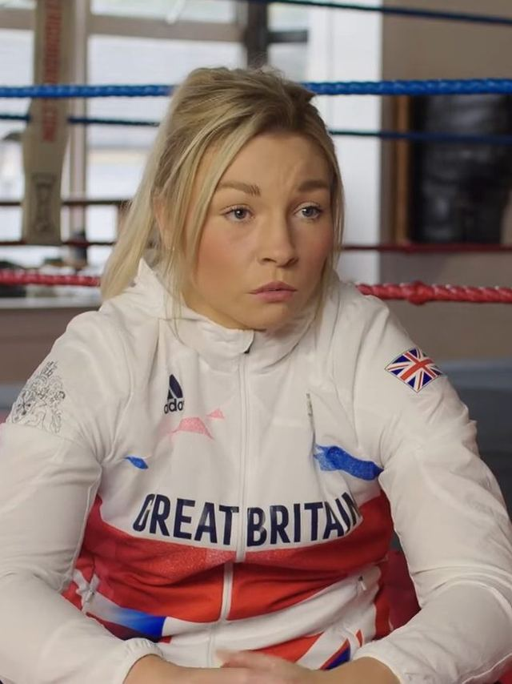

**1. 🟢 OK** · cover Caption: **Lauren Price** 2021 · CC BY 3.0 · [source](https://commons.wikimedia.org/wiki/File:Lauren_Price_in_2021.png) AI sees: _Welsh boxer Lauren Price in Great Britain team kit_
 

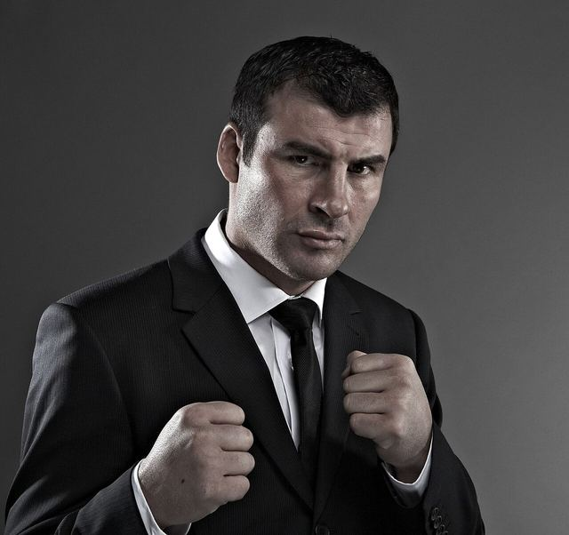

**2. 🟢 OK** Caption: **Joe Calzaghe** 2009 · CC BY 3.0 · [source](https://commons.wikimedia.org/wiki/File:JoeCalzaghe-July2007.jpg) AI sees: _Joe Calzaghe in a suit with raised fists_
 

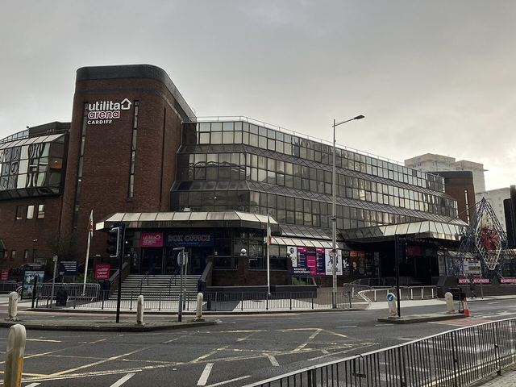

**3. 🟢 OK** Caption: **Cardiff International Arena** 2023 · CC BY-SA 4.0 · [source](https://commons.wikimedia.org/wiki/File:Utilita_Arena_Cardiff_September_2023_10.jpg) AI sees: _Exterior of Utilita Arena Cardiff (Cardiff International Arena)_
 

---

## ✅ live · Man Wei Chong and Tee Kai Wun End Malaysia's 27-Year Hong Kong Open Men's Doubles Title Drought
`2026-11-22-news-ab9fc0` · 2026-11-22

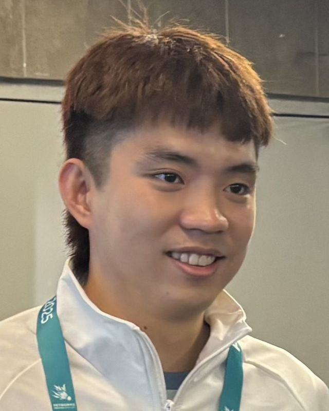

**1. 🟢 OK** · cover Caption: **Man Wei Chong** 2026 · CC BY-SA 4.0 · [source](https://commons.wikimedia.org/wiki/File:ManWC_PMO2025.jpg) AI sees: _close-up portrait of badminton player Man Wei Chong_
 

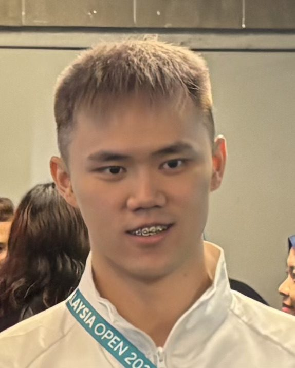

**2. 🟢 OK** Caption: **Tee Kai Wun** 2026 · CC BY-SA 4.0 · [source](https://commons.wikimedia.org/wiki/File:TeeKW_PMO2025.jpg) AI sees: _Badminton player Tee Kai Wun at Malaysia Open_
 

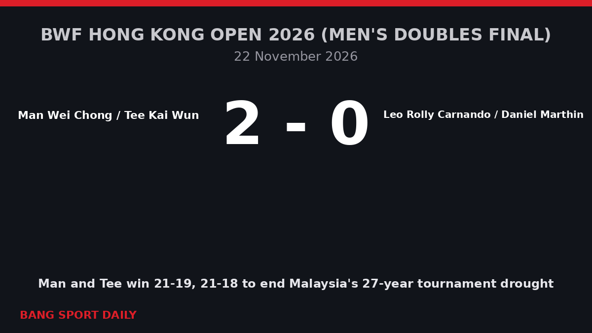

**3. 🟢 our score card** Caption: **Man Wei Chong / Tee Kai Wun 2 - 0 Leo Rolly Carnando / Daniel Marthin · BWF Hong Kong Open 2026 (Men's Doubles Final)** 2026 · Own work
 

---

## ✅ live · Max Verstappen Wins Las Vegas Grand Prix as Russell Crash Sparks Post-Race Feud
`2026-11-22-news-61a15b` · 2026-11-22

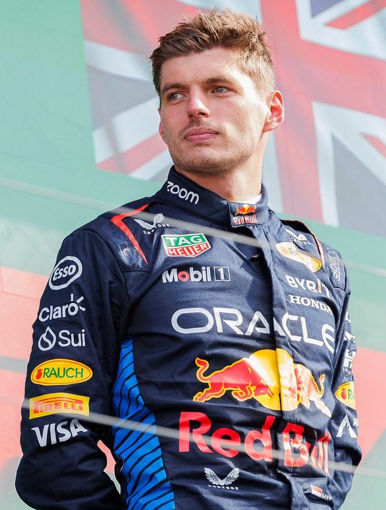

**1. 🟢 OK** · cover Caption: **Max Verstappen** 2024 · CC BY-SA 4.0 · [source](https://commons.wikimedia.org/wiki/File:2024-08-25_Motorsport,_Formel_1,_Gro%C3%9Fer_Preis_der_Niederlande_2024_STP_3973_by_Stepro_(medium_crop).jpg) AI sees: _Max Verstappen in Red Bull Racing race suit on a podium_
 

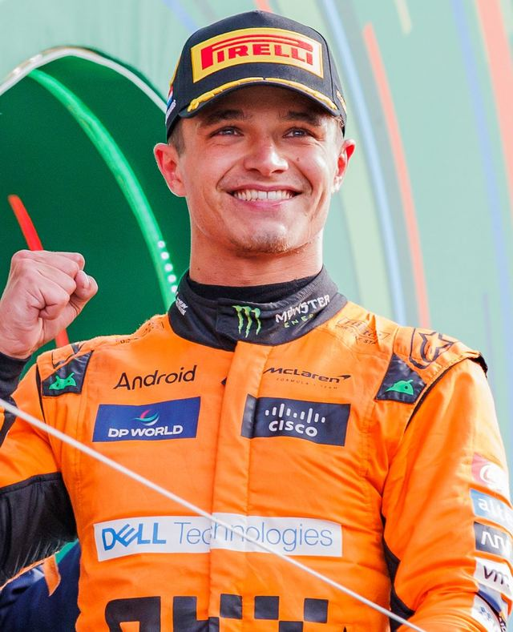

**2. 🟢 OK** Caption: **Lando Norris** 2024 · CC BY-SA 4.0 · [source](https://commons.wikimedia.org/wiki/File:2024-08-25_Motorsport,_Formel_1,_Gro%C3%9Fer_Preis_der_Niederlande_2024_STP_3968_by_Stepro_(cropped2).jpg) AI sees: _Lando Norris celebrating on an F1 podium in McLaren gear_
 

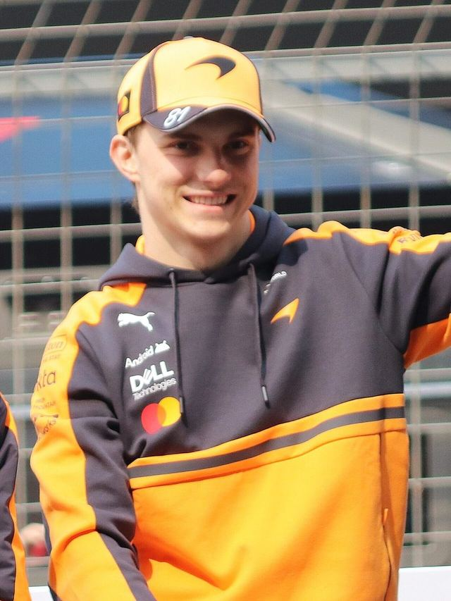

**3. 🟢 OK** Caption: **Oscar Piastri** 2026 · CC BY 4.0 · [source](https://commons.wikimedia.org/wiki/File:2026_Chinese_GP_-_Oscar_Piastri_(cropped)_(cropped).jpg) AI sees: _F1 driver Oscar Piastri in McLaren team gear_
 

---

## ✅ live · Navajo Stirling Knocks Out Jiri Prochazka at UFC Qatar in Career-Defining Win
`2026-11-22-news-1b71a7` · 2026-11-22

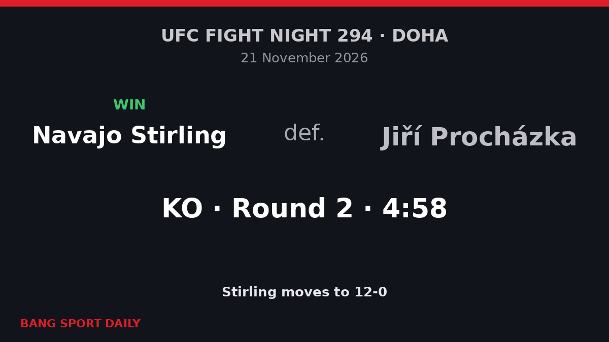

**1. 🟢 our score card** · cover Caption: **Navajo Stirling def. Jiří Procházka · KO · Round 2 · 4:58 · UFC Fight Night 294 · Doha** 2026 · Own work
 

**2. ⚪ not checked** Caption: **Jiří Procházka** 2022 · CC BY 3.0 · [source](https://commons.wikimedia.org/wiki/File:JiriProchazka2022.png)
 

🔗 Embedded post: [Getty Images](https://www.gettyimages.com/detail/2306254634) — {'en': 'Navajo Stirling at UFC Fight Night 294 in Doha, 21 November 2026', 'zh': '纳瓦霍·斯特林在多哈UFC格斗之夜294（2026年11月21日）', 'ru': 'Наваджо Стирлинг на UFC Fight Night 294 в Дохе, 21 ноября 2026 года'}

---

## ✅ live · On This Day in 2013: Magnus Carlsen Dethrones Viswanathan Anand in Chennai
`2026-11-22-hist-478ccb` · 2026-11-22

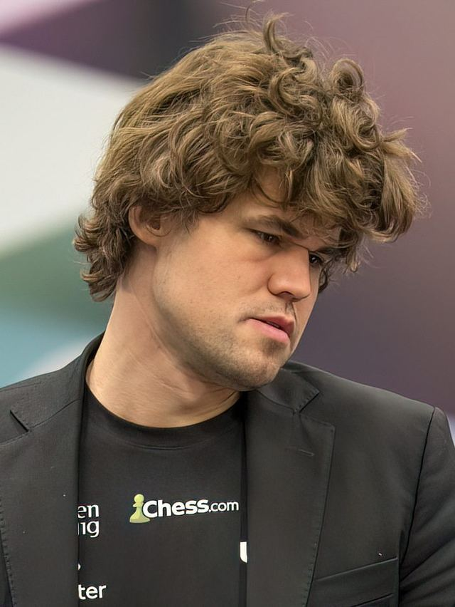

**1. 🟢 OK** · cover Caption: **Magnus Carlsen** 2023 · CC BY-SA 2.0 · [source](https://commons.wikimedia.org/wiki/File:Magnus_Carlsen_Tata_2023_-_71_(cropped_v4).jpg)
 

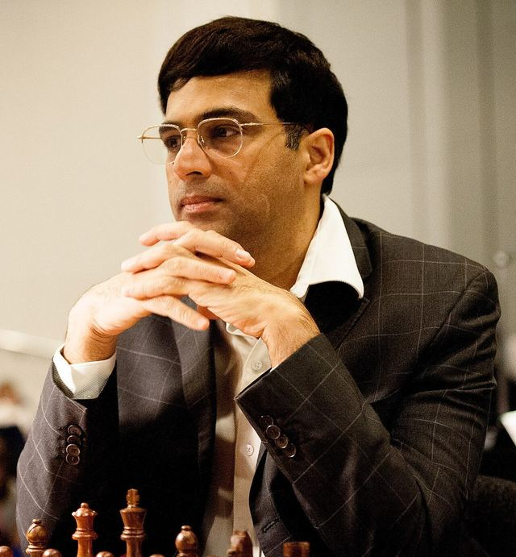

**2. 🟢 OK** Caption: **Viswanathan Anand** 2016 · CC BY 2.0 · [source](https://commons.wikimedia.org/wiki/File:Viswanathan_Anand_(2016)_(cropped).jpeg)
 

---

