# Photo review — 2026-11-28

Drafts and stories published in the last 3 days. **🔴 wrong: 0 · 🟠 to look at: 1**

How to use (about a minute): look at each picture next to its caption. 🔴 photos block publishing. To remove or replace a photo, add the story ID to `photos.yaml` (examples at the top of that file), or tell Claude the story ID and which photo is wrong. Official Instagram/Facebook posts can be added with `embed:` lines in `photos.yaml`.

## 📝 DRAFT · USWNT Crushes El Salvador 8-0 to Seal 2027 World Cup Berth
`2026-11-28-news-80638d` · 2026-11-28

**1. 🟢 OK** · cover Caption: **Ashley Sanchez** 2026 · CC BY-SA 4.0 · [source](https://commons.wikimedia.org/wiki/File:Ashley_Sanchez_Gotham_NC_Courage_Mar_21_2026-63_(cropped).jpg) AI sees: _Ashley Sanchez in a North Carolina Courage soccer kit_
 

**2. 🟢 OK** Caption: **Emma Hayes** 2026 · CC BY-SA 4.0 · [source](https://commons.wikimedia.org/wiki/File:Emma_Hayes_USWNT_v_Colombia_Mar_7_2026-68_(cropped).jpg) AI sees: _Emma Hayes smiling in US team jacket_
 

**3. 🟢 OK** Caption: **Mallory Swanson** 2026 · CC BY-SA 4.0 · [source](https://commons.wikimedia.org/wiki/File:Mallory_Swanson_Gotham_v_Chicago_25_September_2026-056_(cropped).jpg) AI sees: _Mallory Swanson in a Chicago Stars FC soccer kit_
 

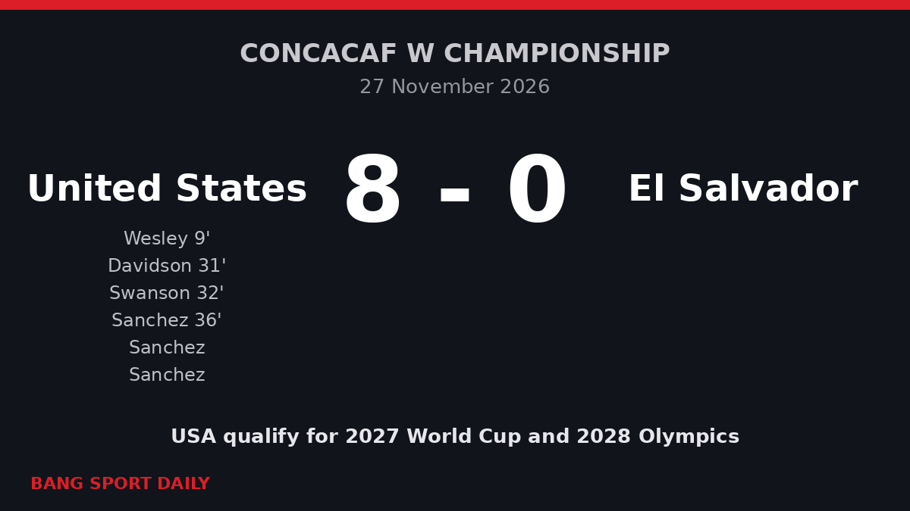

**4. 🟢 our score card** Caption: **United States 8 - 0 El Salvador · Concacaf W Championship** 2026 · Own work
 

---

## 📝 DRAFT · From High School Cut to Global Icon: The Life and Legacy of Michael Jordan
`2026-11-27-athl-5e9dcf` · 2026-11-27

**1. 🟠 CHECK** · cover Caption: **Dean Smith** 1973 · Public domain · [source](https://commons.wikimedia.org/wiki/File:Dean_Smith_1973.jpg) AI sees: _portrait of college basketball coach Dean Smith_ Why: The photo accurately shows legendary North Carolina basketball coach Dean Smith from the 1970s era. ⚑ photo is from 1973: too old for a story about current athletes
 

---

## ✅ live · Sotto and Debutant Boatwright Dominate as Gilas Pilipinas Rout Syria 97-58
`2026-11-28-news-c2986b` · 2026-11-28

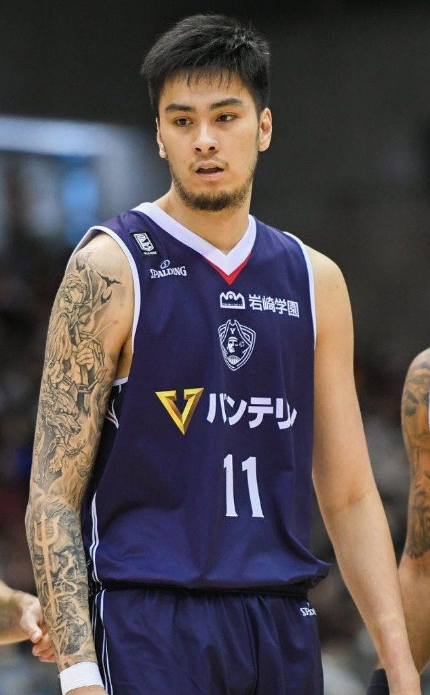

**1. 🟢 OK** · cover Caption: **Kai Sotto** 2024 · CC0 · [source](https://commons.wikimedia.org/wiki/File:Kai_sotto_yokohama_b_corsairs_b_league.jpg) AI sees: _Kai Sotto in a Yokohama B-Corsairs basketball uniform_
 

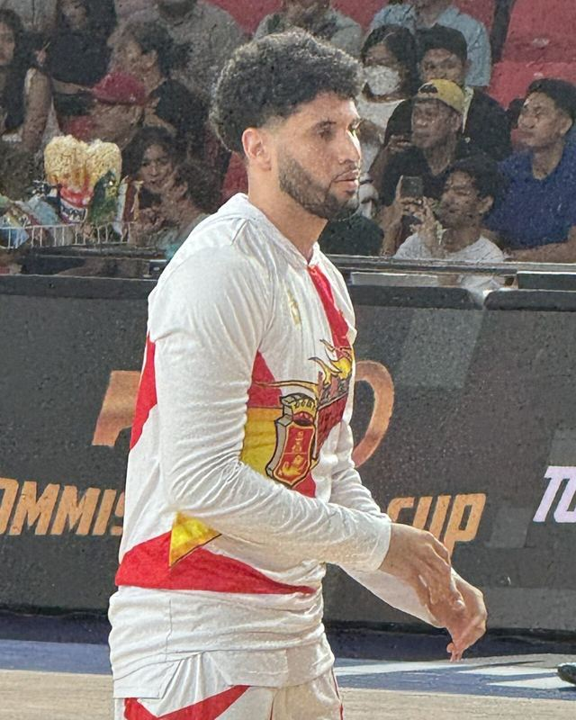

**2. 🟢 OK** Caption: **Bennie Boatwright** 2026 · CC BY 4.0 · [source](https://commons.wikimedia.org/wiki/File:Bennie_Boatwright_2026.jpg) AI sees: _Bennie Boatwright wearing a San Miguel Beermen warm-up shirt during a basketball game_
 

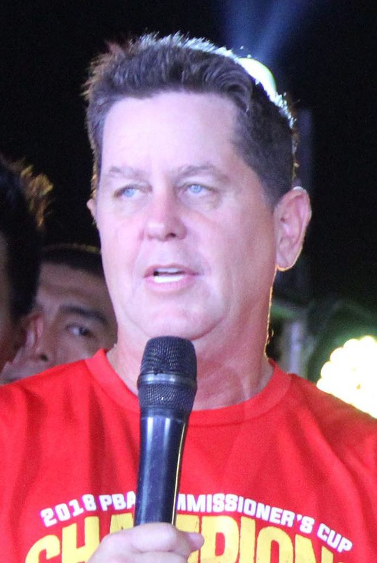

**3. 🟢 OK** Caption: **Tim Cone** 2018 · Public domain · [source](https://commons.wikimedia.org/wiki/File:Barangay_Ginebra_PBA_champions_victory_party_Tim_Cone(cropped).jpg) AI sees: _Basketball coach Tim Cone speaking into a microphone_
 

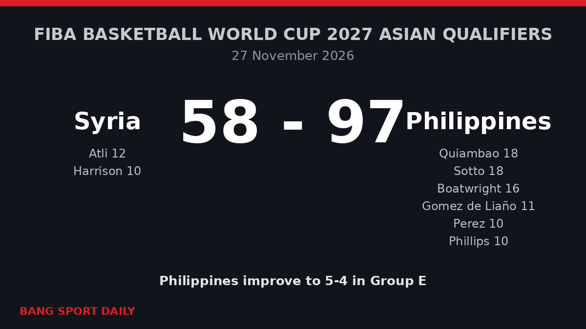

**4. 🟢 our score card** Caption: **Syria 58 - 97 Philippines · FIBA Basketball World Cup 2027 Asian Qualifiers** 2026 · Own work
 

---

## ✅ live · Musetti Stars in Singles and Doubles as Italy Edge Czech Republic to Reach Davis Cup Final
`2026-11-28-news-5e9885` · 2026-11-28

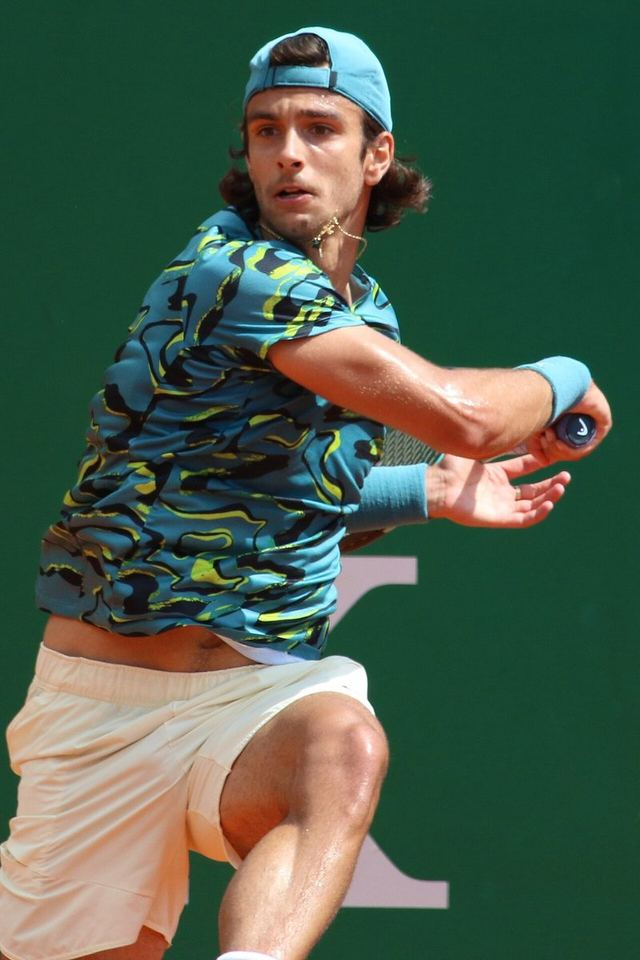

**1. 🟢 OK** · cover Caption: **Lorenzo Musetti** 2023 · CC BY-SA 2.0 · [source](https://commons.wikimedia.org/wiki/File:Musetti_MCM23_(11)_(52883593753).jpg) AI sees: _Lorenzo Musetti playing tennis_
 

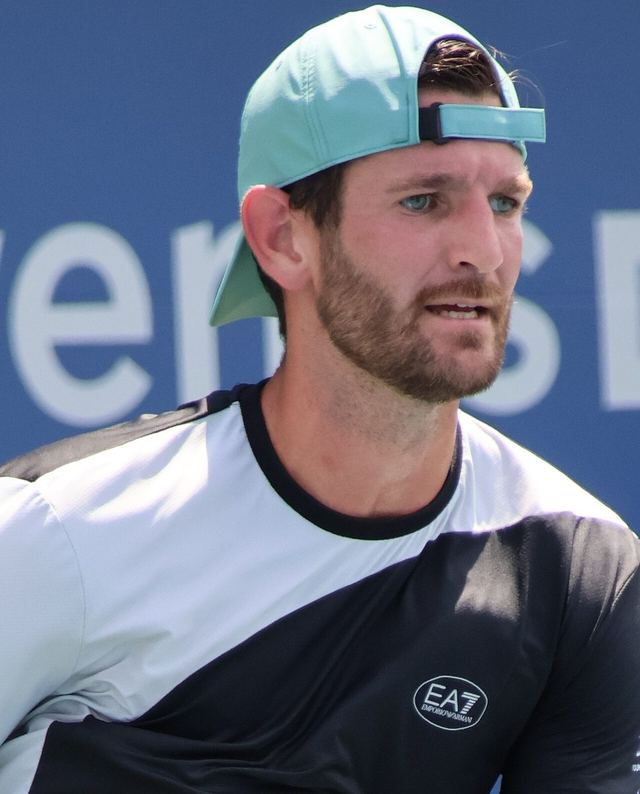

**2. 🟢 OK** Caption: **Andrea Vavassori** 2025 · CC BY-SA 4.0 · [source](https://commons.wikimedia.org/wiki/File:Andrea_Vavassori_(2025_DC_Open)_01_(cropped).jpg) AI sees: _Andrea Vavassori on a tennis court_
 

**3. 🟢 OK** Caption: **Jiří Lehečka** 2023 · CC BY-SA 2.0 · [source](https://commons.wikimedia.org/wiki/File:Lehecka_MCM23_(5)_(52883527310).jpg) AI sees: _tennis player Jiří Lehečka on a clay court_
 

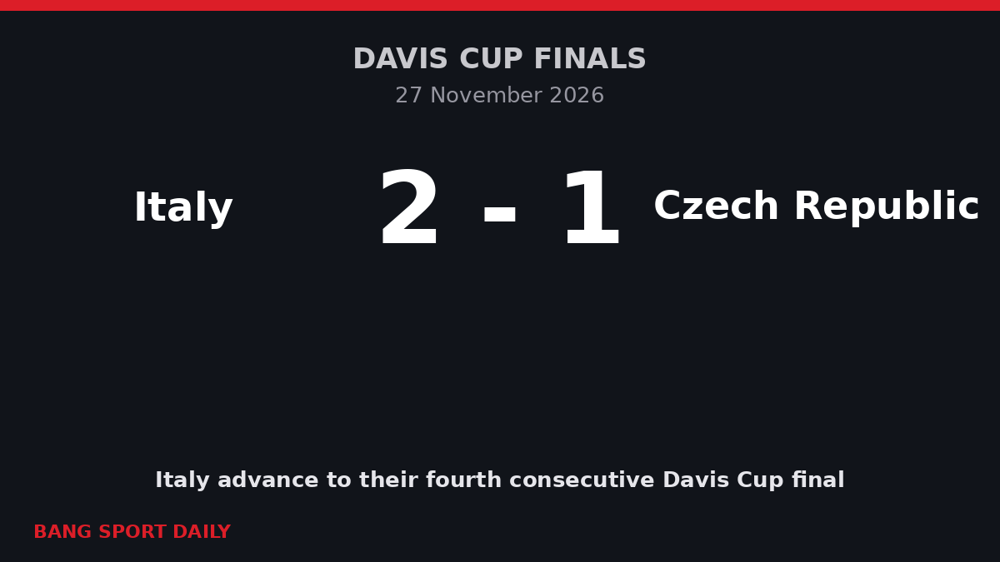

**4. 🟢 our score card** Caption: **Italy 2 - 1 Czech Republic · Davis Cup Finals** 2026 · Own work
 

---

## ✅ live · Pitchamon Opatniputh Banned Three Months by BWF After Positive Doping Test
`2026-11-28-news-435fbd` · 2026-11-28

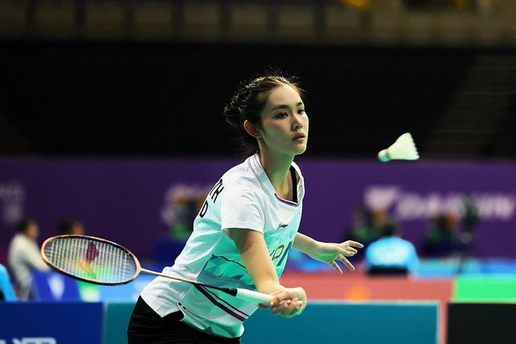

**1. 🟢 OK** · cover Caption: **Pitchamon Opatniputh** 2024 · CC BY-SA 4.0 · [source](https://commons.wikimedia.org/wiki/File:%E7%A2%A7%E6%9F%A5%E5%A4%A2%C2%B7%E6%AD%90%E5%B8%95%E5%A6%AE%E6%99%AE.jpg) AI sees: _Pitchamon Opatniputh playing badminton_
 

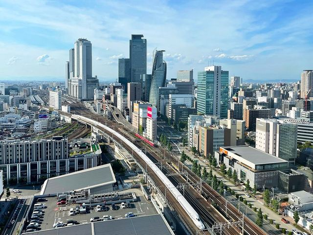

**2. 🟢 OK** Caption: **Nagoya** 2022 · Public domain · [source](https://commons.wikimedia.org/wiki/File:Nagoya_Station_-_View_from_the_Main_Building_in_Nagoya_Campus_of_Aichi_University_2022-6-29.jpg) AI sees: _cityscape of Nagoya with railway tracks and skyscrapers_
 

---

## ✅ live · Marc Marquez Announces MotoGP Retirement Days After Winning Record-Equalling Eighth Title
`2026-11-27-news-eb82c2` · 2026-11-27

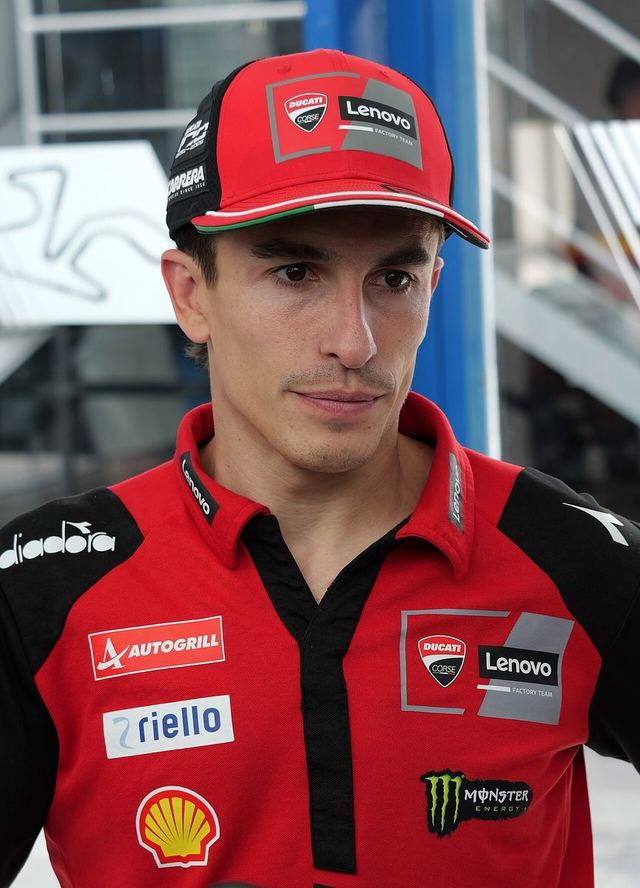

**1. ⚪ not checked** · cover Caption: **Marc Marquez at the 2026 Spanish Grand Prix** 2026 · CC BY-SA 4.0 · [source](https://commons.wikimedia.org/wiki/File:Marc_Marquez_at_the_2026_Spanish_Grand_Prix_(cropped).jpg)
 

🔗 Embedded post: [MotoGP (official Facebook page)](https://www.facebook.com/reel/1209291261533641/) — {'en': 'MotoGP video: Marc Marquez announces his retirement in the Ducati garage in Valencia', 'zh': 'MotoGP官方视频：马克·马克斯在瓦伦西亚杜卡迪维修区宣布退役', 'ru': 'Видео MotoGP: Марк Маркес объявляет о завершении карьеры в боксе Ducati в Валенсии'}

---

## ✅ live · Svay Rieng Stun Machida as Crown Fall in Kuching: ACL Two Matchday 5 Round-Up
`2026-11-27-news-cbc2c5` · 2026-11-27

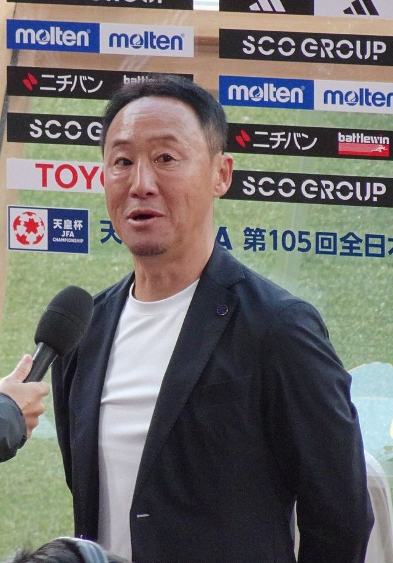

**1. ⚪ not checked** · cover Caption: **Machida Zelvia coach Go Kuroda** 2025 · CC BY 4.0 · [source](https://commons.wikimedia.org/wiki/File:Go_Kuroda_2025.jpg)
 

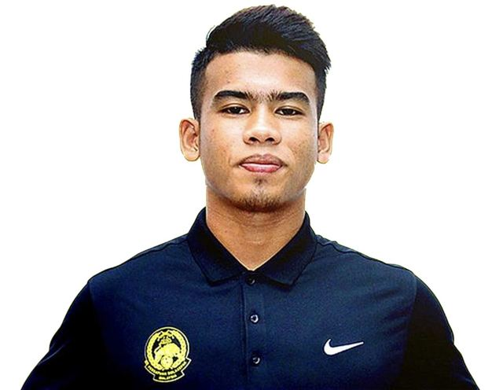

**2. ⚪ not checked** Caption: **Safawi Rasid, who opened the scoring for Kuching City against Phnom Penh Crown** 2026 · CC0 · [source](https://commons.wikimedia.org/wiki/File:Safawi_Rasid.png)
 

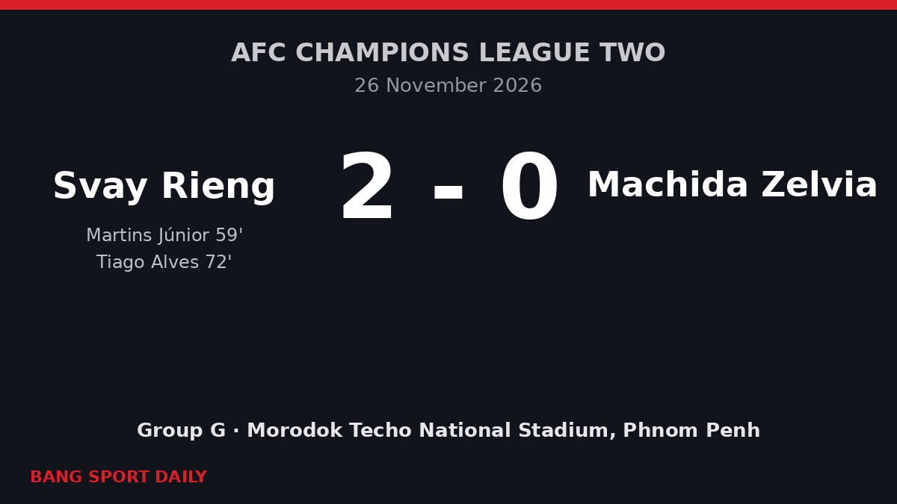

**3. 🟢 our score card** Caption: **Svay Rieng 2 - 0 Machida Zelvia · AFC Champions League Two** 2026 · Own work
 

🔗 Embedded post: [PKR Svay Rieng FC (@pkrsvr_fc_official)](https://www.instagram.com/reel/DgOf5_pgmUm/) — {'en': "Svay Rieng's official Instagram reel after the 2-0 win over Machida Zelvia", 'zh': '柴桢俱乐部官方Instagram视频：2-0战胜町田泽维亚', 'ru': 'Видео из официального Instagram «Свайриенга» после победы над «Матидой Зельвией» 2:0'}

🔗 Embedded post: [PKR Svay Rieng FC (@pkrsvr_fc_official)](https://www.instagram.com/reel/DgOqld1memU/) — {'en': 'Another official Svay Rieng reel from the night they beat Machida Zelvia', 'zh': '柴桢俱乐部官方Instagram视频：击败町田泽维亚之夜', 'ru': 'Ещё одно видео «Свайриенга» из официального Instagram с вечера победы над «Матидой Зельвией»'}

---

## ✅ live · Italy Beat South Korea 2-1 to Reach Davis Cup Semifinals
`2026-11-27-news-bcbdd0` · 2026-11-27

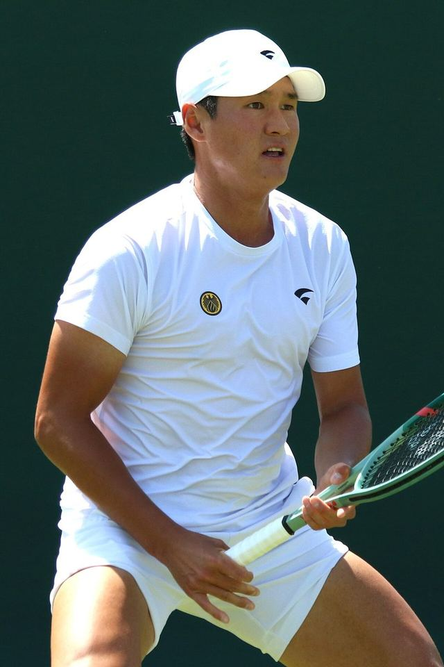

**1. 🟢 OK** · cover Caption: **Kwon Soon-woo** Asked for: Soonwoo Kwon → got page: Kwon Soon-woo 2026 · CC BY-SA 4.0 · [source](https://commons.wikimedia.org/wiki/File:Kwon_WMQ26_(4)_(55466987996).jpg) AI sees: _tennis player Kwon Soon-woo in action_
 

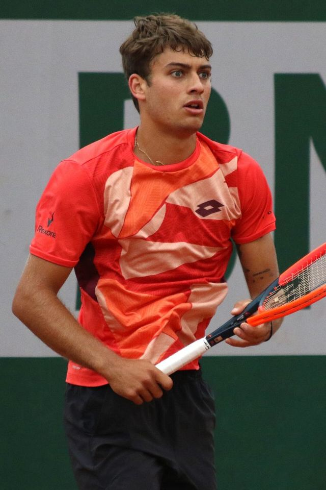

**2. 🟢 OK** Caption: **Flavio Cobolli** 2023 · CC BY-SA 2.0 · [source](https://commons.wikimedia.org/wiki/File:Cobolli_RGQ23_(52944096963).jpg) AI sees: _tennis player Flavio Cobolli holding a racquet during a match_
 

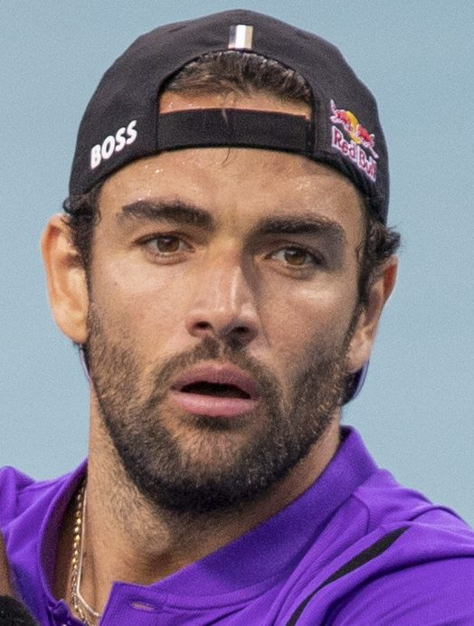

**3. 🟢 OK** Caption: **Matteo Berrettini** 2025 · CC BY-SA 4.0 · [source](https://commons.wikimedia.org/wiki/File:Matteo_Berrettini_at_2025_Miami_Open_01_(cropped)_(cropped).jpg) AI sees: _Matteo Berrettini wearing a cap and purple shirt_
 

---

## ✅ live · Dortmund Lead Bundesliga by Two Points as Kane Injury Leaves Bayern Short
`2026-11-27-news-ae7ce9` · 2026-11-27

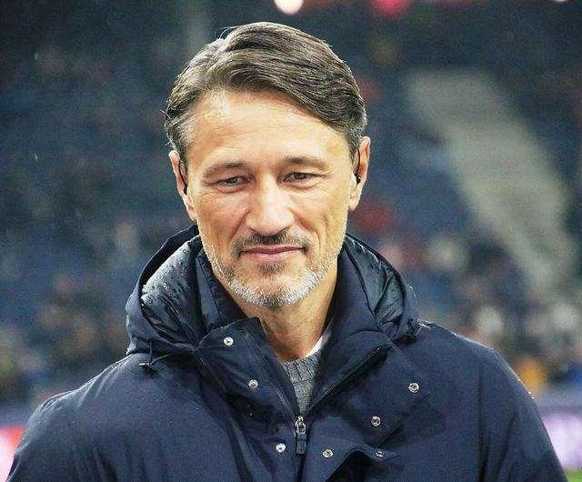

**1. 🟢 OK** · cover Caption: **Niko Kovač** 2024 · CC BY-SA 4.0 · [source](https://commons.wikimedia.org/wiki/File:FC_Salzburg_gegen_GNK_Dinamo_Zagreb_(2024-10-23_Championsleague_Dritte_Runde)_04.jpg) AI sees: _Niko Kovač_
 

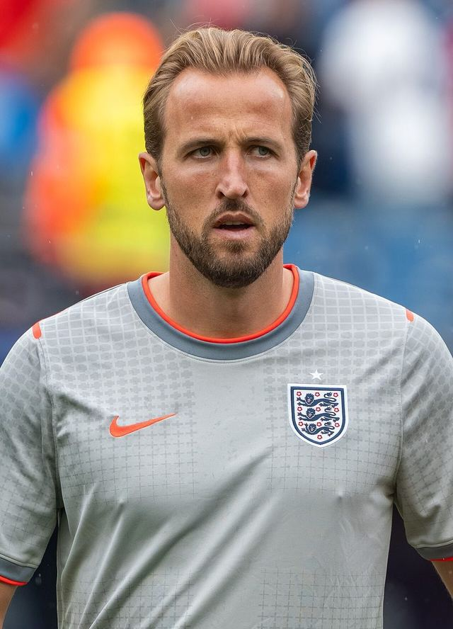

**2. 🟢 OK** Caption: **Harry Kane** 2026 · CC BY-SA 4.0 · [source](https://commons.wikimedia.org/wiki/File:Harry_Kane_England_v_Ghana_23_June_2026-024_(cropped).jpg) AI sees: _Harry Kane wearing an England football kit_
 

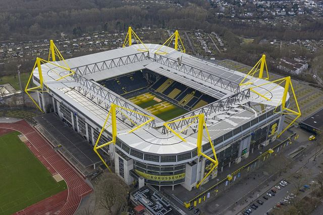

**3. 🟢 OK** Caption: **Westfalenstadion** 2019 · CC BY-SA 3.0 de · [source](https://commons.wikimedia.org/wiki/File:Signal_iduna_park_stadium_dortmund_4.jpg) AI sees: _Aerial view of Westfalenstadion (Signal Iduna Park) in Dortmund_
 

---

## ✅ live · Saudi Arabia Beat China 82-80 in FIBA World Cup Qualifiers for First Win in 33 Years
`2026-11-27-news-7bb2d2` · 2026-11-27

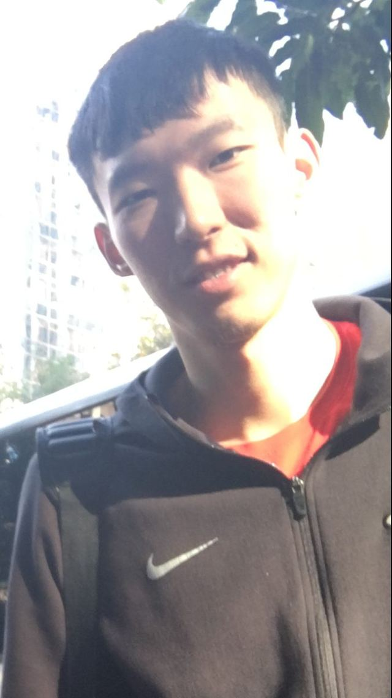

**1. 🟢 OK** · cover Caption: **Zhou Qi** 2017 · CC BY-SA 4.0 · [source](https://commons.wikimedia.org/wiki/File:ZhouQi2017.png) AI sees: _Chinese basketball player Zhou Qi_
 

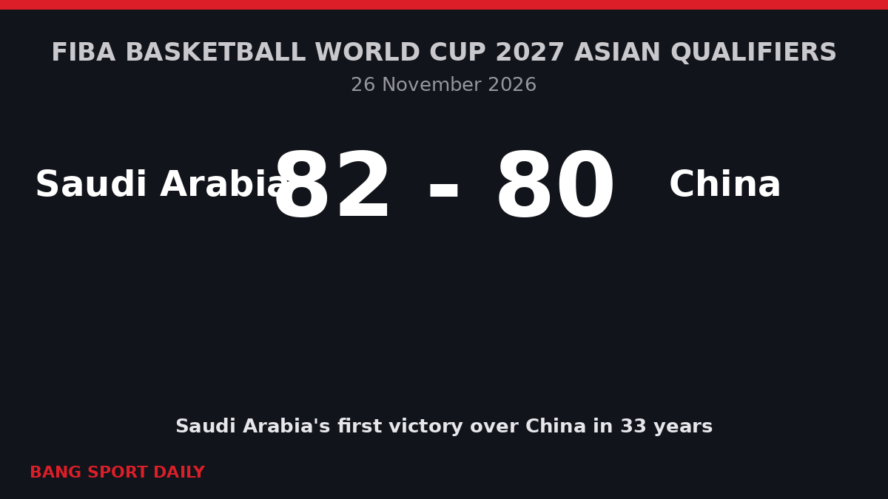

**2. 🟢 our score card** Caption: **Saudi Arabia 82 - 80 China · FIBA Basketball World Cup 2027 Asian Qualifiers** 2026 · Own work
 

---

## ✅ live · United States and West Indies Lined Up as Preferred Co-Hosts for 2034 Men's T20 World Cup
`2026-11-27-news-67c902` · 2026-11-27

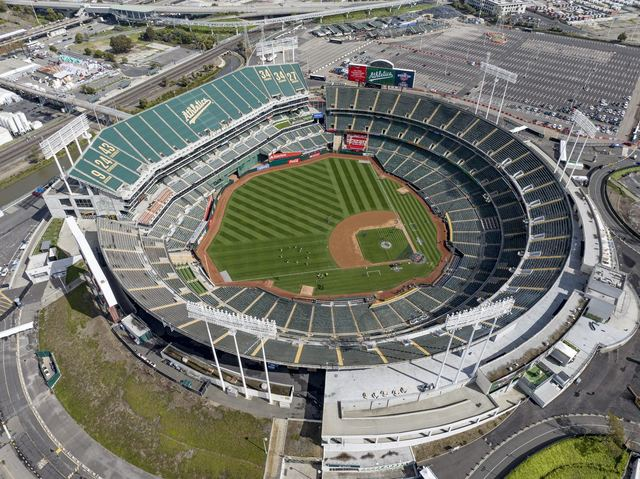

**1. 🟢 OK** · cover Caption: **The Oakland Coliseum, one of the venues discussed for the 2034 T20 World Cup** 2024 · CC BY 4.0 · [source](https://commons.wikimedia.org/wiki/File:Oakland_Coliseum_from_above_2024.png) AI sees: _Aerial view of Oakland Coliseum baseball stadium_
 

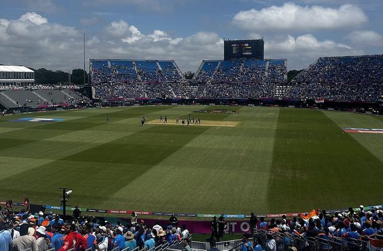

**2. 🟢 OK** Caption: **The temporary Nassau County stadium in New York, a venue at the 2024 T20 World Cup** 2024 · CC0 · [source](https://commons.wikimedia.org/wiki/File:%E0%A7%A8%E0%A7%A6%E0%A7%A8%E0%A7%AA_%E0%A6%9F%E0%A6%BF%E0%A7%A8%E0%A7%A6_%E0%A6%AC%E0%A6%BF%E0%A6%B6%E0%A7%8D%E0%A6%AC%E0%A6%95%E0%A6%BE%E0%A6%AA%E0%A7%87%E0%A6%B0_%E0%A6%B8%E0%A6%AE%E0%A6%AF%E0%A6%BC_%E0%A6%A8%E0%A6%BE%E0%A6%B8%E0%A6%BE%E0%A6%89_%E0%A6%95%E0%A6%BE%E0%A6%89%E0%A6%A8%E0%A7%8D%E0%A6%9F%E0%A6%BF_%E0%A6%86%E0%A6%A8%E0%A7%8D%E0%A6%A4%E0%A6%B0%E0%A7%8D%E0%A6%9C%E0%A6%BE%E0%A6%A4%E0%A6%BF%E0%A6%95_%E0%A6%95%E0%A7%8D%E0%A6%B0%E0%A6%BF%E0%A6%95%E0%A7%87%E0%A6%9F_%E0%A6%B8%E0%A7%8D%E0%A6%9F%E0%A7%87%E0%A6%A1%E0%A6%BF%E0%A6%AF%E0%A6%BC%E0%A6%BE%E0%A6%AE.jpg) AI sees: _A cricket match at Nassau County International Cricket Stadium during the 2024 T20 World Cup_
 

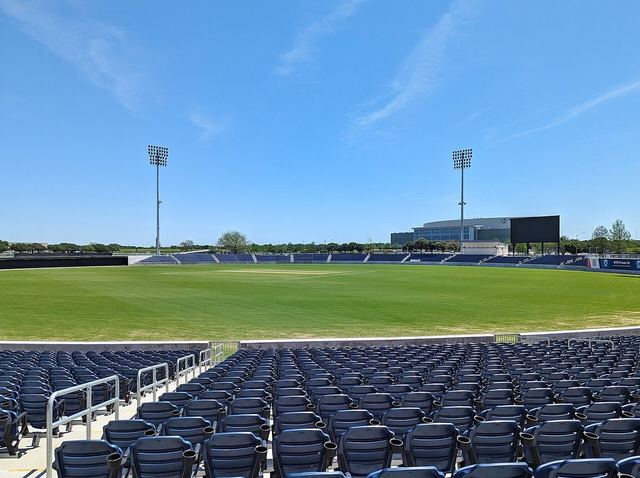

**3. 🟢 OK** Caption: **Grand Prairie Stadium** 2024 · CC BY-SA 4.0 · [source](https://commons.wikimedia.org/wiki/File:Grand_Prairie_Stadium_seating,_April_2024.jpg) AI sees: _Grand Prairie Stadium cricket ground and seating in Texas_
 

---

## ✅ live · Alexander Ovechkin: The Moscow Prodigy Who Broke Wayne Gretzky's NHL Record
`2026-11-27-athl-c4b783` · 2026-11-27

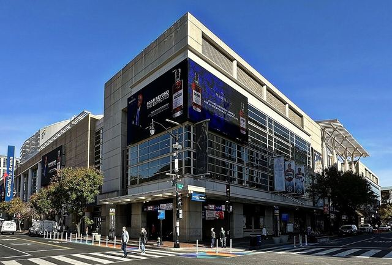

**1. 🟢 OK** · cover Caption: **Capital One Arena** 2023 · CC BY 4.0 · [source](https://commons.wikimedia.org/wiki/File:Capital_One_Arena_-_Washington,_D.C.jpg) AI sees: _Exterior of Capital One Arena in Washington, D.C._
 

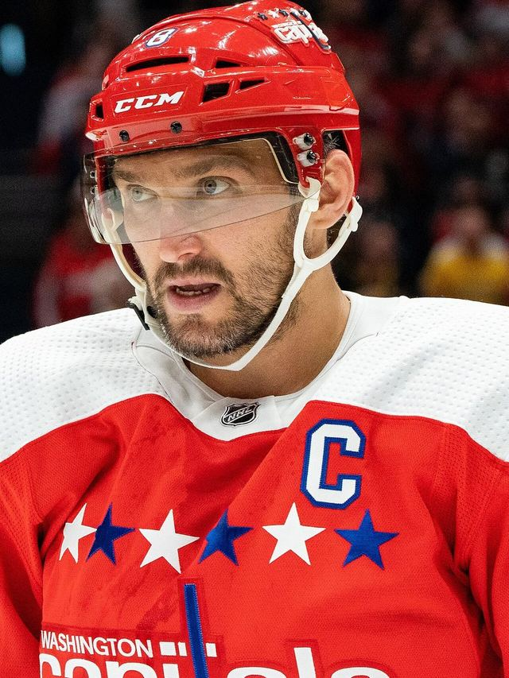

**2. 🟢 OK** Caption: **Alexander Ovechkin** 2020 · CC BY-SA 2.0 · [source](https://commons.wikimedia.org/wiki/File:Alexander_Ovechkin_(49479646361)_(1).jpg) AI sees: _Alexander Ovechkin wearing a Washington Capitals jersey and helmet_
 

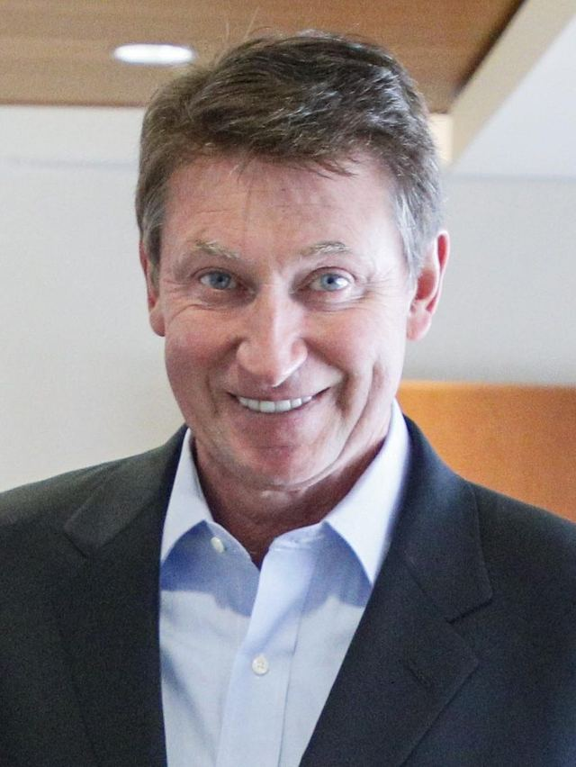

**3. 🟢 OK** Caption: **Wayne Gretzky** 2019 · CC0 · [source](https://commons.wikimedia.org/wiki/File:Andrew_Scheer_with_Wayne_Gretzky_(48055697168)_(cropped).jpg) AI sees: _Portrait of ice hockey legend Wayne Gretzky smiling in a suit_
 

---

## ✅ live · From a Paper Napkin to 47 Trophies: The Life and Legacy of Lionel Messi
`2026-11-27-athl-9e7b9b` · 2026-11-27

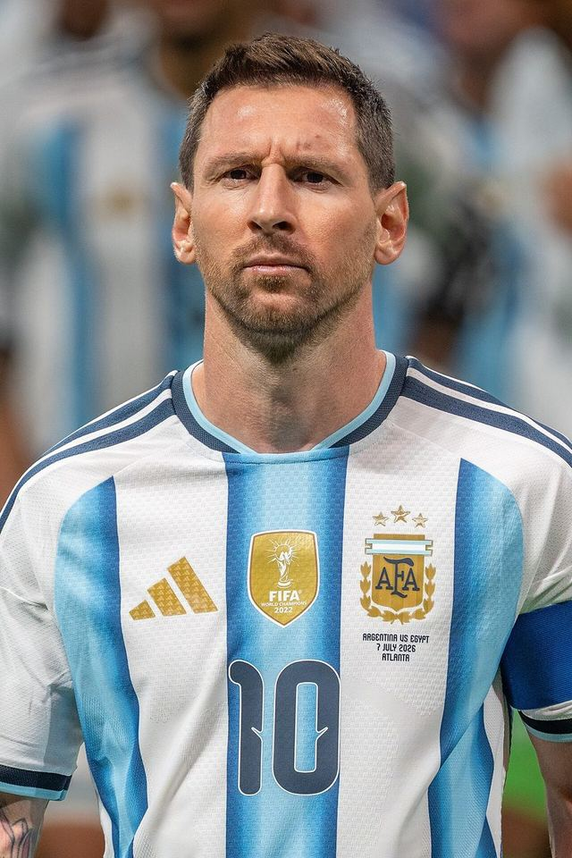

**1. 🟢 OK** · cover Caption: **Lionel Messi** 2026 · CC BY-SA 4.0 · [source](https://commons.wikimedia.org/wiki/File:Leo_Messi_Argentina_v_Egypt_7_July_2026-1.jpg) AI sees: _Lionel Messi in an Argentina national football team kit_
 

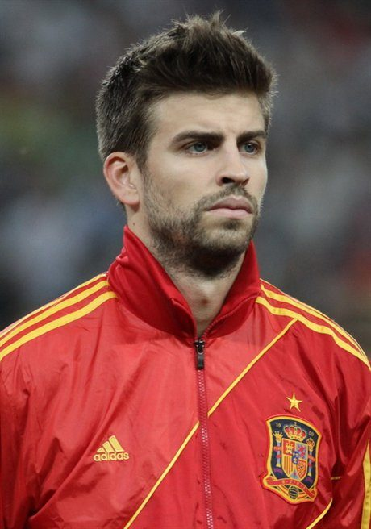

**2. 🟢 OK** Caption: **Gerard Piqué** 2012 · CC BY-SA 3.0 · [source](https://commons.wikimedia.org/wiki/File:Gerard_Piqu%C3%A9_Euro_2012_vs_France_01.jpg) AI sees: _Gerard Piqué in a Spain national team jacket_
 

---

## ✅ live · Jannik Sinner Withdrawn From 2027 Australian Open Following Right Knee Surgery
`2026-11-26-news-cfdcd3` · 2026-11-26

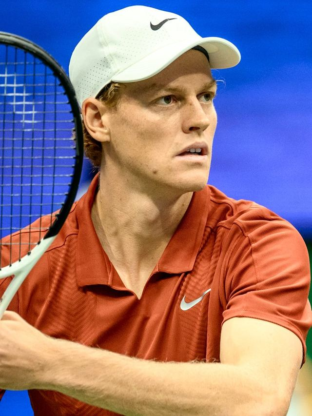

**1. 🟢 OK** · cover Caption: **Jannik Sinner** 2025 · Public domain · [source](https://commons.wikimedia.org/wiki/File:Jannik_Sinner_2025_US_Open.jpg) AI sees: _tennis player Jannik Sinner on court holding a racket_
 

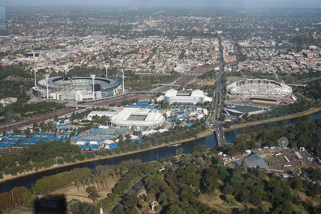

**2. 🟢 OK** Caption: **Melbourne Park** 2010 · CC BY-SA 2.0 · [source](https://commons.wikimedia.org/wiki/File:Melbourne_Park_-_Tennis.jpg) AI sees: _aerial view of Melbourne Park and surrounding sports precinct_
 

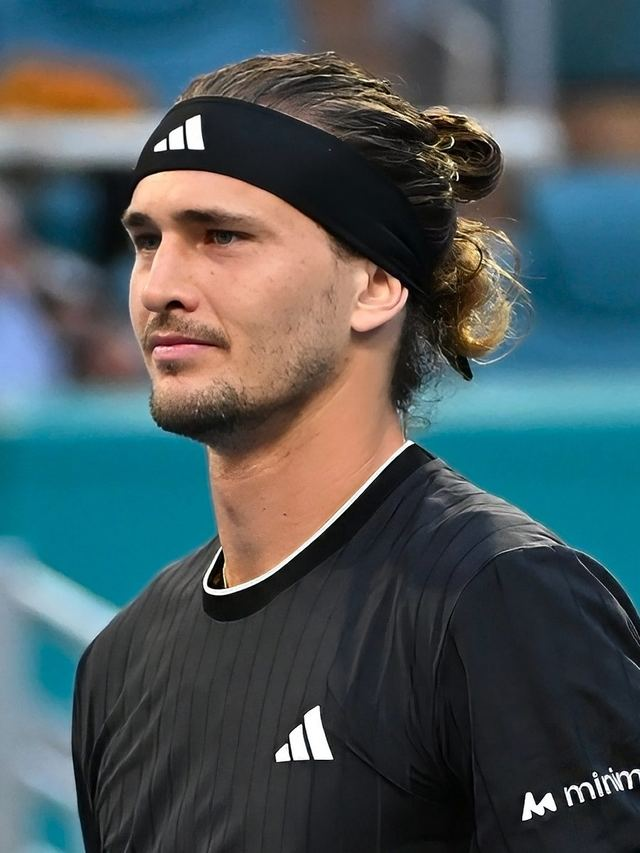

**3. 🟢 OK** Caption: **Alexander Zverev** 2026 · CC BY-SA 4.0 · [source](https://commons.wikimedia.org/wiki/File:Alexander_Zverev_in_Miami.jpg) AI sees: _Alexander Zverev wearing a black Adidas headband and shirt_
 

---

## ✅ live · Daniel Dubois to Defend WBO Heavyweight Title Against Joseph Parker in Manchester
`2026-11-26-news-90b9af` · 2026-11-26

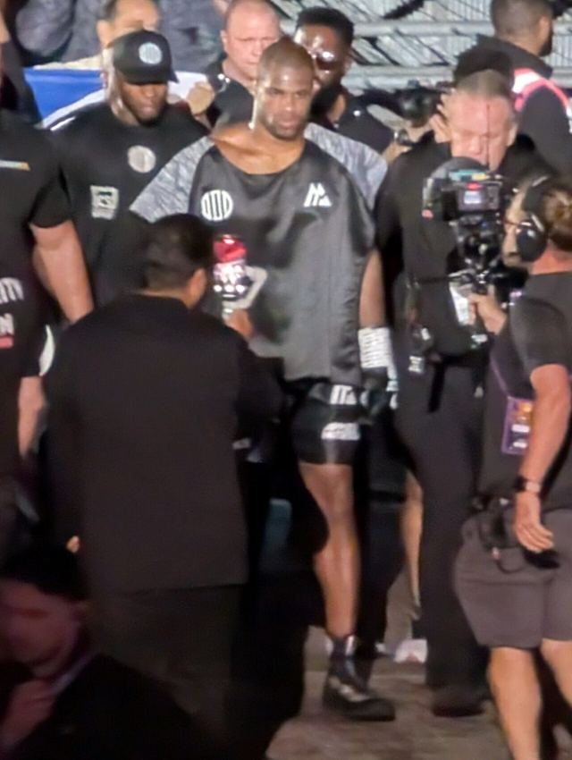

**1. 🟢 OK** · cover Caption: **Daniel Dubois** 2025 · CC BY 4.0 · [source](https://commons.wikimedia.org/wiki/File:Daniel_Dubois_walkout_(cropped).jpg) AI sees: _Daniel Dubois making a ring walk surrounded by his team_
 

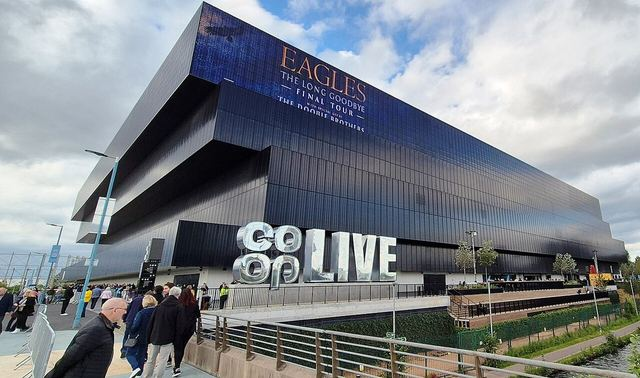

**2. 🟢 OK** Caption: **Co-op Live** 2024 · CC BY-SA 2.0 · [source](https://commons.wikimedia.org/wiki/File:The_Co-Op_Live_Arena_(geograph_7796386).jpg) AI sees: _Exterior of the Co-op Live arena in Manchester_
 

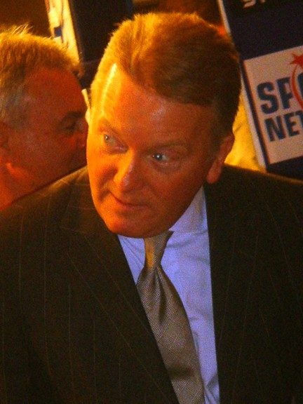

**3. 🟢 OK** Caption: **Frank Warren (promoter)** 2010 · CC BY 3.0 · [source](https://commons.wikimedia.org/wiki/File:Frank_Warren.jpg) AI sees: _boxing promoter Frank Warren in a suit and tie_
 

---

## ✅ live · Bennie Boatwright Debuts as Kai Sotto Boosts Gilas Pilipinas for FIBA Window 5
`2026-11-26-news-6daa79` · 2026-11-26

**1. 🟢 OK** · cover Caption: **Bennie Boatwright** 2026 · CC BY 4.0 · [source](https://commons.wikimedia.org/wiki/File:Bennie_Boatwright_2026.jpg) AI sees: _Bennie Boatwright in San Miguel Beermen uniform_
 

**2. 🟢 OK** Caption: **Kai Sotto** 2024 · CC0 · [source](https://commons.wikimedia.org/wiki/File:Kai_sotto_yokohama_b_corsairs_b_league.jpg) AI sees: _Kai Sotto playing for Yokohama B-Corsairs_
 

**3. 🟢 OK** Caption: **Tim Cone** 2018 · Public domain · [source](https://commons.wikimedia.org/wiki/File:Barangay_Ginebra_PBA_champions_victory_party_Tim_Cone(cropped).jpg) AI sees: _Basketball coach Tim Cone speaking into a microphone_
 

---

## ✅ live · David Beckham Surprises 39 Youth Players at Singapore Football Clinic
`2026-11-26-news-494315` · 2026-11-26

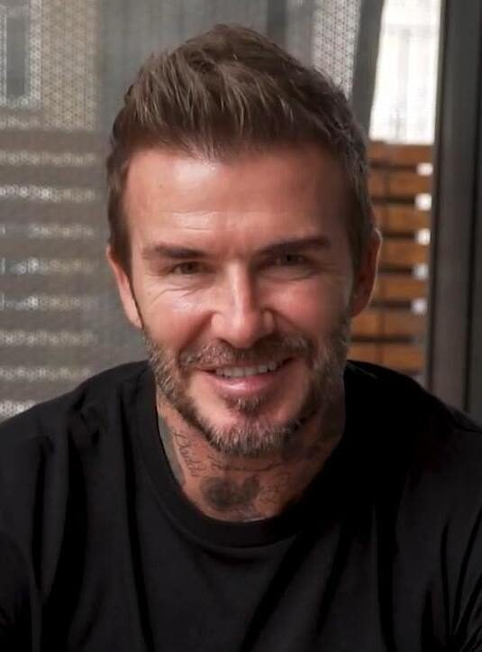

**1. ⚪ not checked** · cover Caption: **David Beckham** 2021 · CC BY 3.0 · [source](https://commons.wikimedia.org/wiki/File:David_Beckham_UNICEF_(cropped2).jpg)
 

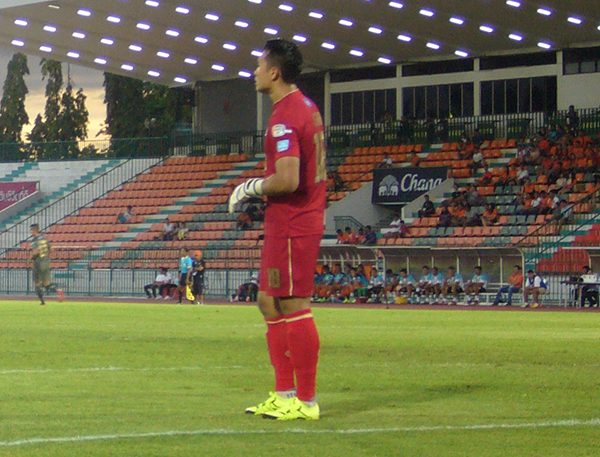

**2. ⚪ not checked** Caption: **Singapore goalkeeper Hassan Sunny** 2015 · CC BY 3.0 · [source](https://commons.wikimedia.org/wiki/File:HassanSunny.jpg)
 

🔗 Embedded post: [CNA (official Facebook page)](https://www.facebook.com/reel/1982174182757033/) — {'en': "CNA video: David Beckham's surprise visit to Bedok South Secondary School", 'zh': 'CNA视频：贝克汉姆突访勿洛南中学', 'ru': 'Видео CNA: неожиданный визит Дэвида Бекхэма в школу Бедок-Саут'}

---

## ✅ live · Oliver Bearman Signs Haas Contract Extension for 2027 Season
`2026-11-26-news-0b230b` · 2026-11-26

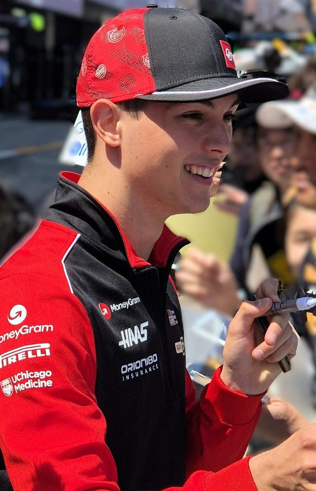

**1. 🟢 OK** · cover Caption: **Oliver Bearman** 2025 · CC BY-SA 4.0 · [source](https://commons.wikimedia.org/wiki/File:2025_Japan_GP_-_Haas_-_Oliver_Bearman_-_Thursday_(cropped).jpg) AI sees: _Oliver Bearman in Haas team kit signing autographs_
 

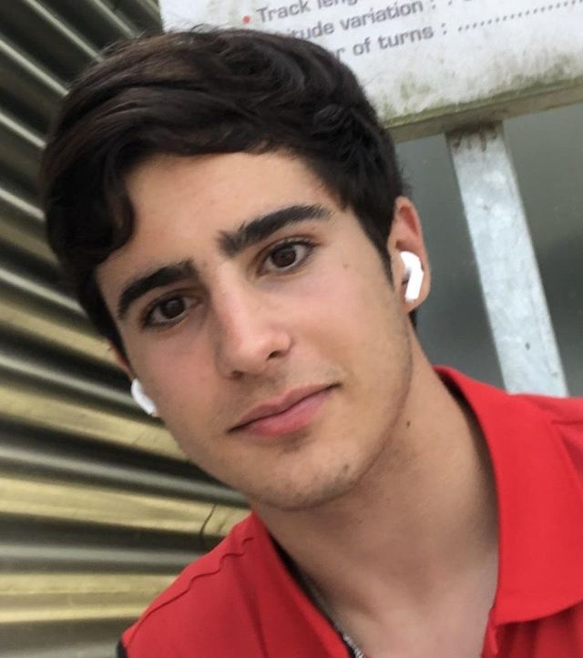

**2. 🟢 OK** Caption: **Rafael Câmara** 2022 · CC BY-SA 4.0 · [source](https://commons.wikimedia.org/wiki/File:Rafael_C%C3%A2mara_in_2022.jpg) AI sees: _portrait of racing driver Rafael Câmara near a track sign_
 

---

## ✅ live · On This Day in 1917: How an Owner Feud Birthed the National Hockey League
`2026-11-26-hist-9bf47d` · 2026-11-26

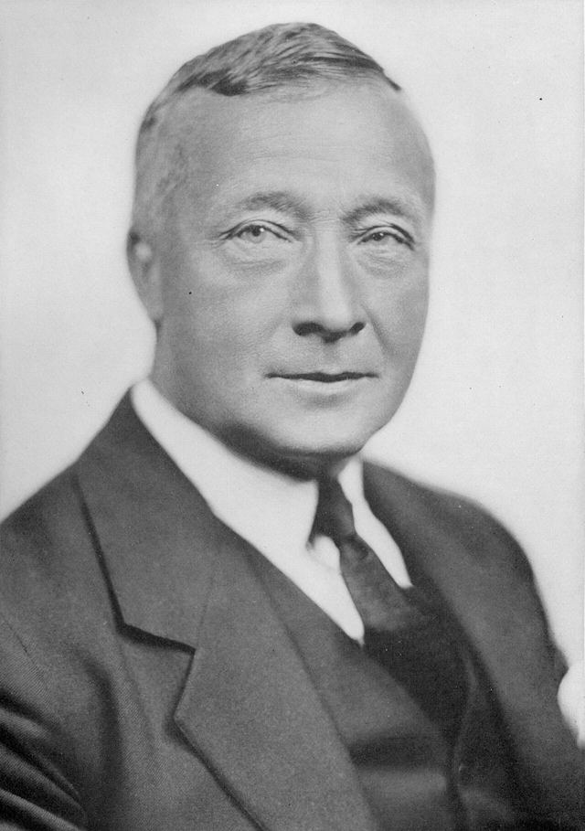

**1. 🟢 OK** · cover Caption: **Frank Calder** 2010 · Public domain · [source](https://commons.wikimedia.org/wiki/File:Frank_Calder.jpg) AI sees: _portrait of Frank Calder, first NHL president_
 

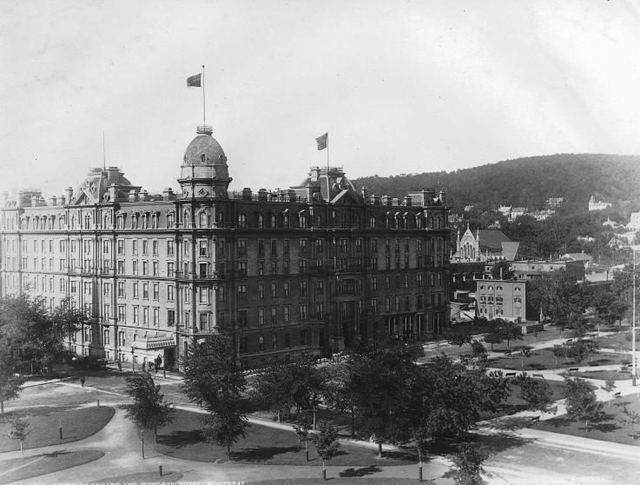

**2. 🟢 OK** Caption: **Windsor Hotel (Montreal)** Asked for: The Windsor Hotel (Montreal) → got page: Windsor Hotel (Montreal) 2008 · Public domain · [source](https://commons.wikimedia.org/wiki/File:Dominion_Square_and_Windsor_Hotel,_Montreal,_QC,_about_1890.jpg) AI sees: _Windsor Hotel and Dominion Square in Montreal_
 

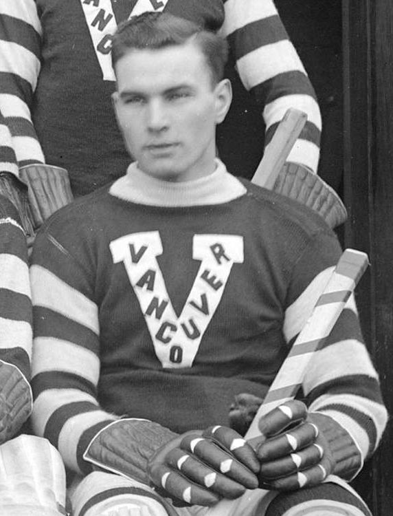

**3. 🟢 OK** Caption: **Frank Nighbor** 2018 · Public domain · [source](https://commons.wikimedia.org/wiki/File:Frank_Nighbor,_Vancouver_Millionaires.jpg) AI sees: _Frank Nighbor in a Vancouver Millionaires hockey jersey_
 

---

## ✅ live · Lehecka and Machac Sweep Canada to Send Czechia Into Davis Cup Semi-Finals
`2026-11-25-news-f7a857` · 2026-11-25

**1. 🟢 OK** · cover Caption: **Jiří Lehečka** 2023 · CC BY-SA 2.0 · [source](https://commons.wikimedia.org/wiki/File:Lehecka_MCM23_(5)_(52883527310).jpg) AI sees: _Jiří Lehečka playing tennis_
 

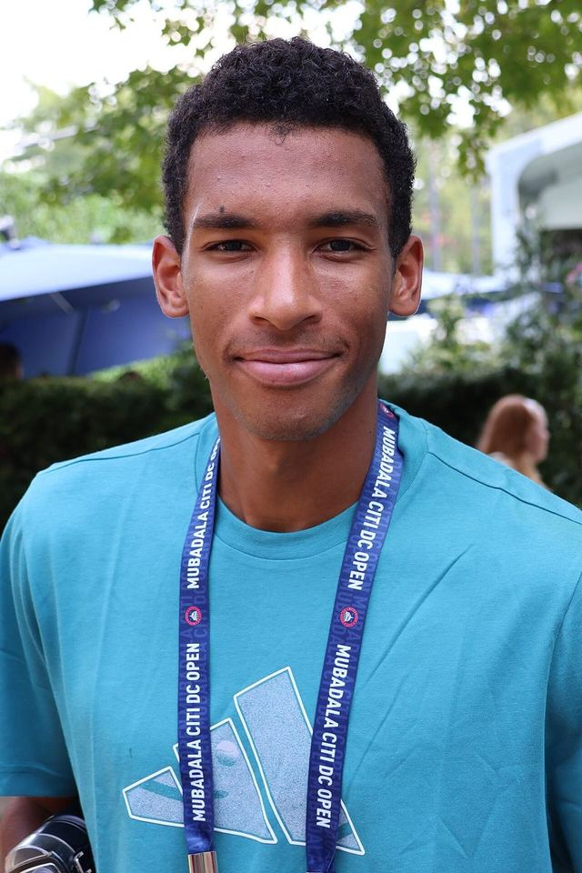

**2. 🟢 OK** Caption: **Félix Auger-Aliassime** 2023 · CC BY-SA 4.0 · [source](https://commons.wikimedia.org/wiki/File:F%C3%A9lix_Auger-Aliassime_(2023_DC_Open)_01_(cropped).jpg) AI sees: _portrait of tennis player Félix Auger-Aliassime_
 

**3. 🟢 OK** Caption: **Tomáš Macháč** 2023 · CC BY-SA 4.0 · [source](https://commons.wikimedia.org/wiki/File:Tom%C3%A1%C5%A1_Mach%C3%A1%C4%8D_(2023_US_Open)_06.jpg) AI sees: _Czech tennis player Tomáš Macháč smiling after a match_
 

---

## ✅ live · Arthur Rinderknech Denies ITIA Anti-Doping Charge Over Alleged Test Refusal
`2026-11-25-news-e226ae` · 2026-11-25

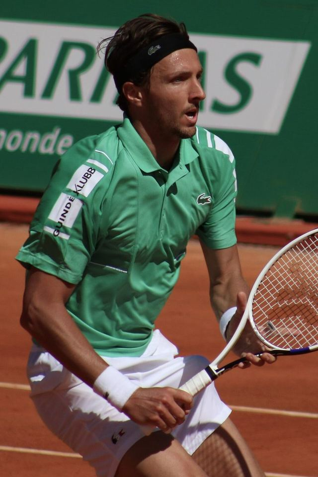

**1. 🟢 OK** · cover Caption: **Arthur Rinderknech** 2022 · CC BY-SA 2.0 · [source](https://commons.wikimedia.org/wiki/File:Rinderknech_MCM22_(16)_(52036912945).jpg) AI sees: _Arthur Rinderknech playing tennis on a clay court_
 

**2. 🟢 OK** Caption: **Markéta Vondroušová** 2023 · CC BY-SA 4.0 · [source](https://commons.wikimedia.org/wiki/File:Mark%C3%A9ta_Vondrou%C5%A1ov%C3%A1_(2023_US_Open)_14.jpg) AI sees: _Markéta Vondroušová on a tennis court_
 

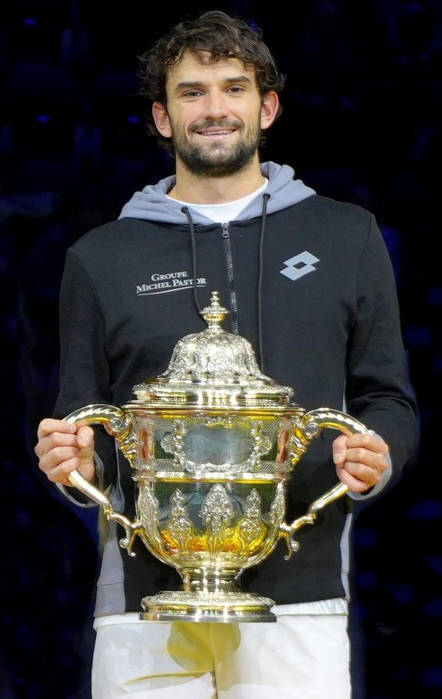

**3. 🟢 OK** Caption: **Valentin Vacherot** 2026 · CC BY-SA 4.0 · [source](https://commons.wikimedia.org/wiki/File:Valentin_Vacherot_Swiss_Indoors_2026_(cropped).jpg) AI sees: _tennis player Valentin Vacherot holding a trophy_
 

---

## ✅ live · Kamila Valieva Ruled Out of Russian Figure Skating Championships in Chelyabinsk
`2026-11-25-news-d8cd04` · 2026-11-25

**1. 🟢 OK** · cover Caption: **Kamila Valieva** 2023 · CC BY 4.0 · [source](https://commons.wikimedia.org/wiki/File:Kamila_Valieva_-_2023_Russian_GP_Stage_4_-_06_(cropped).jpg) AI sees: _Kamila Valieva figure skating in a red dress on ice_
 

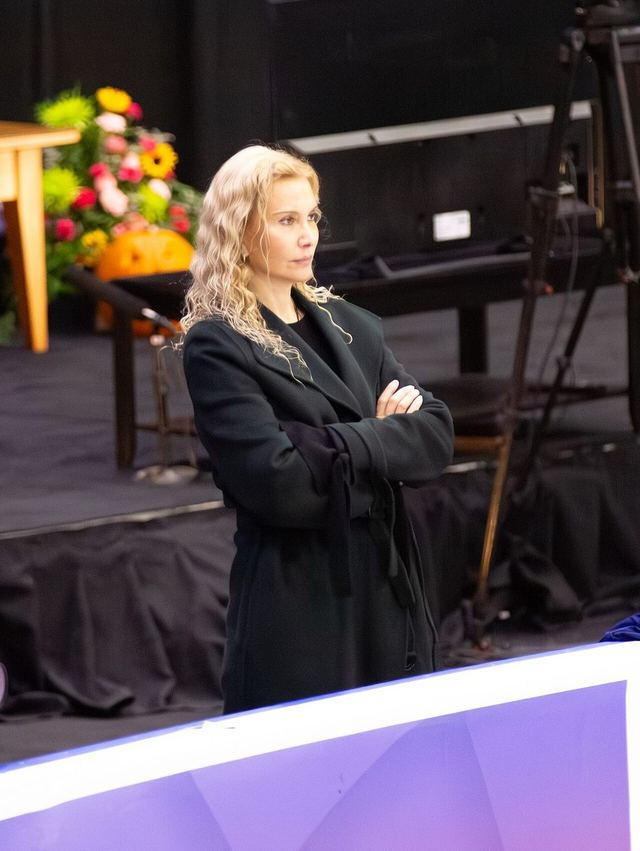

**2. 🟢 OK** Caption: **Eteri Tutberidze** 2025 · CC BY 4.0 · [source](https://commons.wikimedia.org/wiki/File:Eteri_Tutberidze_at_2025_Skate_Canada_International.jpg) AI sees: _figure skating coach Eteri Tutberidze standing by the rink boards_
 

**3. 🟢 OK** Caption: **Chelyabinsk** 2018 · CC BY-SA 4.0 · [source](https://commons.wikimedia.org/wiki/File:Saint_Alexander_Nevsky_Church_(Chelyabinsk).jpg) AI sees: _Saint Alexander Nevsky Church in Chelyabinsk_
 

---

## ✅ live · Jayson Tatum Pours in 41 Points as Celtics Hold Off Wizards 131-116 to Snap Four-Game Skid
`2026-11-25-news-c4f690` · 2026-11-25

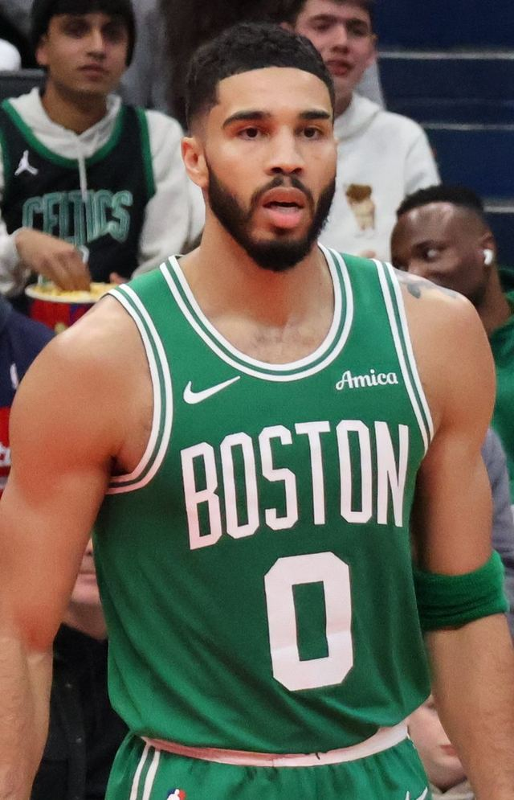

**1. 🟢 OK** · cover Caption: **Jayson Tatum** 2024 · CC BY-SA 4.0 · [source](https://commons.wikimedia.org/wiki/File:Celtics_at_Wizards_2024-12-044_(cropped_2).jpg) AI sees: _Boston Celtics player Jayson Tatum wearing jersey number 0_
 

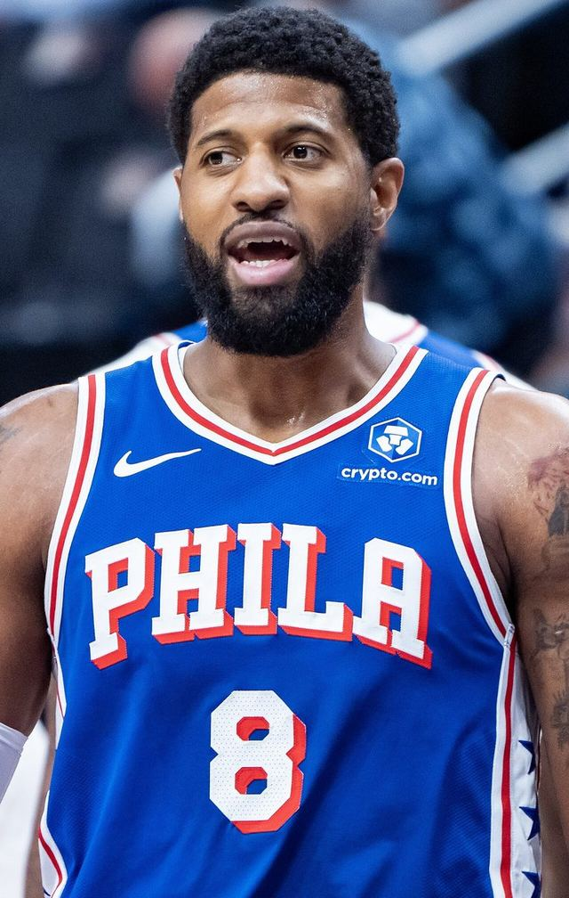

**2. 🟢 OK** Caption: **Paul George** 2026 · CC BY-SA 4.0 · [source](https://commons.wikimedia.org/wiki/File:1_paul_george_2026_(cropped)_(cropped).jpg) AI sees: _Paul George in a Philadelphia 76ers jersey_
 

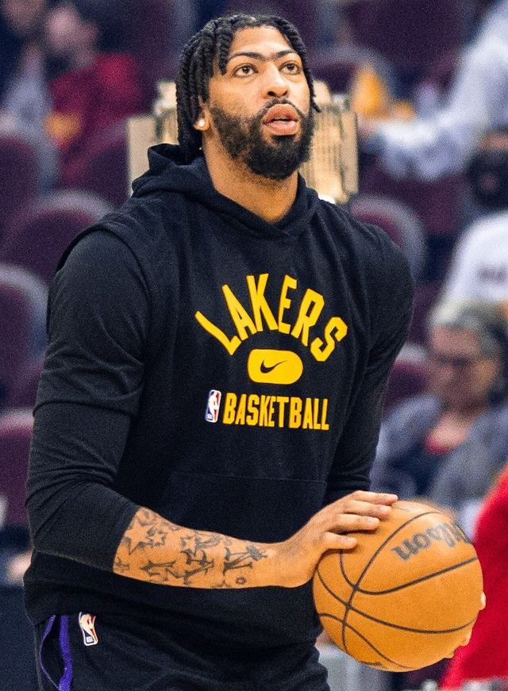

**3. 🟢 OK** Caption: **Anthony Davis** 2022 · CC BY 2.0 · [source](https://commons.wikimedia.org/wiki/File:Anthony_Davis_pre-game_(cropped).jpg) AI sees: _Anthony Davis in a Lakers hoodie holding a basketball_
 

**4. 🟢 our score card** Caption: **Washington Wizards 116 - 131 Boston Celtics · NBA Cup** 2026 · Own work
 

---

## ✅ live · Bojan Hodak Appointed Malaysia Head Coach as Harimau Malaya Reorganise
`2026-11-25-news-b8d792` · 2026-11-25

**1. 🟢 OK** · cover Caption: **Bojan Hodak** 2014 · CC BY 3.0 · [source](https://commons.wikimedia.org/wiki/File:BojanHodak2014.jpg) AI sees: _Bojan Hodak speaking at a football press conference_
 

**2. 🟢 OK** Caption: **Tan Cheng Hoe** 2014 · CC BY 4.0 · [source](https://commons.wikimedia.org/wiki/File:Tan_Cheng_Hoe_2014.png) AI sees: _Tan Cheng Hoe wearing a Kedah football team polo shirt_
 

---

## ✅ live · Former Singapore Captain Rosnani Azman Retires from International Football
`2026-11-25-news-4afcf1` · 2026-11-25

**1. ⚪ not checked** · cover Caption: **Rosnani Azman retires from international football: 58 caps, captain from 2023** 2026 · Own work
 

🔗 Embedded post: [Football Association of Singapore (official Instagram)](https://www.instagram.com/p/DgKX2DyGaqc/) — {'en': "FAS announces Rosnani Azman's retirement from international football", 'zh': '新加坡足球总会宣布罗斯娜妮退出国家队', 'ru': 'Футбольная ассоциация Сингапура объявляет о завершении международной карьеры Роснани Азман'}

---

## ✅ live · Joseph Schooling's Journey: From Childhood Dream to Singapore's First Olympic Gold
`2026-11-25-athl-f4dbe9` · 2026-11-25

**1. 🟢 OK** · cover Caption: **Joseph Schooling** 2015 · CC BY-SA 4.0 · [source](https://commons.wikimedia.org/wiki/File:Joseph_Schooling_Kazan_2015.jpg) AI sees: _Joseph Schooling on the podium holding his medal at a swimming competition_
 

**2. 🟢 OK** Caption: **Michael Phelps** 2016 · CC BY 2.0 · [source](https://commons.wikimedia.org/wiki/File:Michael_Phelps_Rio_Olympics_2016.jpg) AI sees: _Michael Phelps smiling during an interview or event_
 

**3. 🟢 OK** Caption: **The Bolles School** Asked for: Bolles School → got page: The Bolles School 2011 · CC BY-SA 3.0 · [source](https://commons.wikimedia.org/wiki/File:Jax_FL_7356_San_Jose_Blvd_House_Bolles_School_stone01.jpg) AI sees: _A stone crest of The Bolles School mounted on a stucco wall_
 

---

## ✅ live · From a Sweet Factory Court to Badminton History: The Life of Ratchanok Intanon
`2026-11-25-athl-a5a295` · 2026-11-25

**1. 🟢 OK** · cover Caption: **Ratchanok Intanon** 2025 · CC BY 3.0 · [source](https://commons.wikimedia.org/wiki/File:Ratchanok_Intanon_Indonesia_Masters_2025.jpg) AI sees: _Ratchanok Intanon holding a badminton tournament gold medal_
 

**2. 🟢 OK** Caption: **Li Xuerui** 2012 · CC BY-SA 3.0 · [source](https://commons.wikimedia.org/wiki/File:Li_Xuerui_2012_(portrait).jpg) AI sees: _Chinese badminton player Li Xuerui at London 2012_
 

**3. 🟢 OK** Caption: **Tai Tzu-ying** 2024 · CC BY 2.0 · [source](https://commons.wikimedia.org/wiki/File:Tai_Tzu-ying_in_2024.jpg) AI sees: _Badminton player Tai Tzu-ying holding a framed certificate_
 

---

## ✅ live · From Heartbreak in London to History in Rio: The Life of Hoang Xuan Vinh
`2026-11-25-athl-9fb3af` · 2026-11-25

**1. 🟢 OK** · cover Caption: **Hoàng Xuân Vinh** 2016 · CC BY 3.0 br · [source](https://commons.wikimedia.org/wiki/File:Hoang_Xuan_Vinh.jpg) AI sees: _Hoàng Xuân Vinh holding his Rio 2016 Olympic gold medal_
 

**2. 🟢 OK** Caption: **Shooting at the 2016 Summer Olympics – Men's 10 metre air pistol** 2016 · CC BY 3.0 br · [source](https://commons.wikimedia.org/wiki/File:Rio2016_julho_ZonaB_Deodoro_004_8180_-c-2016_GabrielHeusi_HeusiAction.jpg) AI sees: _Aerial view of the National Shooting Center in Deodoro, Rio de Janeiro_
 

---

## ✅ live · Chan Vathanaka: The Kampot Prodigy Who Put Cambodian Football on the Regional Map
`2026-11-25-athl-077aa4` · 2026-11-25

**1. 🟢 OK** · cover Caption: **Chan Vathanaka** 2013 · CC BY-SA 3.0 · [source](https://commons.wikimedia.org/wiki/File:Chan_vathanaka_2013-11-04_11-18.jpg) AI sees: _Chan Vathanaka holding a Golden Boot trophy on a football pitch_
 

**2. 🟢 OK** Caption: **Olympic Stadium (Phnom Penh)** Asked for: Phnom Penh Olympic Stadium → got page: Olympic Stadium (Phnom Penh) 2023 · CC BY 3.0 · [source](https://commons.wikimedia.org/wiki/File:Olympic_Stadium_Phnom_Penh_SG2023.png) AI sees: _Olympic Stadium in Phnom Penh during the 2023 SEA Games final_
 

🔗 Embedded post: [Cambodian Premier League (@the_official_cpl)](https://www.instagram.com/p/DdeH7JXgVxy/) — {'en': 'Chan Vathanaka in an official Cambodian Premier League post', 'zh': '柬埔寨超级联赛官方帖子中的占·瓦塔纳卡', 'ru': 'Чан Ватанака в официальной публикации Камбоджийской Премьер-лиги'}

🔗 Embedded post: [Boeung Ket Football Club (official Facebook page)](https://www.facebook.com/reel/1012398621820953/) — {'en': 'Boeung Ket welcome Chan Vathanaka back to the pitch (19 September 2026)', 'zh': '万吉俱乐部欢迎占·瓦塔纳卡重返赛场（2026年9月19日）', 'ru': '«Боэнг Кет» приветствует возвращение Чан Ватанаки на поле (19 сентября 2026 года)'}

---

