# Photo review — 2026-11-21

Drafts and stories published in the last 3 days. **🔴 wrong: 0 · 🟠 to look at: 0**

How to use (about a minute): look at each picture next to its caption. 🔴 photos block publishing. To remove or replace a photo, add the story ID to `photos.yaml` (examples at the top of that file), or tell Claude the story ID and which photo is wrong. Official Instagram/Facebook posts can be added with `embed:` lines in `photos.yaml`.

## ✅ live · Kevin Vallejos Targets Title Shot Ahead of Aljamain Sterling Clash at UFC Qatar
`2026-11-21-news-d01c57` · 2026-11-21

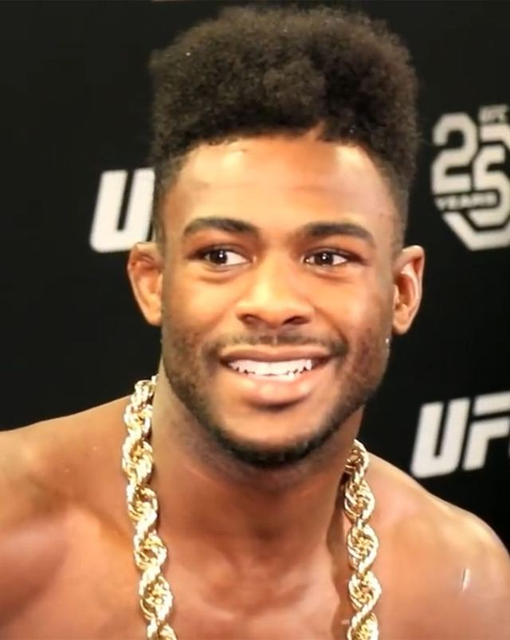

**1. 🟢 OK** · cover Caption: **Aljamain Sterling** 2018 · CC BY 3.0 · [source](https://commons.wikimedia.org/wiki/File:Alijamain_Sterling_at_UFC_228.jpg) AI sees: _UFC fighter Aljamain Sterling_
 

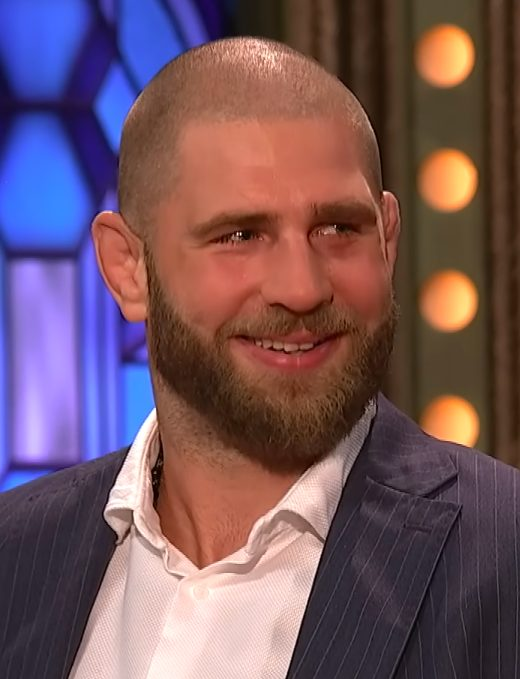

**2. 🟢 OK** Caption: **Jiří Procházka** 2022 · CC BY 3.0 · [source](https://commons.wikimedia.org/wiki/File:JiriProchazka2022.png) AI sees: _Czech mixed martial artist Jiří Procházka during an interview_
 

---

## ✅ live · Jiří Procházka and Navajo Stirling Make Weight Ahead of UFC Qatar Main Event
`2026-11-21-news-14e91f` · 2026-11-21

**1. 🟢 OK** · cover Caption: **Jiří Procházka** 2022 · CC BY 3.0 · [source](https://commons.wikimedia.org/wiki/File:JiriProchazka2022.png)
 

---

## ✅ live · Vietnam Push Belgium to the Brink in Spirited 3-2 U-17 World Cup Debut
`2026-11-21-news-10e4ee` · 2026-11-21

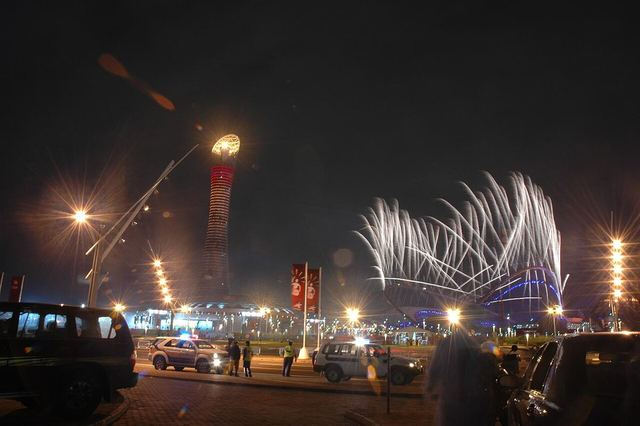

**1. 🟢 OK** · cover Caption: **Aspire Zone** 2006 · CC BY-SA 2.0 · [source](https://commons.wikimedia.org/wiki/File:Asian_Games_Doha_2006_fireworks.jpg) AI sees: _Aspire Tower and Khalifa International Stadium in Aspire Zone at night with fireworks_ ⚑ file looks like a non-sport scene (Fireworks)
 

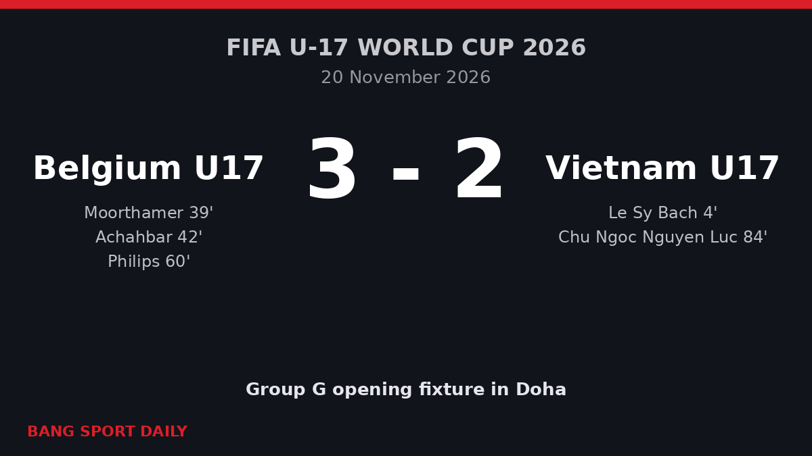

**2. 🟢 our score card** Caption: **Belgium U17 3 - 2 Vietnam U17 · FIFA U-17 World Cup 2026** 2026 · Own work
 

🔗 Embedded post: [Mohamed Farag - FIFA/FIFA via Getty Images](https://www.gettyimages.com/detail/2306053490) — {'en': "Vietnam's players line up for the team photo before their U-17 World Cup opener against Belgium at the Aspire Zone", 'zh': '越南队球员在精英学院与比利时队的U-17世界杯首战开赛前合影', 'ru': 'Игроки сборной Вьетнама фотографируются перед стартовым матчем юношеского ЧМ против Бельгии на арене Aspire Zone'}

---

## ✅ live · The Boy from Madeira Who Rewrote Football: The Life and Legacy of Cristiano Ronaldo
`2026-11-21-athl-6d2c08` · 2026-11-21

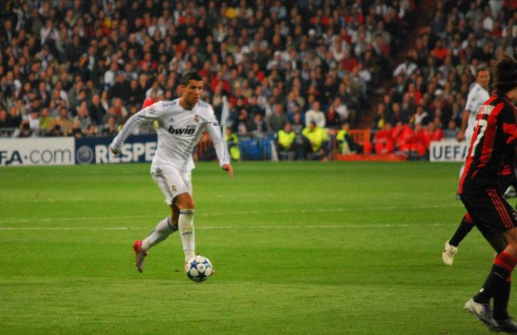

**1. 🟢 OK** · cover Caption: **"Cristiano Ronaldo"** 2010 · CC BY-SA 2.0 · [source](https://commons.wikimedia.org/wiki/File:%22Cristiano_Ronaldo%22_(5098214382).jpg) AI sees: _Cristiano Ronaldo playing for Real Madrid in a Champions League football match_
 

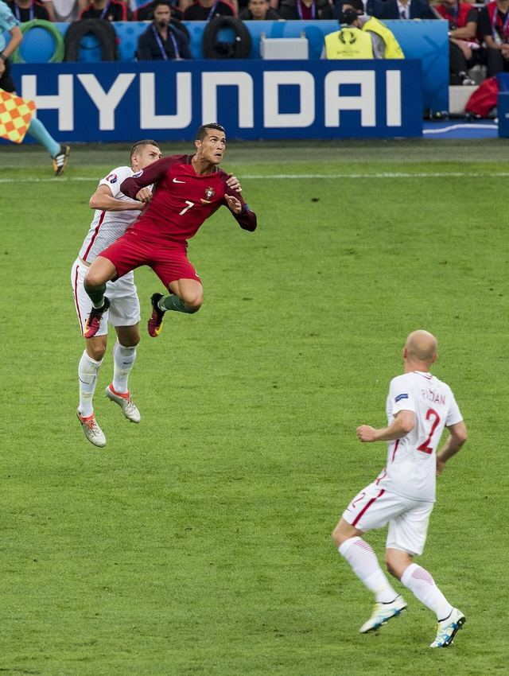

**2. 🟢 OK** Caption: **Cristiano Ronaldo playing for Portugal in the quarterfinal game against Poland at the UEFA Euro 2016** 2016 · CC BY-SA 4.0 · [source](https://commons.wikimedia.org/wiki/File:1_cristiano_ronaldo_2016.jpg) AI sees: _Cristiano Ronaldo jumping during Portugal vs Poland at UEFA Euro 2016_
 

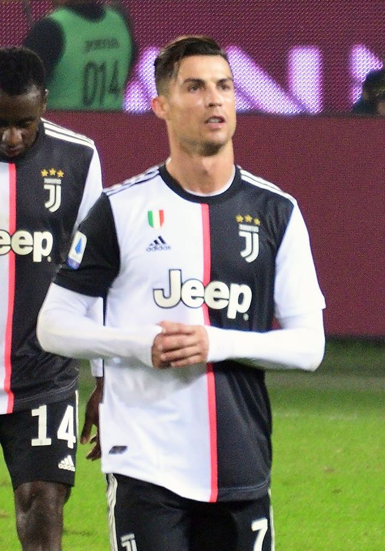

**3. 🟢 OK** Caption: **Turin (Italy), Olympic "Grande Torino" Stadium, November 2, 2019. Juventus' forward Cristiano Ronaldo leave the pitch at the end of the victorius Turin derby between Torino FC and Juventus FC (0-1), M** 2019 · CC BY-SA 4.0 · [source](https://commons.wikimedia.org/wiki/File:2019-20_Serie_A_-_Torino_v_Juventus_-_Cristiano_Ronaldo_(cropped).jpg) AI sees: _Cristiano Ronaldo playing for Juventus in 2019_
 

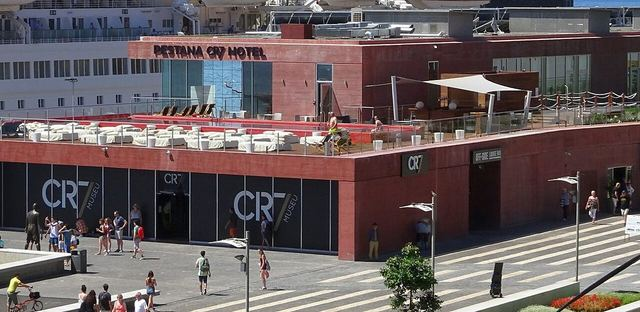

**4. 🟢 OK** Caption: **CR7 museum and hotel in Funchal, Madeira** 2016 · CC BY-SA 3.0 · [source](https://commons.wikimedia.org/wiki/File:CR7_museum_and_hotel_in_Funchal,_Madeira.JPG) AI sees: _The Pestana CR7 Hotel and CR7 Museu in Funchal, Madeira_
 

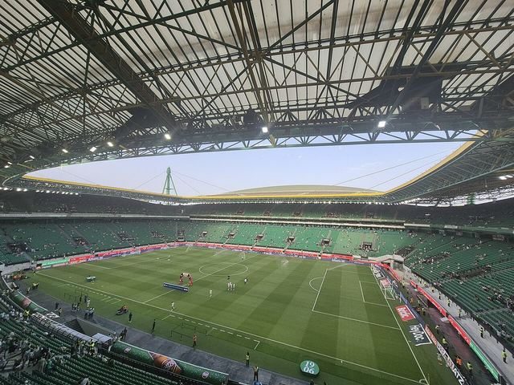

**5. 🟢 OK** Caption: **Estádio José Alvalade in Lisbon, home of Sporting CP, where Ronaldo turned professional** 2025 · CC BY 4.0 · [source](https://commons.wikimedia.org/wiki/File:Est%C3%A1dio_Jos%C3%A9_Alvalade_antes_do_jogo_Sporting_-_Arouca.jpg) AI sees: _interior of Estádio José Alvalade with green seats and pitch_
 

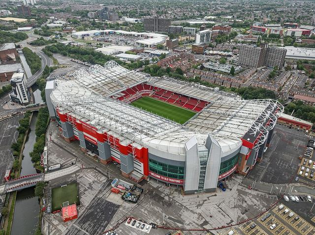

**6. 🟢 OK** Caption: **Old Trafford, Manchester United's home, where Ronaldo won his first Ballon d'Or** 2023 · CC BY-SA 2.0 · [source](https://commons.wikimedia.org/wiki/File:2023_07_31_arne_mueseler_00060-Verbessert-RR_(53106651455).jpg) AI sees: _Aerial view of Old Trafford football stadium_
 

---

## ✅ live · Khabib Nurmagomedov's Path From the Dagestan Mountains to 29-0 MMA Perfection
`2026-11-21-athl-4ed038` · 2026-11-21

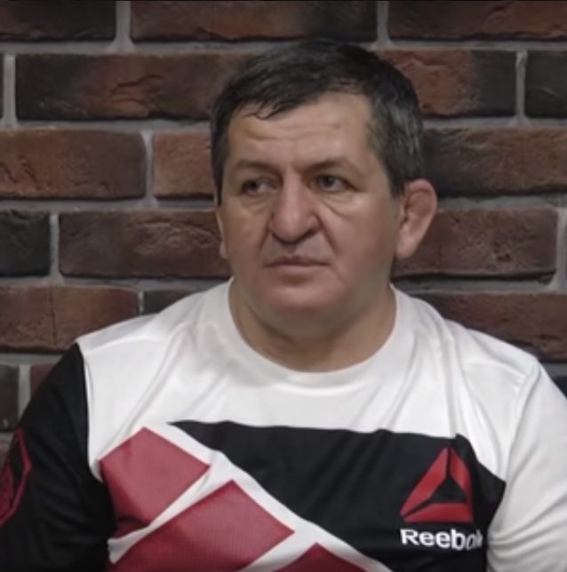

**1. 🟢 OK** · cover Caption: **Abdulmanap Nurmagomedov** 2016 · CC BY 3.0 · [source](https://commons.wikimedia.org/wiki/File:%D0%90%D0%B1%D0%B4%D1%83%D0%BB%D0%BC%D0%B0%D0%BD%D0%B0%D0%BF_%D0%9D%D1%83%D1%80%D0%BC%D0%B0%D0%B3%D0%BE%D0%BC%D0%B5%D0%B4%D0%BE%D0%B2.png) AI sees: _Abdulmanap Nurmagomedov wearing a Reebok shirt_
 

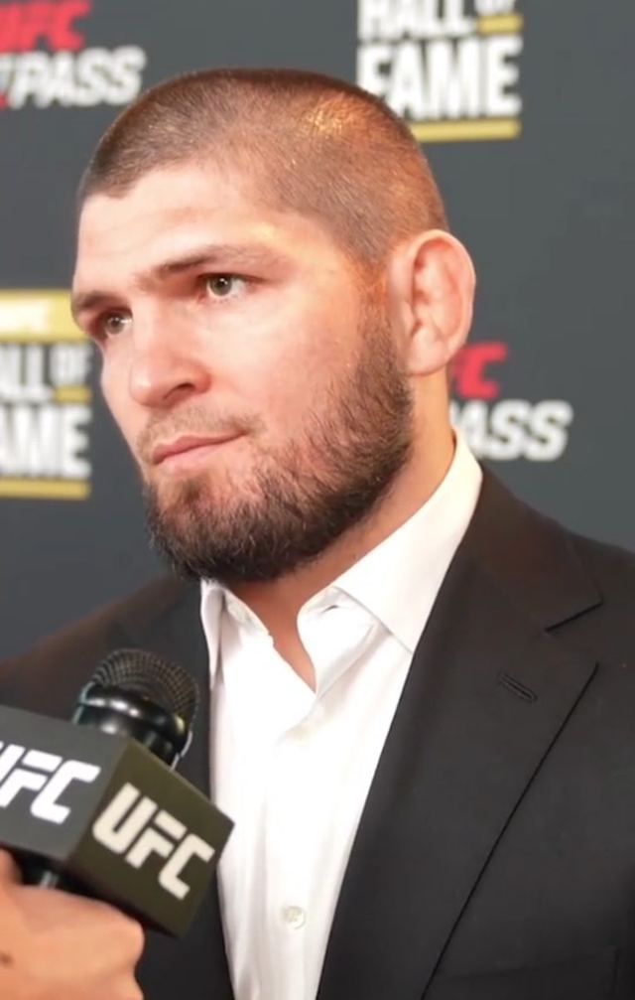

**2. 🟢 OK** Caption: **Khabib Nurmagomedov** 2022 · CC BY-SA 4.0 · [source](https://commons.wikimedia.org/wiki/File:Khabib_nurmagomedov.jpg) AI sees: _Khabib Nurmagomedov being interviewed at a UFC Hall of Fame event_
 

---

## ✅ live · Svay Rieng Sweep Past Port FC 4-1 to Revive ASEAN Club Championship Hopes
`2026-11-20-news-c324ff` · 2026-11-20

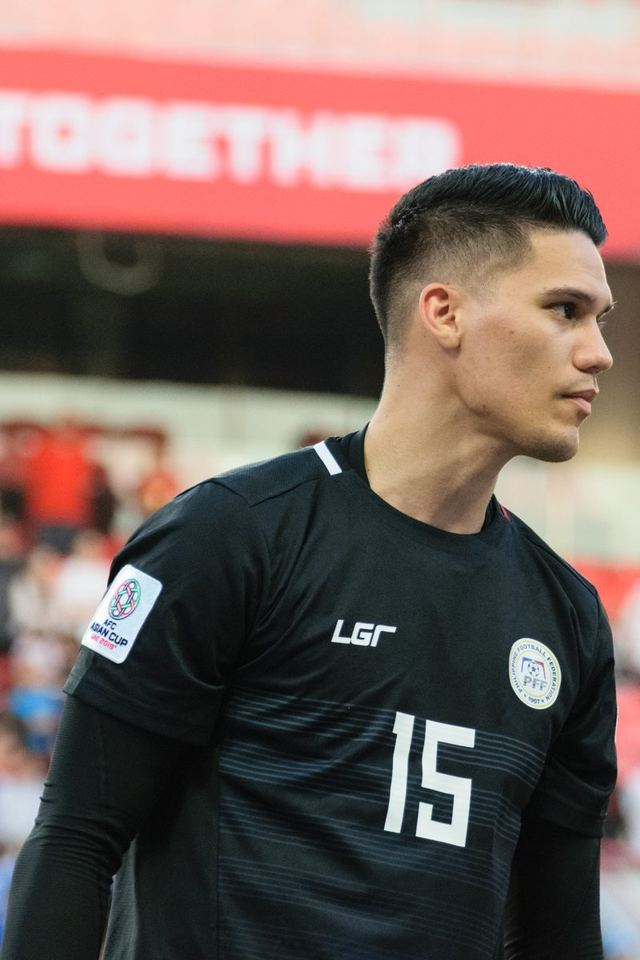

**1. ⚪ not checked** · cover Caption: **Port FC goalkeeper Michael Falkesgaard** 2019 · CC BY 4.0 · [source](https://commons.wikimedia.org/wiki/File:Michael_Falkesgaard_20191101.jpg)
 

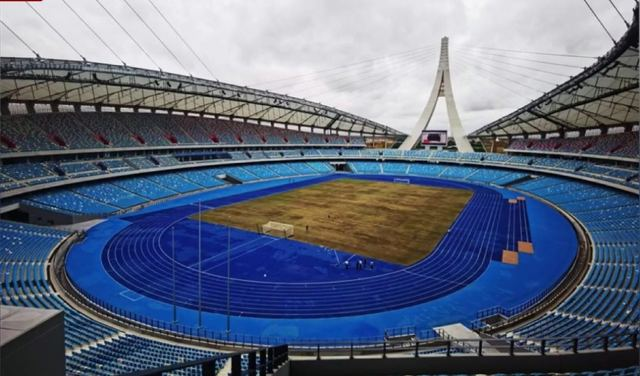

**2. ⚪ not checked** Caption: **Morodok Techo National Stadium in Phnom Penh, where Svay Rieng beat Port FC** 2021 · CC BY-SA 3.0 · [source](https://commons.wikimedia.org/wiki/File:Morodok_Techno_Stadium_in_2021.png)
 

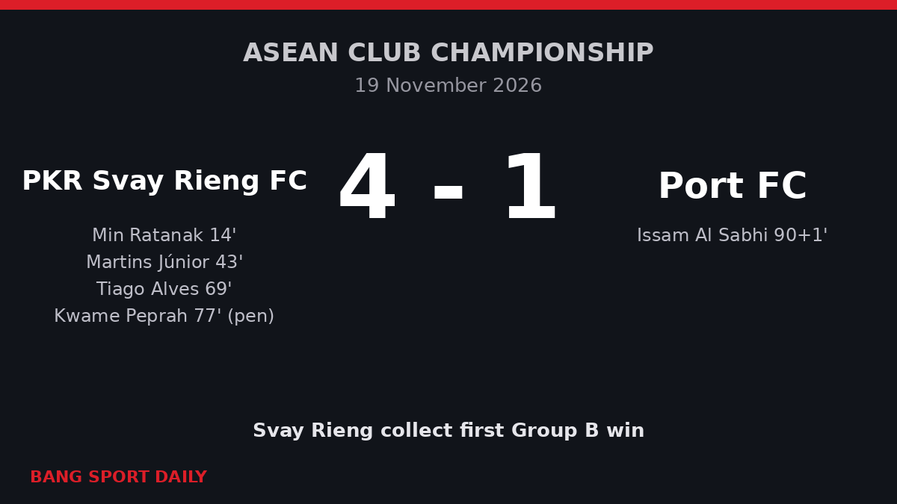

**3. 🟢 our score card** Caption: **PKR Svay Rieng FC 4 - 1 Port FC · ASEAN Club Championship** 2026 · Own work
 

🔗 Embedded post: [PKR Svay Rieng FC (@pkrsvr_fc_official)](https://www.instagram.com/p/Df8UWg-AT9i/) — {'en': 'Captains and match officials line up before PKR Svay Rieng v Port FC, ASEAN Club Championship Group B', 'zh': '东盟俱乐部锦标赛B组柴桢对阵泰港赛前，双方队长与裁判组合影', 'ru': 'Капитаны и судьи перед матчем «Свайриенг» — «Порт», группа B Клубного чемпионата АСЕАН'}

🔗 Embedded post: [PKR Svay Rieng FC (@pkrsvr_fc_official)](https://www.instagram.com/p/Df7RkYEgY7K/) — {'en': 'Martins Júnior (No. 21) with his Shopee Star of the Match award', 'zh': '马丁斯·儒尼奥尔（21号）手捧Shopee全场最佳球员奖杯', 'ru': 'Мартинс Жуниор (№21) с призом лучшему игроку матча Shopee'}

---

## ✅ live · Khabib Nurmagomedov Rejects Jake Paul's $200 Million Offer for MMA Return
`2026-11-20-news-64c370` · 2026-11-20

**1. 🟢 OK** · cover Caption: **Khabib Nurmagomedov** 2022 · CC BY-SA 4.0 · [source](https://commons.wikimedia.org/wiki/File:Khabib_nurmagomedov.jpg) AI sees: _Khabib Nurmagomedov in a suit at a UFC Hall of Fame event_
 

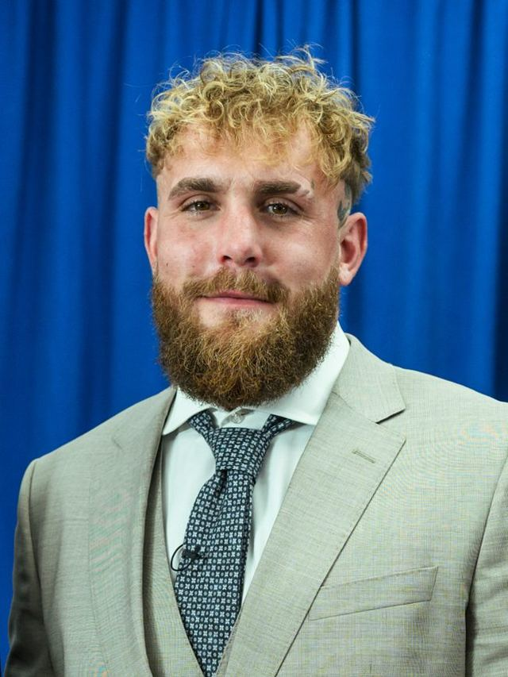

**2. 🟢 OK** Caption: **Jake Paul** 2026 · Public domain · [source](https://commons.wikimedia.org/wiki/File:Jake_Paul_March_2026_(3x4_cropped).jpg) AI sees: _portrait of Jake Paul in a suit_ ⚑ file looks like a non-sport scene (White House)
 

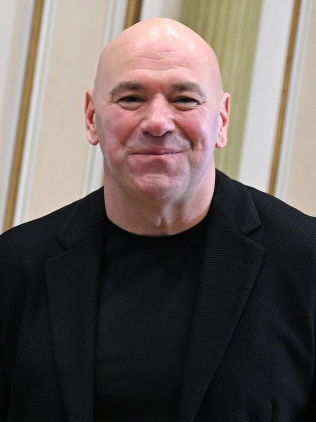

**3. 🟢 OK** Caption: **Dana White** 2025 · CC BY 4.0 · [source](https://commons.wikimedia.org/wiki/File:Ilham_Aliyev_received_Dana_White,_June_2025_(3x4_cropped_and_rotated_on_White).jpg) AI sees: _portrait of Dana White in a black blazer_ ⚑ file looks like a non-sport scene (received)
 

---

## ✅ live · On This Day in 2022: Qatar Kicks Off First Middle East World Cup
`2026-11-20-hist-924465` · 2026-11-20

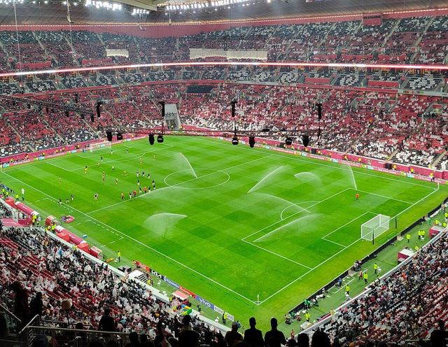

**1. 🟢 OK** · cover Caption: **Al Bayt Stadium** 2021 · CC BY-SA 4.0 · [source](https://commons.wikimedia.org/wiki/File:Al_Bayt_Stadium.jpg) AI sees: _Interior of Al Bayt Stadium during the 2021 FIFA Arab Cup_
 

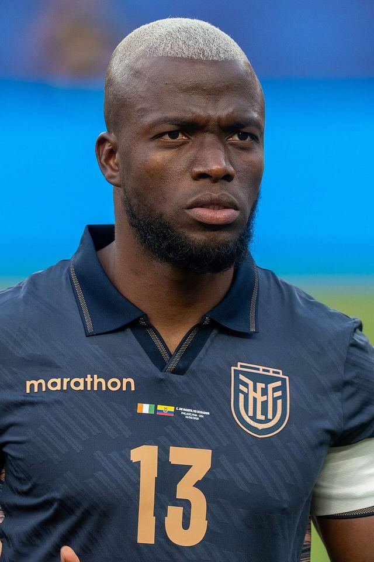

**2. 🟢 OK** Caption: **Enner Valencia** 2026 · CC BY-SA 4.0 · [source](https://commons.wikimedia.org/wiki/File:Enner_Valencia_Cote_D%27Ivoire_v_Ecuador_14_June_2026-95.jpg) AI sees: _Ecuadorian footballer Enner Valencia wearing the national team jersey_
 

**3. 🟢 OK** Caption: **Lionel Messi** 2026 · CC BY-SA 4.0 · [source](https://commons.wikimedia.org/wiki/File:Leo_Messi_Argentina_v_Egypt_7_July_2026-1.jpg) AI sees: _Lionel Messi in an Argentina national football team kit_
 

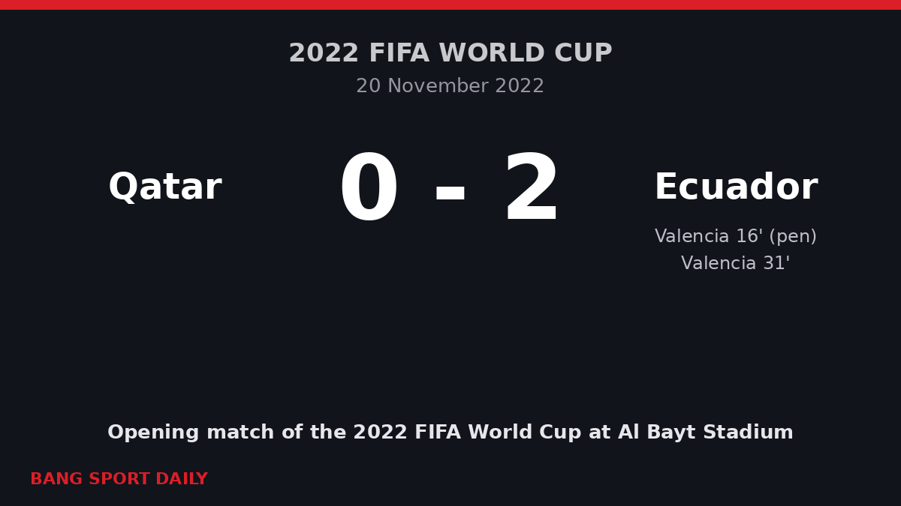

**4. 🟢 our score card** Caption: **Qatar 0 - 2 Ecuador · 2022 FIFA World Cup** 2026 · Own work
 

---

## ✅ live · Emma Hayes Names 23-Player USWNT Squad for World Cup Qualifying Campaign
`2026-11-19-news-291d8b` · 2026-11-19

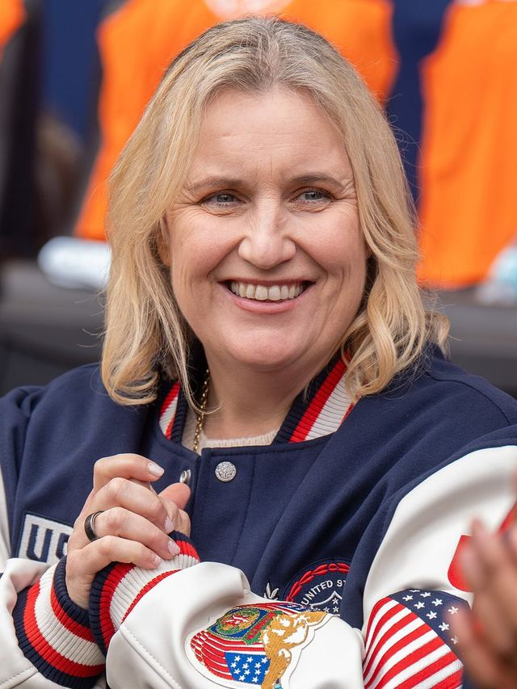

**1. 🟢 OK** · cover Caption: **Emma Hayes** 2026 · CC BY-SA 4.0 · [source](https://commons.wikimedia.org/wiki/File:Emma_Hayes_USWNT_v_Colombia_Mar_7_2026-68_(cropped).jpg) AI sees: _football manager Emma Hayes smiling in Team USA apparel_
 

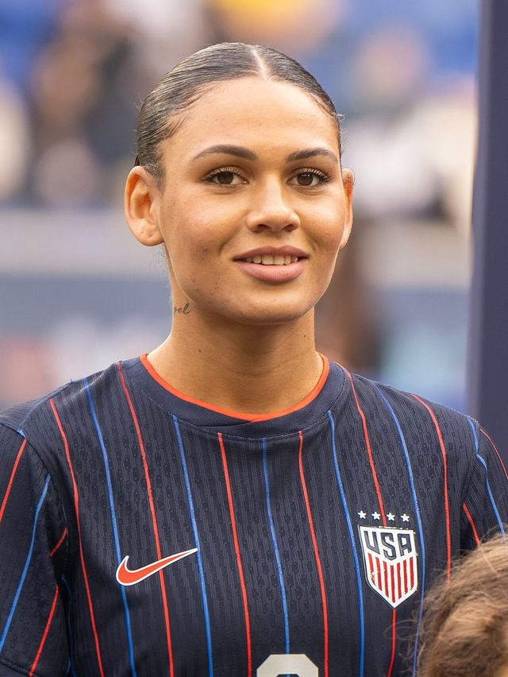

**2. 🟢 OK** Caption: **Trinity Rodman** 2026 · CC BY-SA 4.0 · [source](https://commons.wikimedia.org/wiki/File:Trinity_Rodman_USWNT_v_Colombia_Mar_7_2026-87_(cropped).jpg) AI sees: _USWNT soccer player Trinity Rodman in team kit_
 

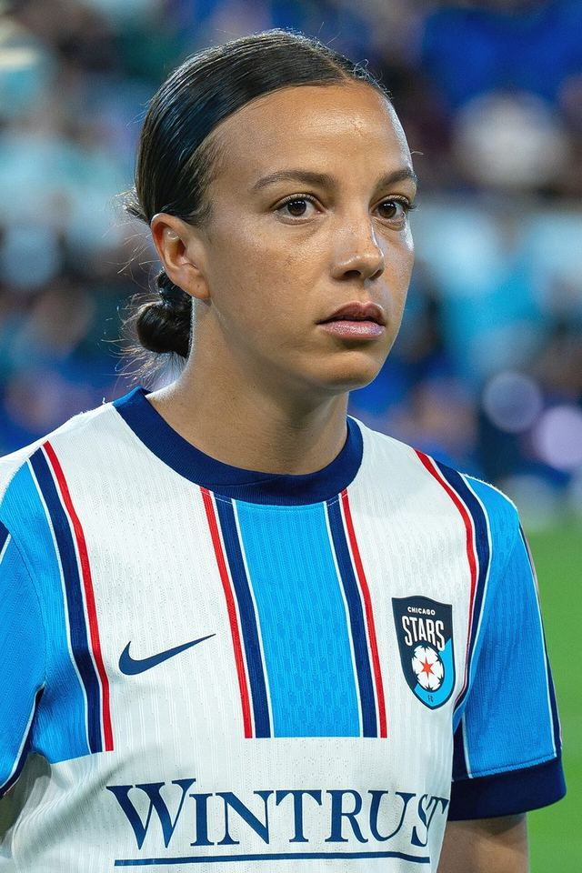

**3. 🟢 OK** Caption: **Mallory Swanson** 2026 · CC BY-SA 4.0 · [source](https://commons.wikimedia.org/wiki/File:Mallory_Swanson_Gotham_v_Chicago_25_September_2026-056_(cropped).jpg) AI sees: _Mallory Swanson in a Chicago Stars FC football jersey_
 

---

## ✅ live · Paraguay Spoil Moriyasu's Farewell as Japan Lose 2-1 in Singapore
`2026-11-18-news-cc77a5` · 2026-11-18

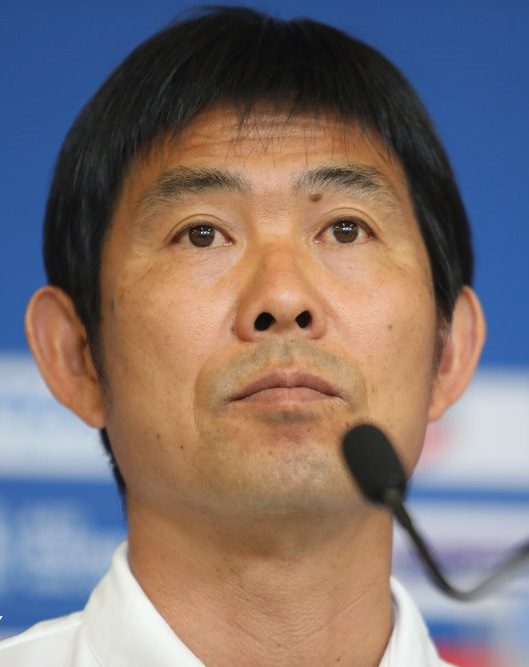

**1. 🟢 OK** · cover Caption: **Hajime Moriyasu, who led Japan in 113 matches from 2018** 2019 · CC BY 4.0 · [source](https://commons.wikimedia.org/wiki/File:Hajime_Moriyasu_at_Iran-Japan_pre-match_conference_2.jpg) AI sees: _Hajime Moriyasu speaking at a press conference_
 

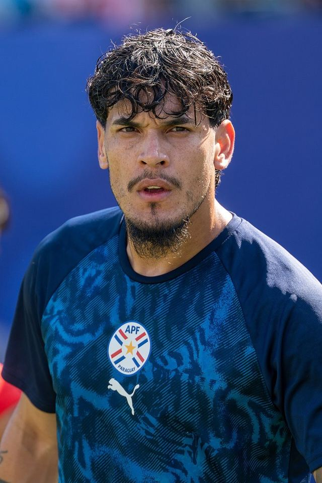

**2. 🟢 OK** Caption: **Paraguay captain Gustavo Gómez, who scored the second goal** 2026 · CC BY-SA 4.0 · [source](https://commons.wikimedia.org/wiki/File:Gustavo_Gomez_France_v_Paraguay_4_July_2026-029.jpg) AI sees: _Paraguayan footballer Gustavo Gómez wearing a Paraguay national team training kit_
 

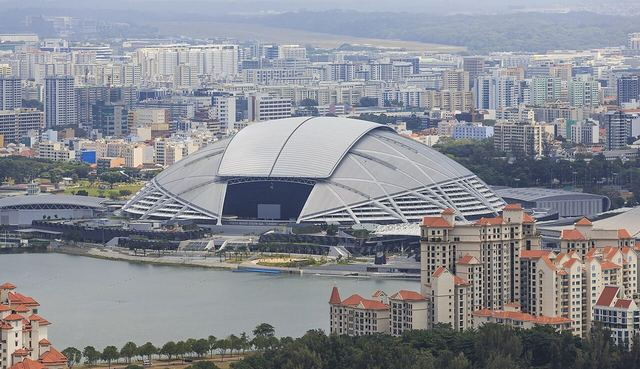

**3. 🟢 OK** Caption: **The National Stadium in Singapore, venue of the friendly** 2015 · CC BY-SA 3.0 · [source](https://commons.wikimedia.org/wiki/File:Singapore_Singapore-Sports-Hub-with-National-Stadium-01.jpg) AI sees: _The National Stadium at Singapore Sports Hub_
 

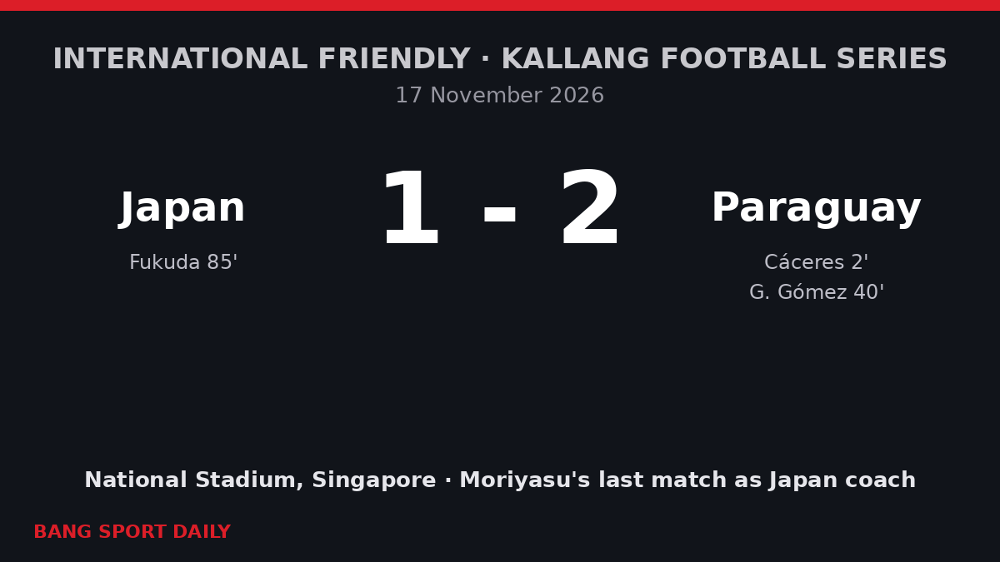

**4. 🟢 our score card** Caption: **Japan 1 - 2 Paraguay · International friendly · Kallang Football Series** 2026 · Own work
 

---

## ✅ live · Spartak and Metallurg Swap Four Forwards as Maltsev and Morozov Move to Magnitogorsk
`2026-11-18-news-3dca37` · 2026-11-18

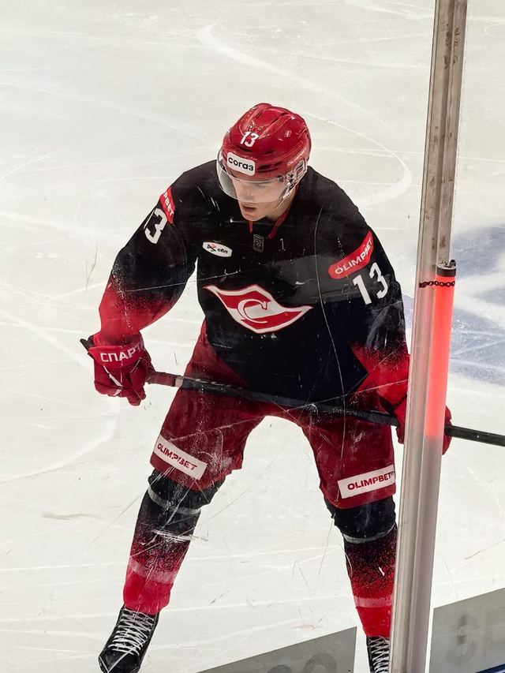

**1. 🟢 OK** · cover Caption: **Mikhail Maltsev, who moves from Spartak to Metallurg** 2024 · CC0 · [source](https://commons.wikimedia.org/wiki/File:%D0%9C%D0%B0%D0%BB%D1%8C%D1%86%D0%B5%D0%B2_%D0%9C%D0%B8%D1%85%D0%B0%D0%B8%D0%BB_(%D1%85%D0%BE%D0%BA%D0%BA%D0%B5%D0%B8%D1%81%D1%82).jpg) AI sees: _Spartak Moscow ice hockey player wearing number 13 on the ice_
 

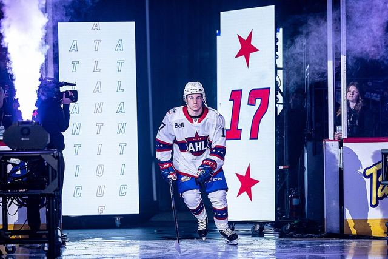

**2. 🟢 OK** Caption: **Ruslan Iskhakov, who moves from Metallurg to Spartak** 2023 · CC BY 2.0 · [source](https://commons.wikimedia.org/wiki/File:2023_AHL_All-Star_Classic_Game_-_Ruslan_Iskhakov_(52673708091).jpg) AI sees: _hockey player Ruslan Iskhakov at the 2023 AHL All-Star Classic_
 

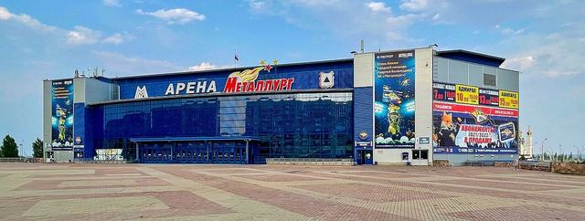

**3. 🟢 OK** Caption: **Arena Metallurg in Magnitogorsk** 2021 · CC BY-SA 4.0 · [source](https://commons.wikimedia.org/wiki/File:Views_of_Magnitogorsk-2021_-_72.jpeg) AI sees: _Exterior of Arena Metallurg in Magnitogorsk_
 

---

## ✅ live · Irish Boxer Lee Reeves Dies at 31, Three Months After Being Injured in a Fight in Dublin
`2026-11-18-news-24f2df` · 2026-11-18

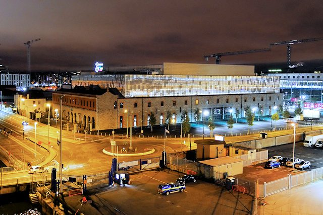

**1. 🟢 OK** · cover Caption: **The 3Arena in Dublin, where Reeves fought on 1 August** 2017 · CC BY-SA 2.0 · [source](https://commons.wikimedia.org/wiki/File:3Arena,_Dublin_(geograph_5417559).jpg) AI sees: _Exterior of the 3Arena at night in Dublin_
 

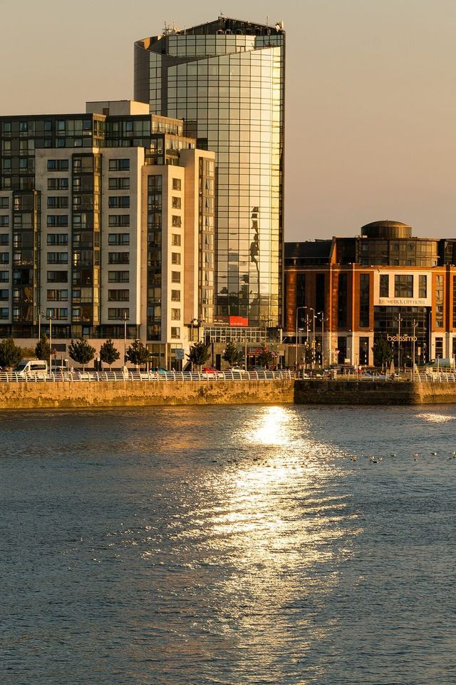

**2. 🟢 OK** Caption: **Limerick, Reeves' home city** 2018 · CC BY-SA 2.0 · [source](https://commons.wikimedia.org/wiki/File:Limerick_r%C3%ADo_(46531600435).jpg) AI sees: _Waterfront buildings including Riverpoint along the River Shannon in Limerick_
 

---

## ✅ live · Michkov's Two Assists Help Flyers Edge Sabres 4-3 and Extend His Point Streak to Five Games
`2026-11-18-news-00e678` · 2026-11-18

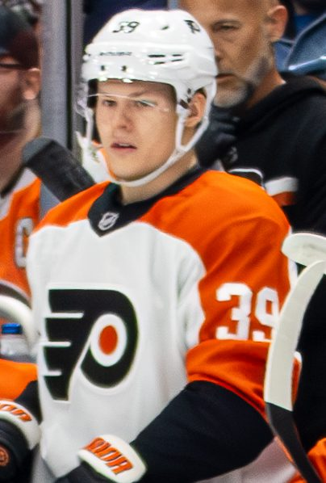

**1. 🟢 OK** · cover Caption: **Matvei Michkov, who had two assists for the Flyers** 2024 · CC BY-SA 2.0 · [source](https://commons.wikimedia.org/wiki/File:Matvei_Michkov_2024-10-17.jpg) AI sees: _Philadelphia Flyers player Matvei Michkov in uniform_
 

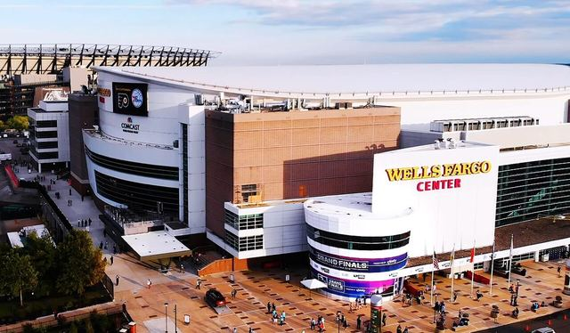

**2. 🟢 OK** Caption: **The Flyers' home arena in Philadelphia** 2019 · CC BY 3.0 · [source](https://commons.wikimedia.org/wiki/File:Wells_Fargo_Center_-_2019_OWL_Grand_Finals.jpg) AI sees: _Wells Fargo Center in Philadelphia_
 

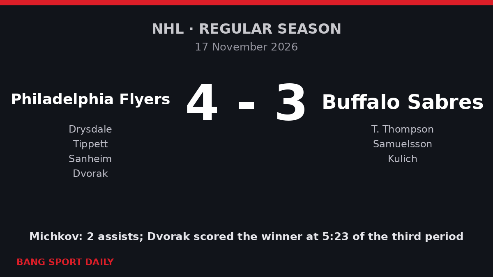

**3. 🟢 our score card** Caption: **Philadelphia Flyers 4 - 3 Buffalo Sabres · NHL · Regular season** 2026 · Own work
 

---

